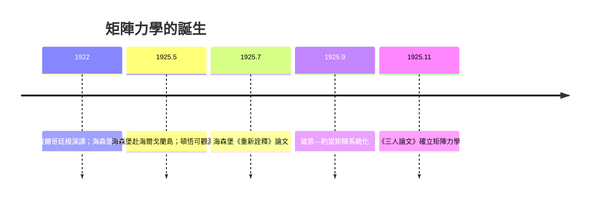

# 海森堡矩陣力學：放棄直觀軌道

## 舊量子論的總崩潰

1924 到 1925 年之交，玻爾——索末菲的「舊量子論」終於走到了絕路。氫原子的光譜雖然算得漂亮，但氦原子怎麼算都對不上；塞曼效應中譜線的異常分裂沒人能解；色散（折射率）問題更是全面潰敗。年輕一輩已經嗅到氣氛：在某個深層的地方，理論的骨架必須重造。

維爾納・海森堡（Werner Heisenberg）1922 年還是慕尼黑大學本科生時，在索末菲帶他赴哥廷根聽玻爾演講的場合上，當眾提出尖銳問題，令玻爾印象深刻，邀他同去海利根達姆散步——這位年方二十的晚輩從此被捲入新量子物理的中心網絡：慕尼黑（索末菲）—哥廷根（玻恩）—哥本哈根（玻爾）三大中心的「三族通婚」。

## 海爾戈蘭島上的頓悟

1925 年 5 月起，24 歲的海森堡在哥廷根受乾草熱（花粉症）之苦，向玻恩請假前往北海無樹木的海爾戈蘭島（Helgoland）休養。海風、極簡的生活、充足的睡眠，讓他的腦子徹底清空。他決心做到一件事：**抛棄不能觀測的東西**。玻爾理論中電子的「軌道」、"橢圓的形狀"、電子在軌道上「什麼時候在哪裡」——這些從來沒有被測到過的花哨物事，一律扔掉。

他只保留兩類真正可測的量：原子輻射的頻率（由譜線直接讀出）與強度（由譜線亮度讀出）。他用傅立葉的方式把電子的位置分解成這些可觀測的頻率分量，然後試著把這些「數組」相乘組合，得到新的譜線組合規則。深夜在孤島的地平線上算著氫原子時，他突然意識到：兩個數組相乘的結果，與相乘的**順序有關**——這在普通數字裡是荒謬的，他起初還以为自己犯了算術錯誤。多年後他回憶，那晚他興奮到凌晨三點爬上島畔的岩壁，等日出——「海洋與礁岩在我眼前伸展，我感到再沒有什麼可以阻擋我理解的通路」。

七月他把論文《關於運動學與力學關係的重新詮釋》交給玻恩，自己接著去劍橋訪問。玻恩讀了幾天，驚恐而興奮地發現：海森堡亂乘出來的規則，正是數學家早已熟知的**矩陣乘法**！更驚人的是，玻恩在幾天之內證明出：矩陣對易關係 $qp - pq = \frac{\hbar}{i} \mathbf{1}$ 使能量守恆——海森堡神奇地「發明」了數學界二十年前的矩陣而不自知。

## 三人論文與哥廷根的數學威力

玻恩與學生約當（Pascual Jordan）合寫一篇「關於量子力學」的後續論文，把矩陣形式系統化；再與海森堡三人合寫著名的《三人論文》（Dreimännerarbeit，1925 年 11 月）闡明普遍的量子力學。玻恩深厚的數學素養（他早年遊學哥廷根師從希爾伯特與克萊因）在此發揮關鍵作用；約當則是罕見的同時精通矩陣與群論的年輕人。哥廷根作為十九世紀末高斯、黎曼開創的世界數學首都，此刻提供了新物理急需的血肉——精神上這是「高斯傳統」的一次還魂。

矩陣力學一問世就展現威脅性的精確：它自動給出氫原子譜線的強度與選擇規則，這是舊量子論永遠做不到的事。

## 年輕人的革命

這場革命最驚人的是它的年齡結構：海森堡 24 歲、約當 23 歲、狄拉克在劍橋 23 歲；正規「老人」玻恩 42 歲、玻爾 40 歲已算長者。哥本哈根研究所裡的雞尾酒會、桌球、海森堡的鋼琴與笑話，構成一種全新的科學文化：沒有等級、沒有師道尊嚴，只有無休止的辯論。索爾維會議與皇家學院那種紳士科學的時代正在落幕，一個由二、三十歲青年主導、以可觀測性為教義的新科學，正在北海與哈登山（Harz）之間誕生。

