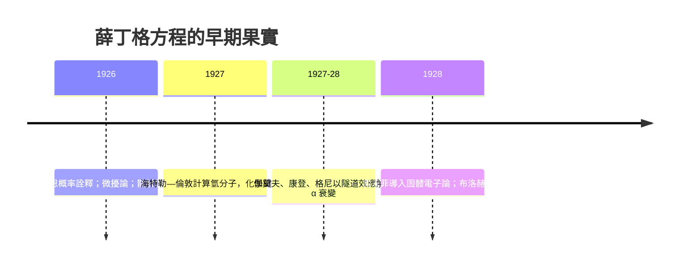

# 薛丁格方程式：微觀的牛頓第二定律

## 一條方程的雙重身分

1687 年，牛頓在《原理》中寫下 $\mathbf{F} = m\mathbf{a}$，此後兩百多年，這條方程就是物理世界的動力學憲法：給定此刻的位置與速度，未來的一切都被唯一確定。1926 年，薛丁格寫下

$$i\hbar \frac{\partial}{\partial t}\psi(\mathbf{r},t) = \hat{H}\psi(\mathbf{r},t)$$

這條方程在微觀世界扮演了同樣的角色——只是角色劇本整個被改寫：**主詞不再是位置與速度，而是一個可以取複數值的函數 $\psi$——波函數。**

兩條方程有深刻的家族相似，也有關鍵的不同。相似處：兩者都是決定論式的演化方程——給定初始 $\psi(\mathbf{r}, 0)$，薛丁格方程唯一確定未來任何時刻的 $\psi$。不同處：牛頓方程演化的是六個實數（三個位置、三個動量分量），薛丁格方程演化的是整個三維空間上的複數場；前者演化「狀態」，後者演化「狀態的振幅」。而且 $i$ 的出現意味着演化必然在複數平面上旋轉，永遠不會像經典波那樣實數可見。

## 定態、本徵值與氫原子

若哈密頓算符 $\hat{H}$ 不含時間（孤立系統），可以分離變數得到不含時的定態方程：

$$\hat{H}\psi_n = E_n \psi_n$$

這是個本徵值問題：像撥動一根繃緊的弦，只有特定頻率的駐波才能存在。量子化不再是附加的數學規則，而是微分方程加邊界條件的自然結果——這正是薛丁格最得意的洞見：「量子化作為本徵值問題」。

氫原子的解是一場豐收：能量本徵值 $E_n = -\frac{13.6\,\text{eV}}{n^2}$，與巴耳末光譜系精確吻合；角動量量子數 $l$ 與磁量子數 $m$ 自動湧現，解釋了譜線的多重結構。1830 年代發明的「本徵函數展開」數學（傅立葉、斯特姆—劉維爾理論），在物理學最需要的時刻毫無預警地派上用場——這是數學與物理交融的絕佳註腳。

## 玻恩的 $|\psi|^2$：從振幅到概率

方程給出 $\psi$，但 $\psi$ 本身是什麼？薛丁格希望它是電荷的真實波動分布。1926 年夏天，哥廷根的玻恩（Max Born）在處理散射碰撞時提出截然不同的詮釋：

$$P(\mathbf{r}) = |\psi(\mathbf{r}, t)|^2 \mathrm{d}\mathbf{r}$$

—— $|\psi|^2$ 是在 $\mathbf{r}$ 附近找到粒子的**概率密度**。$\psi$ 是「機率幅」：它自身不可測、可以互相抵消（因此有干涉），但模方永遠是非負的概率。玻恩因此得了 1954 年諾貝爾獎。這一步讓量子力學的決定論只剩一半：$\psi$ 的演化完全決定論，但邊緣落在測量上，只有概率統計可以言說。愛因斯坦終身為此遺憾：「我忍不住想，舊的那一位（上帝）知道自己的骰子在幹什麼。」

## 應用的雪崩

掌握方程之後，微觀世界像被解鎖的寶庫：

海特勒與倫敦用量子力學算出兩個氫原子为何會結合成氫分子，這是**化學鍵第一次被物理學解釋**——化學與物理的分界線自此移動，鮑林（Linus Pauling）隨即把價鍵理論發展成整座化學大廈。1927 到 1928 年，伽莫夫、康登與格尼注意到：若勢壘高於粒子能量，經典上粒子永遠出不去，但薛丁格方程的解卻在勢壘內指數衰減而不為零——粒子能「穿牆」。這個隧道效應立即解釋了 α 衰變的半衰期規律（蓋革—努塔尔定律），也預示了日後半導體元件、掃描穿隧顯微鏡與閃存的核心原理。

一條方程、一個符號 $i$、一個複數波函數——就這樣同時接管了原子、分子、化學鍵與原子核。物理學的中心，從此確立。
