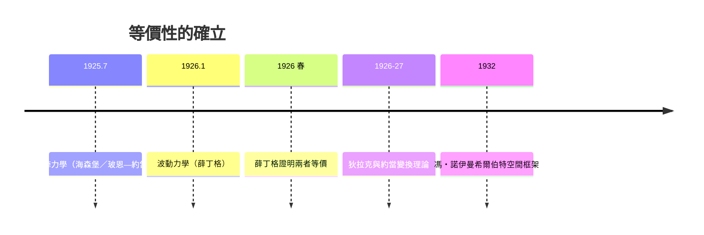

# 數學等價性：矩陣與波動是同一硬幣兩面

## 二選一的困局，在 1926 年被打破

1926 年上半年，物理學界出現了一個尷尬局面：兩套自洽、精確、完全不同的量子理論同時存在。海森堡—玻恩—約當的矩陣力學，用無窮維的矩陣描述可觀測量，離散、代數、反直觀；薛丁格的波動力學，用連續的偏微分方程描述波函數，具體、熟悉、合乎十九世紀物理的口味。兩者都能精確重現氫原子光譜。普朗克欣喜地表態支持薛丁格；海森堡則私下抱怨波動力學「太花了」，沒抓到物理本質。

同年，薛丁格本人動手證明了一件令雙方都意外的事：**兩者是同一個數學結構的兩種表象**。他發現矩陣力學的矩陣元恰好可以由波動力學的本徵函數積分構造出來；哈密頓的波動力學理論與哥廷根的矩陣代數，在滿足適當邊界條件的前提下，給出完全相同的譜、相同的躍遷振幅、相同的所有可檢驗預言。薛丁格在他《量子化作為本徵值問題》第四篇溝通了這一切。這件事的哲學意味深長：**理論的正誤之外，還有「表述」的問題**——同一個真相可以戴著完全不同的面具。

## 狄拉克、約當與轉換理論

更深的統一來自兩位年輕人。劍橋的保羅・狄拉克（Paul Dirac）剛在 1925 年夏天從老師福勒那裡看到海森堡論文的副本，幾週內就獨立發展出比哥廷根更抽象、更優雅的形式；1926 到 1927 年間他建立了以 $\delta$ 函數、對易關係與「變換理論」為核心的一般框架，用一個符號系統涵蓋矩陣、波動與所有其他可能的表象。哥廷根的約當也在 1926 年獨立得到等價的變換理論。狄拉克名句般的形式語言（ket 向量、braket 記號）在 1930 年的教科書《量子力學原理》中定型，成為此後百年理論物理的通用語言。

## 希爾伯特空間：數學的總接管

1932 年，普林斯頓來訪的馮・諾伊曼（John von Neumann）出版《量子力學的數學基礎》，把零散的矩陣與波函數統一放進**希爾伯特空間**——由數學家大衛・希爾伯特與里斯、菲舍爾在 1900 年代發展出的無窮維函數空間理論。波函數是這個空間中的向量，可觀測量是自伴（厄米）算符，測量結果是算符的本徵值，疊加是向量的線性組合。矩陣力學只是「選一組離散基底」的表象，波動力學只是「選一組位置基底」的表象，還有動量表象、能量表象——選哪個純屬計算方便。海森堡曾擔心的「矩陣相乘順序荒謬」在希爾伯特空間裡變得清晰：算符交換子表達的正是測量順序不可互換這一物理事實。

這是物理與數學關係史上的里程碑：不是數學為某個已知問題服務，而是物理理論本身就「長成」一數學結構——希爾伯特空間與算符譜理論從此成為理論物理學家的必修語法，普通話般的普遍性遠遠超出最初兩套理論的提出者想像。

## 「哪一個是真的？」

等價性提出後，物理學家們面對一個新的哲學問題：既然兩套表象預言全同，「哪一套描述了實在」就變成沒有意義的問題——真正的理論是希爾伯特空間那個不變的核心。這預示了現代物理的普遍態度：實在由不變的數學結構承載，具體表象只是投影。

但這並未平息詮釋之爭。海森堡批評薛丁格的波動詮釋（粒子是波包）在物理上站不住（波包會擴散）；薛丁格反擊矩陣力學像「沒有圖像的代數大片」；玻爾則在 1927 年的互補原理中收攏全局：波與粒子、位置與動量都是只用一種表象無法窮盡的互補相面。兩年後，海森堡的不確定性原理與玻爾的互補原理，把這種「表象的選擇」從數學事實提升為物理意義的憲章。

