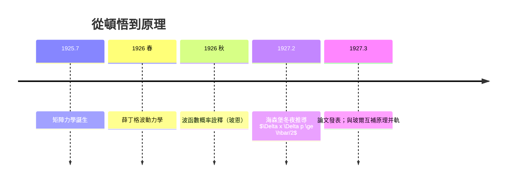

# 海森堡不確定性原理：測量的客觀極限

## 哥本哈根的冬夜

1927 年 2 月，26 歲的海森堡在哥本哈根玻爾研究所度過了他一生最重要的冬夜。此時波動力學已出現、矩陣力學已成熟，但一個問題撕裂著哥本哈根：**新的理論到底描寫的是什麼？** 玻爾主張用互補原理架構全局；海森堡則想找一個更直接、更物理的答案。薛丁格的波動力學给了他一個靈感來源：一個真實的粒子無論如何都「佔據」波包的有限大小，而波包的優點正是能在空間中定位。

海森堡問：用高斯波包代表一個電子，它的位置 $\Delta x$ 與動量 $\Delta p$ 能不能同時無限精確？他用傅立葉分析的性質算出答案：一個在空間中越窄的波包，必須由越多不同波長的平面波疊加而成，而德布羅意關係 $p = h/\lambda$ 把波長映射為動量——**壓縮位置，必然膨脹動量**。二者之積存在一個不可逾越的下限：

$$\Delta x \, \Delta p \ge \frac{\hbar}{2}$$

## 這不是技術問題，而是自然律

海森堡最關鍵的洞察是：這個極限**與儀器的品質無關**。就算人類做出完美的顯微鏡、完美的粒子探測器，$\hbar$ 的下限仍在。因為它根源於波粒二象性本身，是傅立葉轉換的數學性質與德布羅意關係的必然推論。位置與動量是共軛的傅立葉對偶變量，就像「一段音符」與「它的音頻譜」——你無法說清任一瞬間音符的「絕對頻率」與它的「發生時刻」。

為了向物理同行說明這不是空談，海森堡設計了著名的 $\gamma$ 射線顯微鏡思想實驗：要「看見」電子的位置，必須用光去散射它；光的波長越短，位置越精確，但波長越短代表光子動量越大，撞擊時就越多地踢了電子一腳，改變了它的動量。他寫出公式，顯示顯微鏡的繞射極限（阿貝極限）恰好給出 $\Delta x \Delta p \sim \hbar$。結論震撼甚至他自己：「**觀察本身就改變了被觀察者**。」在宏觀世界裡光子對炮彈的踢腳可以忽略，在微觀世界裡，光與電子被拉到同一量級，「測量」永遠是參與。

同理可以寫出另一對共軛量：時間與能量

$$\Delta E \, \Delta t \ge \frac{\hbar}{2}$$

這條能量—時間不確定性成為理解躍遷線寬、暫態壽命與隧道過程的鑰匙。

## 玻爾的反駁與海森堡的妥協

海森堡把論文《關於量子理論運動學與力學的直觀內容》寄給玻爾，玻爾卻立即指出他推導裡的一個瑕疵：海森堡只用「光子踢一脚」的粒子圖像推論，忽略了波動圖像——顯微鏡能分辨位置，其實也要依賴波的光圈孔徑繞射；那是光本身波動性的功勞。玻爾堅持正確的理解是**互補性**：位置與動量是兩種互斥的實驗安排，每個實驗只能展示一面。兩人吵得激烈，海森堡一度哭著說這一切都只是名詞之爭。最後他讓步，在發表的論文裡補了一個附註，承認論證其實可以用玻爾的方式更嚴謹地推出。兩人不因為这一夜分裂，反而成為日後量子論最著名的搭檔——吵架吵出來的友誼。

## 思想的份量

不確定性原理是二十世紀思想史上影響最廣的科學觀念之一。它宣告：在微觀世界，**知識本身有上限**。拉普拉斯式的全知決定論從原理上（不只是技術上）被終結；機率不再是無知之名，而是自然的基本結構。哲學、神學、心理學、甚至教育學在往後十年都趕著引用它。後來的發展更精緻：科學家發現還存在第三種、甚至第四種不確定性關係（如自旋分量、量子非局域性），並發展出連續統計、信息論的表述。

今天，不確定性原理不再是令人不安的障礙，而是資源：量子計算、量子密碼學、引力波探測器的壓縮光（squeezed light）技術，全都是「主動操控不確定性」的工程應用。海森堡的冬夜頓悟，成為二十一世紀資訊科技最奇特的基石。

