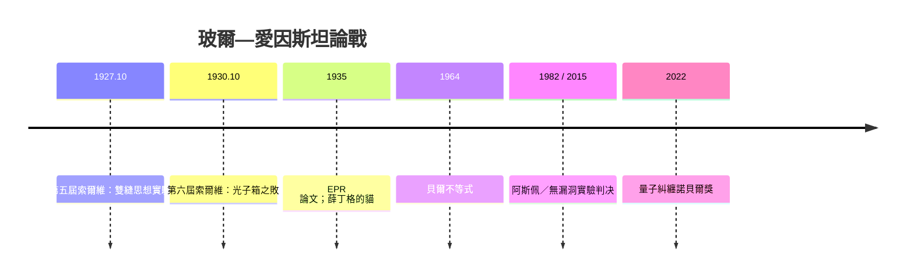

# 玻爾與愛因斯坦世紀論戰：上帝不擲骰子

## 布魯塞爾的十月

1927 年 10 月，第五屆索爾維會議在布魯塞爾的索爾維國際物理學院舉行，主題是「電子與光子」。這張著名合照裡擠著十七位（日後）諾貝爾獎得主：居里夫人、普朗克、愛因斯坦、玻爾、薛丁格、海森堡、狄拉克、玻恩、康普頓……它常被稱為「史上最聰明的一張照片」。但會議真正的戲碼，是**愛因斯坦對量子力學的總攻**。

會議的正式議程是康普頓報告、玻恩—海森堡報告與玻爾的互補性補充。新矩陣力學與波動力學已經無可否認地精確，但它的詮釋——概率、測量、不確定性——並未被所有人接受。愛因斯坦從 1905 年以來一手點燃了量子革命（光量子），卻在此時成了最著名也最固執的懷疑者。

## 第一回合：雙縫與「弩圖」

愛因斯坦沒有公開反駁，而是在早餐桌上與玻爾一對一交鋒。他一連幾天提出一個又一個思想實驗，企圖證明量子力學不完備。最著名的是**單縫／雙縫實驗**：一個電子（或光子）穿過縫後，是否在縫前已有確定的位置與路徑？如果它真的走「一條路」，那哪來的干涉條紋？倘若用可移動的牆、可動的儀器去追蹤它，能否逃過不確定性關係、同時知道路徑與干涉？

玻爾的不敗祕訣是：**每次都從愛因斯坦自己的理論反攻**。每一次愛因斯坦想同時精確知道兩個共軛量，玻爾就運用愛因斯坦自己的相對論——狹義相對論中光速的有限性、或不確定性關係——證明實驗裝置本身會恰好把所需的干擾補回去：想確定路徑，儀器必須固定；儀器一固定，動量的測量精度就崩塌。 幾輪交鋒之後，愛因斯坦放棄直接否定理論，轉向新的戰略：證明量子力學「不完備」。

## 1930 年：光子箱的敗仗

1930 年第六屆索爾維會議，愛因斯坦端出精心設計的「光子箱」：一個掛在彈簧秤上的箱子，快門由箱內機構定時開啟極短時間 $\Delta t$ 釋放一個光子，秤的讀數變化給出能量損失，理論上可以**同時**準確測得能量與時間，違反 $\Delta E \Delta t \ge \hbar/2$——用他自己創立的物理反擊量子力學。

這一擊讓玻爾徹夜未眠。翌日早晨，他端出絕地反擊：仔細追蹤箱子的測量過程，秤的指針在引力場中的位置不確定，會因**廣義相對論的重力紅移**——時鐘速率隨引力勢而變——使快門的定時不准。算完結果恰好回到 $\Delta E \Delta t \ge \hbar/2$。玻爾甚至得意地寫道，他讓愛因斯坦「以自己的矛攻自己的盾」。史家公認：此戰之後，愛因斯坦不再質疑量子力學的**內部一致性**，只堅持它「不完備」。

## 「上帝不擲骰子」

這兩人數十年的辯論，凝成一組世紀格言。愛因斯坦在寫給玻恩的信中說：

> 「量子力學固然令人肅然起敬，但一種內心的聲音告訴我，它還不是真實的（the real thing）。理論說出了很多，但並沒有真正把我們拉近『老頭子』的祕密。**我，無論如何，確信上帝不擲骰子。**」

玻爾的回嘴更是一語中的：**「愛因斯坦，不要告訴上帝該怎麼做。」**愛因斯坦的「不擲骰子」，其實是對決定論宇宙觀的堅持——來自斯賓諾莎的神、牛頓的力學與他自己的相對論；而玻爾代表的哥本哈根詮釋認為，微觀世界本來就沒有「尚未測量前的確定值」，測量不只是揭示既有實在，**在某種意義上是參與創造實在**。

## 論戰的長尾：EPR 與貝爾

1935 年，愛因斯坦與波多爾斯基、羅森合發著名的 EPR 論文，提出「糾纏粒子對」來論證量子力學不完備：兩個相距任意遠的粒子可以瞬間「相關」，違反局域實在論。薛丁格同年回應這篇論文時，順手創造了「薛丁格的貓」，並把「糾纏」（Verschränkung）一詞推入科學詞典。這場戰爭延燒到愛因斯坦死後：1964 年北愛爾蘭的貝爾（John Bell）提出貝爾不等式，把 EPR 的哲學爭論變成可實驗的數學命題；1982 年阿斯佩實驗、2015 年的無漏洞實驗都判決：**局域實在論錯了，量子力學對**。2022 年諾貝爾物理獎便頒給 Clauser、Aspect 與 Zeilinger，肯定了這條從 1927 年索爾維延伸而來的長線。

愛因斯坦終其一生沒有推翻任何一條量子力學預言，但他的每一次質疑，都迫使哥本哈根陣營把話說得更清楚、更可檢驗——這場「共同的失敗」，正是科學哲學史上最高貴的戰役：懷疑，讓理論變得更深刻。

