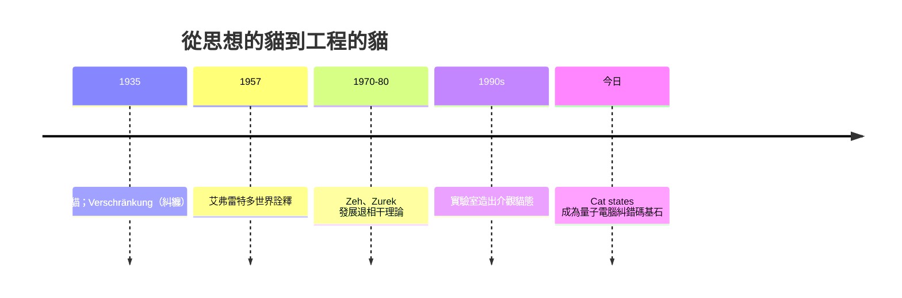

# 薛丁格的貓：疊加態的荒謬困境

## 一篇長文裡的諷刺漫畫

1935 年，薛丁格在德國《自然科學》（Naturwissenschaften）期刊發表長文《量子力學的現狀》（Die gegenwärtige Situation in der Quantenmechanik），回應年中愛因斯坦—波多爾斯基—羅森的 EPR 論文。文章前半是嚴肅的哲學分析，後半卻突然出現一隻動物園級的漫畫式猛獸——中間段落他用德文寫了那個後來舉世聞名的「荒謬案例」（der burleske Fall）：

> 把一隻貓關進鋼箱，箱內有微量的放射性物質，透過蓋革計數器與一小瓶氫氰酸相連：一小時內，放射性物質有 50% 概率衰變出一個 α 粒子——計數器放電、錘子碎瓶、氫氰酸蒸發，貓死；也可能什麼都不發生，貓活。**「若把玻恩的波函數詮釋老實套到整個系統上，那麼這個系統的 $\psi$ 函數便同時包含一隻活貓與一隻死貓，兩者混合、不定地（undeterminiert）攙和在一起。」**

薛丁格的用意是犀利的**歸謬**：這套理論明明在最微觀的原子裡「驗證有效」，一旦按字面外推，就會連宏觀世界也一起拉進「又生又死」的荒誕。他想用最直觀、最可笑的畫面暴露哥本哈根詮釋的痛點——**測量的邊界在哪裡？** 為什麼蓋革計數器的「觀測」就足以把疊加態「坍縮」？坍縮是一條真實的物理過程，還只是我們把問題推給儀器的語言把戲？他還順手發明了「糾纏」（Verschränkung）這個詞，成為今日量子資訊學的核心詞彙。

## 一隻貓，八十年陰影

薛丁格本人視這隻貓為「荒謬的諷刺小品」，並希望它早日被人遺忘——事實恰恰相反：它是物理史上被引用、被畫成漫畫、被印在 T 恤上最多的思想實驗，讀者甚至比同行更愛它。背後原因很簡單：一隻毛茸茸的小生物，把最抽象的疊加原理，翻譯成每個人都本能理解的生命與死亡的兩難小品。哲學家把貓視為「測量問題」的圖騰；物理學家則被迫正面回應。

關鍵的技術回答是**退相干**（decoherence）：1980 年代起，Zurek 與 Zeh 等人精確計算後表明，任何宏觀物體（貓、計數器、實驗室）都在與環境中的無數粒子（空氣分子、光子）不斷「纏」在一起——糾纏一旦蔓延到環境，原系統的干涉相位就會以極快的時間尺度（遠快於納秒）被「洗」掉，宏觀系統在實際意義上瞬間坍縮成一種「表觀經典」狀態。換句話說，貓從來不需要「觀察者」救它——環境本身就是觀察者。哥本哈根的「特殊地位」在退相干的視角下退位，測量問題從玄學降級為開放系統物理。

但退相干並沒有直接回答「為什麼會有一個特定的結果」——機率的基礎仍在爭論中。1957 年休・埃弗雷特（Hugh Everett）提出多世界詮釋：沒有坍縮，$\psi$ 整體永遠線性演化，貓的兩個分支都存在於不同的「世界」中，只是作為觀察者的我們每次只流經其中一支。多世界、哥本哈根、玻姆導航波（Bohm）與 GRW 自發坍縮等詮釋至今並存——數學結構同一，全預言相同，分歧在「實在應該是怎樣」。

## 從哲學到工程：貓的後世

有趣的是那個曾讓人不安的宏觀疊加，今天已是工程資源。超導量子電路與離子阱中，物理學家真的造出了「貓態」（Cat states）——宏觀上可分辨的兩個狀態的相干疊加，正是量子電腦的核心邏輯；量子密鑰、量子中繼與量子糾纏感知便是糾纏資訊的產業化。薛丁格的原意在於諷刺，歷史卻和他開了個玩笑：被他諷刺的疊加態，真的成為了新工業的基石。

