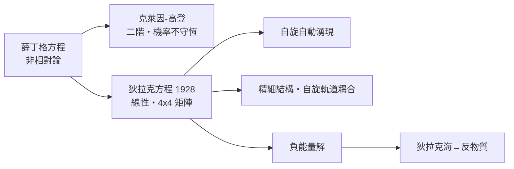

# 節標題：狄拉克方程——量子與相對論的合併

1928 年 1 月，劍橋聖約翰學院一間安靜的辦公室裡，年僅二十五歲的保羅·狄拉克（Paul Dirac）面對一個困擾全歐洲物理學界的難題：海森堡與薛丁格的量子力學雖然成功解釋了原子光譜，卻與愛因斯坦 1905 年的狹義相對論格格不入。薛丁格方程不是相對論協變的，它把空間與時間差別對待；而電子的自旋，這個當年被烏倫貝克與高斯密特硬塞進來的「多餘自由度」，在理論中始終像一件外来的補丁。狄拉克相信，真正的理論不應該插入自旋，而應該讓自旋從方程中自己湧現。

## 克萊因–高登方程的不滿

第一步早已有人嘗試。1926 年，瑞典的克萊因與高登把薛丁格方程改寫成相對論形式，得到

$$\left(\frac{1}{c^2}\frac{\partial^2}{\partial t^2}-\nabla^2+\frac{m^2c^2}{\hbar^2}\right)\psi=0.$$

但這個二階方程有致命缺陷：機率密度不再是守恆的正定量，且無法自然描述自旋 $\frac{\hbar}{2}$ 的電子在電磁場中的行為——氫原子精細結構的預測也不正確。狄拉克不肯接受妥協。他後來回憶，當時他給自己的功課是：「找出能使薛丁格基本方程自然擴展的漂亮數學。」他坚持一個原則：波動方程必須對時間只含一次微分，如此機率守恆才能存活，而相對論的时空對稱也才能尊重。

## 開平方與四乘四矩陣

要把能量動量關係 $E^2=c^2p^2+m^2c^4$ 開平方取線性形式 $E=c\boldsymbol{\alpha}\cdot\mathbf{p}+\beta mc^2$，就必須找到一組滿足反對易關係 $\alpha_i\alpha_j+\alpha_j\alpha_i=2\delta_{ij}$、$\alpha_i\beta+\beta\alpha_i=0$ 的量。這些量不可能是普通數字——狄拉克意識到，唯一能同時滿足一切的是 $4\times4$ 矩陣。於是波函數從單一分量膨脹為四分量旋量，方程自動包含了自旋 $\tfrac{\hbar}{2}$，並且在計算氫原子光譜時，精細結構的公式——包括自旋–軌道耦合（electron 的自旋與其繞核公轉的相對磁場交互作用）——分毫不出地浮現，與實驗完全吻合。這是理論物理史上罕見的時刻：一個從美學與邏輯出发推導出的方程，毫無保留地為你解釋了此前只能硬湊的現象。

狄拉克方程的另一個形式展現了它驚人的協變外衣：

$$i\hbar\frac{\partial}{\partial t}\psi=\left(c\,\boldsymbol{\alpha}\cdot\mathbf{p}+\beta mc^2\right)\psi.$$

## 負能量：一個話題無休的愛迪生

但方程在給予的同時也索取。它預言了與正能量對稱的**負能量解**——以 $-mc^2$ 為中心的另一組能譜。物理世界上若存在這種可以跌入無盡負能階的電子，氫原子中的電子早該釋放無窮光了。這個「缺陷」令狄拉克困擾多年，卻也在兩年後被他轉化為二十世纪最膽大的一個預言：反物質（見 10.2 節）。

## 沉默的精確者

狄拉克其人，是科學史上一道特殊的風景。他沉默寡言、字斟句酌，說話永遠拒絕修辭客套。同事們甚至流傳著「狄拉克單位」的笑話——諷刺他說一句話的簡潔程度。他不是不友善，而是堅持語言必須與事實一樣精確。他敬畏實驗，卻更敬畏數學之美。他曾說：「physical law 必須具有數學美」（physical laws should have mathematical beauty），這句話後來刻在劍橋西敏寺附近的狄拉克紀念碑上，成為他的墓誌銘。

泡利——這位以苛刻聞名的物理學家——在看到狄拉克方程時給出了著名的評語：這方程「索取的少，給予的多」（it gives more than it takes）。向來毒舌的泡利難得地承認了一個理論的豐饒：它自動推出了自旋、磁矩、精細結構與反物質，付出的代價只是接受一個起初令人不安的負能量問題。

## 時代脈絡：一個需要美學的政治年代

1920 年代的劍橋，是一個由卡文迪許實驗室的實驗傳統與劍橋數學傳統共同滋養的環境。盧瑟福的原子核是實驗家的凱旋，而海森堡、薛丁格、狄拉克的方程則是理論家的會師。歐洲在戰間期的相对穩定中讓純科學得以繁盛，高等教育擴張、期刊網絡形成、國際會議（如 1927 年著名的索爾維會議）把新一代理論物理的結論迅速制度化為共識。狄拉克正是這張網絡的節點：他受益於劍橋的獎學金制度、愛丁頓的廣義相對論講座、以及海森堡論文的及時流通。

狄拉克方程的意義遠超一個公式。它宣告：量子力學要完整，必須吸收狹義相對論——兩大支柱的這次合併看似周全，卻意外打開了通往反物質與量子場論的大門。整個粒子物理的未來，都藏在那 4×4 矩陣的負號之後。

