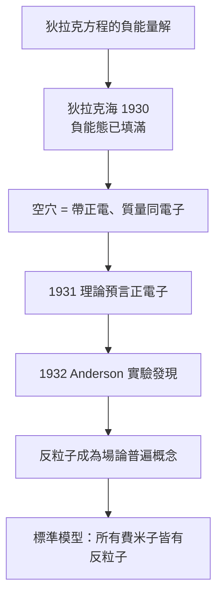

# 節標題：狄拉克海與反物質預言

狄拉克方程在 1928 年震動了物理學界，但它同時帶來一個尷尬的問題：方程允許電子擁有**負能量**。若能量可以低到 $-mc^2$ 以下並一路跌向 $-\infty$，那麼原子中的電子為何不持續輻射光、跌入這無底的深淵？氫原子根本不該穩定存在。這對以「精確」聞名的狄拉克而言，是不能忍受的瑕疵。

## 費米子才有的救命稻草

狄拉克在 1929–1930 年間想出一個極具想像力的解法。他注意到泡利不相容原理：兩個電子不能占據同一個量子態。於是他構想：也許宇宙中的**所有負能量態早已被填滿**——一個看不見、無法感覺的無限深海。

這片後世稱為「狄拉克海」（Dirac sea）的圖像，把問題轉化為有趣的新現象：能量若足夠大（至少 $2mc^2 \approx 1.022\,\mathrm{MeV}$），可以將海中的一個電子撞出、躍升到正能量世界；而它在海中留下的**空洞**，在周圍負能電子眼中，行為就像一個帶**正電荷**的粒子——有點像氣泡在水中上浮。

起初狄拉克以為這個「空穴」也許就是當時剛被認識的質子——宇宙中已知唯一的正電荷粒子。但數學不允許：質子質量太重，空穴的質量必須與電子完全相同。1931 年，狄拉克在論文中正式提出一個驚人大膽的結論：

> 必存在一種與電子質量相同、電荷相反的**未知粒子**——正電子（positron）。

這是物理史上首度由純理論推導「預言」一種基本粒子。狄拉克的邏輯是典型的他：既然數學一致，那麼自然界就必須有一個對應物。他寫道：「若這粒子不存在，人們候會不得不提出新的假設與修改。」他並不猶豫，但也不情緒化——預言在他筆下像在一次嚴肅帳戶結算後的自然決定。

## 1932：安德森在雲霧室裡撞見對手

預言發表不到一年，1932 年 8 月，加州理工學院的年輕實驗家卡爾·安德森（Carl Anderson）在研究宇宙射線的威爾遜雲霧室中，拍到一張著名的軌跡照片：一條在磁場中與電子**方向相反**彎曲的徑跡，但質量與穿透力顯然是電子等級。起初他謹慎地只寫「帶正電的類電子粒子」，但很快確認：這正是狄拉克預言的正電子。

布萊克特與奧恰利尼（Occhialini）在劍橋幾乎同時用自動化雲霧室系統獨立觀測到正電子，並提出正確的結構性解釋：宇宙線中的 $\gamma$ 光子在原子核附近「對生」（pair production）為一對電子與正電子——這正是狄拉克海中「電子被擊出、留下空穴」的物理版本。（詳見 10.3 節。）

## 狄拉克海的榮耀與退位

正電子的發現使狄拉克聲望達到高峰，1933 年他與薛丁格共享諾貝爾物理獎（年僅三十一歲）。但理論本身的故事還未結束。

「狄拉克海」作為一個圖像有著難以迴避的困擾：無窮大密度的負能電子海，其重力效應、電磁效應理應驚天動地，卻被假設「完全觀察不到」——這在物理上是強加的假設。隨著 1940–50 年代量子電動力學（QED）的重整化繁榮發展，物理學家找到了更好的表達方式：不再需要一片想像中的負能海，只要把狄拉克方程改寫成**量子場**的形式，讓「電子場」的激發包含正電與負電兩種粒子——正電子成為電子場的反粒子，負能量問題自然消失。

費曼圖的語言裡，反粒子被解釋為沿時間「倒退」的粒子，這正是狄拉克海圖像的幾何精華被保留了下來。標準模型中，**每一種**費米子都有反粒子——包括 1955 年發現的反質子、反中子。狄拉克的預言被推廣為整個粒子物理的基本對稱原理。

## 殘留的美學

今天教科書已少用狄拉克海，但它的精神永在：它示範了什麼叫**理論先行**——當數學結構自身產生一個看似缺陷的預言，有膽識的物理學家不是修補缺陷，而是把缺陷推進現實中看它會不會實現。狄拉克相信：「在物理學中，正確的道路往往是數學上美的那條。」負能量、這個看似缺陷的痕迹，最終成為他留給宇宙最浪漫的請柬。

狄拉克本人與反物質的「信仰」與「實驗」保持着奇妙的距離：他很少親自做實驗、也不熱衷於宣揚自己預言的重要性，而是繼續靜靜地工作。這種「數學即預言」的態度深深影響了後來幾代理論家——從楊振寧、費曼，到今天的弦論與量子重力研究者。狄拉克海可能在形式上消失了，但它作為一段思想史，仍然是我們理解「理論物理之美學」的最佳標本。
