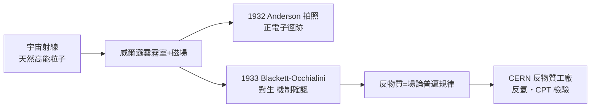

# 節標題：正電子的發現——宇宙深處的反物質痕跡

1932 年，狄拉克的反物質預言仍在紙上等待審判。而宣判它的，不是巨大的實驗室，而是一縷從太空落下的宇宙射線。

## 帕薩迪納的雲霧室

加州理工學院的密立根（Robert Millikan）自 1920 年代起全力推動一個課題：宇宙射線到底是什麼？——是光子還是帶電粒子？為了回答這問題，他讓年輕博士生卡爾·安德森（Carl Anderson）建造一座威爾遜雲霧室，並讓它置身於強磁場中，以觀察穿透薄鉛板的宇宙線粒子如何在磁場中彎曲。

磁場中的曲率方向立刻透露電荷的正負，曲率半徑則透露動量與質量的關係。1932 年 8 月 2 日，安德森拍到一張 40 條徑跡的照片，其中一條在穿過 6 mm 鉛板後明顯減速、曲率變大——比較穿板前後的方向與彎曲，唯一自洽的解釋是：這是一個**帶正電、質量與電子相當**的粒子。帶正電的粒子當時已知只有質子，但這條徑跡太細、穿透力太強，絕不可能是質子。

安德森並不知道狄拉克的預言。他起初謹慎地寫信給《科學》（Science），用最保守的語言描述「一種帶正電、質量比質子小得多的自由粒子」，並建議名稱 positron（正電子）。他試圖徵詢理論家的意見，也到處求證；最後才發現遠在劍橋的狄拉克早已在數學上等著這個粒子。理論與實驗，事前毫無串通，幾乎同時抵達同一結論——這成為二十世紀物理最有名的一次「不期而遇」。

## 劍橋的呼應：布萊克特與奧恰利尼

幾乎同時，劍橋卡文迪許實驗室的布萊克特（Patrick Blackett）與義大利青年奧恰利尼（Giuseppe Occhialini）用一套更先進的「自動觸發雲霧室」——由鍺蓋革計數器與雲霧室自動串聯，讓照片總是在粒子到達的瞬間拍攝——也在宇宙線中觀測到正電子，並且象徵性地展示了「對生」（pair production）：一個高能 $\gamma$ 光子在原子核附近化為一對電子與正電子。布萊克特作風嚴謹甚至近乎苛刻，他們花了近一年時間反覆檢驗，1933 年才發表，因此失去首發權，但提供了解釋框架：這不是質子反射電子，而是物質與能量的直接互換——$E=mc^2$ 的最可見演出。

安德森於 1936 年獲得諾貝爾物理學獎（同獎還有發現宇宙線中子的赫斯）；布萊克特則在 1948 年因改進雲霧室與相關發現獲獎。

## 反物質今天的實驗面

反物質早已從「宇宙深處的痕跡」變成實驗室的日常工具：

- **反質子（1955）**與**反中子**在 Berkeley 質子同步迴旋加速器上被發現，宣告反物質是費米子世界的一般規律。
- **CERN 的反物質工廠**（Antiproton Decelerator、AD 計劃）專門製造並冷卻反質子；ALPHA 實驗近年成功吹冷反氫原子，並測量反氫光譜——迄今所得一切與氫理論一致，這是「CPT 對稱」的最直接檢驗。
- 天文上，AMS-02（國際太空站）與南極氣球實驗一直搜尋宇宙中殘留的反物質信號（如可能的反氦），至今無確定發現。

反物質還有個常被誤解的地方：它是否具有「反重力」（gravitationally repelled）？2023 年 ALPHA 合作組測得反氫在重力場中**下落**，與普通物質一致——科幻小說裡的反重力飛船，被迫退場。

## 一點時代脈絡

安德森的發現所以可能，是幾種非物理因素匯流：加州理工的基金制度讓密立根有大筆資助運作宇宙線站（包括派登山頂觀測與彩色照片輔十），美國高等教育在 1920 年代向實驗物理大舉注資;宇宙射線本身是「免費加速度器」，它讓落後國家也能做高能物理。狄拉克—安德森的故事也顯示了理論與實驗網絡的效率：一項預言若足夠清晰，全球各地的觀測系統都會在幾個月之內為它找到證據。

反物質的後續意義超過一種新粒子。它宣告世界不是「粒子清單」，而是場論的結構——每一場都有正負兩面。這一思想放大到後來的夸克場、規範場，成為整個標準模型的骨架。而狄拉克那個曾經被當作「缺陷」的負號，如今以**反物質工廠**的形式在 CERN 生生不息地製造著——數學之美，最終被真實世界接住。

