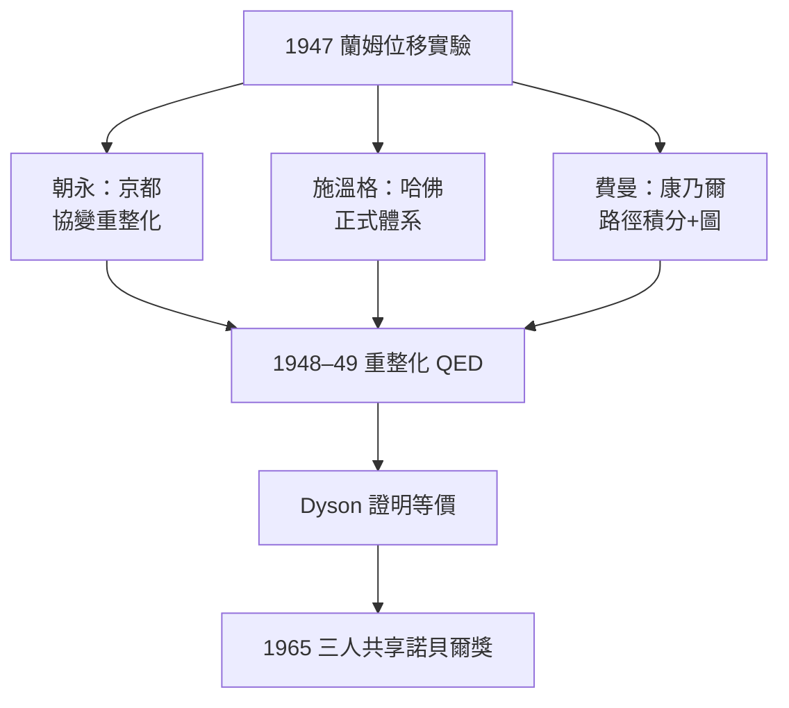

# 節標題：朝永、施溫格、費曼——馴服無窮大的重整化

1930 年代末，量子電動力學（QED）在原則上已經完備，卻在實務上寸步難行：一旦計算電子自能、電荷，或更高階的輻射修正，積分便在無窮大處爆炸。對最簡單的一階近似，大家還能容忍；但要走進第二章，所有人面對的都是 $\infty$。蘭姆（Willis Lamb）1947 年測得氫原子 $2S_{1/2}$ 與 $2P_{1/2}$ 能階有一微小位移（蘭姆位移），狄拉克理論自洽的框架下本不該存在——實驗把理論的無窮大問題推到了無法再拖延的位置。

## 京都：朝永振一郎

1943–1948 年間，日本處於戰敗後的廢墟，朝永振一郎在東京理化學研究所（與仁科芳雄的傳統一脈相承）培養出一個小型團隊。朝永的方法論與西方不同：他把電子場與電磁場的相互作用，拆解為「重整化後」質量與電荷的定義問題。當 1948 年 波科諾（Pocono）會議消息傳到日本（透過期刊與信件），朝永與學生（包括後來的南部陽一郎）已獨立發展出一套協變的、系統的演算——super-many-time 理論——在實質上與西方所得互相印證。他們在物資匱乏下以算術般的耐心重建了整個理論。

## 劍橋（美國）：施溫格

哈佛的朱利安·施溫格（Julian Schwinger）是同代人中著名的「正式主義大師」。他自幼神童，在哥倫比亞受教，二戰期間在 MIT 雷達實驗室鍛鍊了工程般的計算能力。1948 年，他在 Pocono 會議上以連續數小時的黑板表演，展示了能夠計算蘭姆位移、電子異常磁矩的完整體系：包含「重整化」——把無窮大自然地納入可觀測的質量與電荷。他的形式完美無瑕，卻也深不可测——同代人形容「覺得像看一位魔術師」。

## 普林斯頓：費曼

加州理工一路走到康乃爾的理查·費曼（Richard Feynman），選擇了完全異質、直觀的路徑：把量子振幅寫成**空時路徑**的積分，用空時圖景代替複雜場運算。他在 Pocono 會議上首次公開講述——卻遭遇尷挫：玻爾（Bohr）當場攔住他，說「二十年前我們就知道路徑積分是不自恰的」；費曼的手勢和圖畫對與會者而言像天書。最終是年輕的弗里曼·戴森（Freeman Dyson）——1948 年乘巴士橫越美國，將施溫格與費曼的理解都吸收——在 1949 年發表論文證明：二人體系在本質上等價，費曼圖是我們能理解的語言。這個「翻譯」成就，讓革命被世界接住。

## 1947–1950：一次解決所有無窮大

三組人馬的方法在細節上不同，結論的核心一致：

1. 理論中出現的無窮大，是**裸**質量與**裸**電荷的表現；
2. 觀測到的電子質量 $m_{\rm obs}$ 與電荷 $e_{\rm obs}$ 是包含真空極化等修正的**重整化**值；
3. 一旦把所有物理量以可測量表示，所有修正皆有限。

第一個關鍵檢驗：**電子異常磁矩**。狄拉克理論預測 $g=2$；重整化 QED 一階預測 $\dfrac{g-2}{2}=\dfrac{\alpha}{2\pi}\approx 0.00116$，正是 1947–48 年 Kusch 與 Foley 在實驗測到的值。理論與實驗在四位小數上吻合，這是 QED 的「驗血」章。蘭姆位移也同樣被馴服。

## 戰後結構

這次重整化不只是數學修補，它背後是一個時代：二戰使美國政府持續資助純科學；雷達、原子彈運動使計算物理與精確測量人才迅速擴張；日本在戰後以極小資源維持理論存續。三個文化圈——京都、劍橋（美）、普林斯頓——幾乎同時抵達，證明了物理問題本身在邀請答案。

1965 年，諾貝爾物理獎同時授予朝永、施溫格、費曼，是委員會對「同一理論的多元路徑」的罕見致敬。重整化的哲學爭議卻未平息——狄拉克本人一直反對，稱之為「丑陋」；直到 1970 年代威爾遜（Kenneth Wilson）的重整化群，把無窮大解釋為「理論在有效能量尺度上的性質」，問題才真正在概念上獲得安放。

