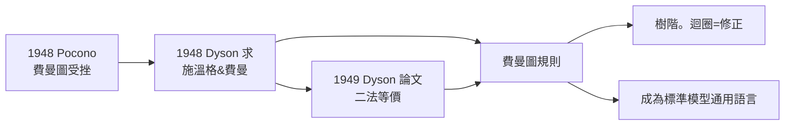

# 節標題：費曼圖——將量子交互作用視覺化

在 1948 年的 Pocono 會議上，費曼的演講是災難性的。他手舞足蹈地在黑板上畫出粒子在空時中的曲折路徑，試圖解釋正負電子如何在圖上「沿時間倒退」，玻爾卻當場打斷他，說這種圖像「二十年前我們就已知道沒有意義」。費曼所使用的語言——直觀、幾何、不含任何演繹步驟——與會的歐式傳統聽不懂。他後來回憶：「我用的是我自己的語言，大家都不懂。」半年後，他自己的報告仍然被認為「缺乏數學」。

## 戴森：那位翻譯者

把這種視覺語言變成科學公共財的，是年輕的弗里曼·戴森（Freeman Dyson）。1948 年夏天，他先是跟隨貝特（Hans Bethe）在康乃爾，又搭長途巴士到加州聽費曼講課，接著去哈佛聽施溫格連續幾天的演講。他發現，兩套完全不同的表述——施溫格的協變場論、費曼的直觀空時圖——是**同一理論**。1949 年他發表的論文證明了這一點，並展示了如何用費曼圖系統地組織微擾計算，每一階（每一個圖）都對應一個確定的積分。

於是，量子電動力學的「無窮大毒藥」，如今可以被一張一張圖像化地消化：每條線是一個傳播子（propagator），每個頂點是一個相互作用，每個迴圈是一階修正。畫出圖、寫下規則（費曼規則）、積分、去無窮大——大學生也能做的步驟，取代了往日需要幾頁場論演算的工作。

## 一張圖，一組規則

以 $e^- e^- \to e^- e^-$（動量轉移 $q$）為例，樹階圖給出

$$i\mathcal{M}=\bar{u}(p')(-ie\gamma^\mu)u(p)\frac{-ig_{\mu\nu}}{q^2}\bar{v}(k')(-ie\gamma^\nu)v(k).$$

上述公式看起來抽象，但它的每一因子對應圖上的一個元素：兩條電子線、一條光子內線、兩個頂點。物理學家一看圖便知公式——這是費曼圖真正的革命：**計理学和直觉合併了**。它不只是一個工具，也改變了人類思考量子的方式：亞原子世界可以用「畫」的方式推理，而每一張圖都隱藏著一個可以計算的數字。

## 從圖像到哲學

費曼圖的深層意涵，遠超一個計算技巧：

1. **多階結構**：耦合常數 $e$ 的每個頂點帶一個因子 $e$；圖中頂點數越多，貢獻約以 $\alpha^{n}$ 變小（$\alpha\approx 1/137$），這正是微擾論可以執行的原因。
2. **真空不空**：迴圈圖表明「真空」中無時無刻不發生虛粒子的生成與湮滅；蘭姆位移、電子 $g-2$ 正是這些圖上的實驗印記。
3. **普適語法**：這套圖式後來推廣到弱作用、強作用（QCD）的計算中，成為**標準模型的通用繪圖語法**。任何新理論的第一個自我檢查，就是「這能否畫成費曼圖」。

## 費曼其人

費曼的做法，是他性格的自然延伸。他厭惡繁文縟節、相信一切理解都必須能還原為一句直觀的句子；他在康乃爾的天台、在巴西的桑巴鼓、在加州理工的辦公室，都習慣把問題「畫」出來。費曼圖最早出現在他 1948 年草稿的邊角與信紙上，廢紙、手稿、黑板都是它的誕生地。1949 年正式發表；而費曼本人一直到 1950 年代中期才開始在講義中系統使用它。

1965 年它在諾貝爾演講中回顧：「圖像方法最大的意義，是提供一種新的思考方式。」他並強調這不是敘事上的修飾，而是一種能被公式化為數學的表述。費曼圖如今是全世界物理系研究所的入門語言——亦是所有高能實驗論文中的第一張示意圖。從一個在會議上被攔阻的年輕人到教科書的章節名，這段經歷提醒我們：科學的革命不一定以演繹形式到達，常常是先以一幅圖被人看見。

