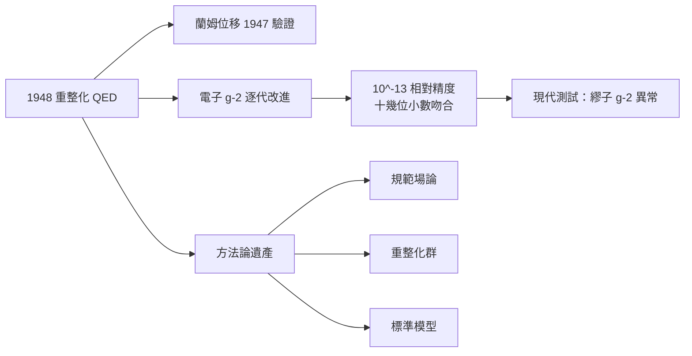

# 節標題：QED——宇宙中最精準的理論

重整化之後的量子電動力學（QED），在 1950 年代慢慢展現出它真正的威力：它不是一個「勉強可用」的理論，而是人類迄今建立的最精確的知識體系。

## $g-2$：小數點後十位以上的對話

狄拉克理論預測電子的磁矩恰為 $g=2$。但 QED 認為，電子自身周圍的真空極化、自能等「虛過程」會讓這個數字**略偏**：

$$\frac{g-2}{2}= \frac{\alpha}{2\pi} - 0.32847\dots\left(\frac{\alpha}{\pi}\right)^2 + 1.181\left(\frac{\alpha}{\pi}\right)^3+\cdots$$

如今實驗（哈佛 2008 年的單電子量子圓柱阱，以及後續的改進）測得 $(g-2)/2$ 到約 $10^{-13}$ 相對精度，與理論在十幾位小數上一致——若以有效數位來算，這相當於把洛杉磯至紐約的距離量準到一根頭髮的寬度。費曼因此說過那句名言：

> 「QED 是人類史上最精確的知識。」

蘭姆位移也同樣：氫原子 $2S_{1/2}-2P_{1/2}$ 的間隔被測到兆分之一級，與理論計算一致到相對誤差小於 $10^{-6}$（需要考慮質子半徑的不確定度）。這樣的吻合不是一個數據點，而是數十年中對氫、氘、µ子氫、電子磁矩、正電子偶素等多體系同時成立的圖景。

## 檢驗制度：公尺有多準，QED 就有多準

QED 的精度要求的不只是理論，而是整個**計量制度**。美國 NIST、法國 LNE-SYRTE、日本 RIKEN 等計量機構必須為實驗提供高電流電子阱、超高真空、極低震動環境；CERN 等歐洲機構則以質子流、離子阱繼續做 $g-2$ 與譜學測試。這種「測量基礎設施—理論—實驗」的三角，是二十世紀後半科學制度化的縮影：一個理論數字的成立，涉及半導體技術、冷原子物理、資助體系、刊物與同行審查，而不再是一個天才在黑板上完成。

## QED 的方法論遺產

QED 的真正持久的貢獻，在於它教會了物理學家如何**建構場論**：

1. **規範對稱**：光子場的存在，被理解為局域 $U(1)$ 對稱性的必然結果。這一手法後來被推廣為 $SU(2)\times U(1)$（電弱）、$SU(3)$（強作用）。換言之，沒有 QED 就沒有標準模型的語法。
2. **重整化群**：威爾遜把無窮大的問題轉為「理論如何隨能量尺度演化」。重整化群解釋了強作用在短距離變弱（漸近自由），使 QCD 在 1973 年成立。今天它已渗入凝態物理、臨界現象、甚至金融數學。
3. **有效場論的哲學**：QED 不是「最終理論」；它是一個在能量遠低於普朗克尺度均可自洽的有效描述。這種謙遜的方法論，使今天許多理論工作時刻記得自己工作的適用範圍。

## 現代的波瀾：繆子 $g-2$

21 世紀 QED 的邊界也開始被測試。布魯克海文與後續費米實驗室的**繆子 $g-2$ 實驗**發現，繆子的異常磁矩與理論預測似有微小偏差（在 $4\sigma$ 左右）。但情況比電子複雜——理論值本身依賴強作用對 QED 修正的「強子真空極化」計算，兩種計算方法（數據驅動 vs 格點 QCD）給出不同結果，使得「新物理」的說法仍被爭論。而電子 $g-2$ 在最新的精確度下也開始偏離（受制於里德伯常數等的不確定度）。這些「異常」即使最後消失於計量精度之內，也提醒我們：QED 再精準，它的真理仍是**有邊界條件的**。

## 結語

從 1948 年的絕望（無窮大）到 2020 年代的十位小數吻合，QED 告訴我們的是：理論與實驗可以在 **難以想像的精度** 上合拍，但這種合拍依賴整個科學共同體——計量 institute、 supercomputer 上進行的大規模計算、動輒十年的實驗週期。它同時也提示了理論物理的另一面：一個再美的理論，也是**有條件的表述**，等待下一張能量尺度高的圖紙展開。

