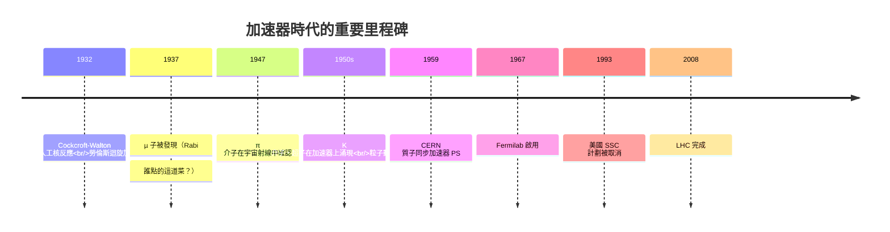

# 節標題：加速器時代——粒子動物園

重整化之後，理論物理擁有了可工作的框架，但接下來的問題是：**自然到底有多少種基本粒子？** 要回答它，人類必須自己製造高能碰撞——加速器時代因此開啟。

## 從靜電起壓到同步迴旋

1932 年，考克饒夫與瓦爾頓（Cockcroft–Walton）在劍橋用層疊整流電路把質子加速到約 700 keV，首次人工裂解鋰核——「實現了盧瑟福夢想的核反應」。同年，加州伯克利的勞倫斯（Ernest Lawrence）發明**迴旋加速器**（cyclotron）：磁場把帶電粒子拗成圓圈，射頻電場反覆加能，從而把幾十厘米的裝置變成百萬伏特級的「粒子大砲」。勞倫斯的風格是工程型樂觀主義：他相信「更大的機器必然產生更大的發現」，在伯克利建立了輻射實驗室，培育了整整一代加速器人才。

巴德（Veksler）與麥克米蘭（McMillan）1945 年各自獨立提出 **同步加速原理**（synchrotron）：隨能量上升同步調整磁場與射頻，粒子可以不只被限制在猛轉的圓盤，而是被推進更大的環形加速器。這計理使高能物理有了可規模化的路徑——之後的加速器 (CERN 1959 年的質子同步加速器 PS 達 28 GeV；Brookhaven 的 AGS 33 GeV) 幾乎都是同步加速器。

## 動物園：七十種粒子

從 1940 年代起，宇宙射線與早期加速器開始揭示一個驚人的世界：

- **µ 子（1937，Anderson & Neddermeyer）**：質量約電子 207 倍，性質卻只是「重電子」；除了質量，它與電子幾乎無差。拉比（I. I. Rabi）的著名反問成為粒子物理最有名的牢騷：「**誰點的這道菜？**（Who ordered that?）」——它沒有任何存在理論要求的理由，卻真實存在。
- **π 介子（1947，Bristol 的照相乳膠團隊）**：湯川秀樹 1935 年預言的核力介子，宇宙射線中找到；1950 年代加速器上量產。
- **K 介子、$\Lambda$、$\Sigma$、$\Xi$ 等奇異粒子**（1950 年代）：大批「陌生」粒子在 Brookhaven 的 Cosmotron（1952）等加速器上密集湧現。它們都有奇怪的性質——產生容易、衰變慢——引出了「奇異數」（strangeness）新量子數。

到 1960 年代早期，能被確認的基本粒子已近七十種，物理學家只能繪製巨大的「粒子表」，像動物園導覽一般。這是一種理論的羞辱：人們曾相信基本粒子只有幾種，現在草稿卻像化學元素週期表一樣擁擠。

## 政治：冷戰的加速器競賽

1950 年代的加速器不只是物理，更是**冷戰工具**。1954 年 CERN 的成立背後，是歐洲各國（特別是戰後的法、德、義）希望在基礎科學上重建自信與人才回流；蘇聯則以 Dubna 的同步迴旋加速器與杜布納聯合研究所（1956）對抗西方。加速器的規模經費超越了任何單一大學，於是誕生了新制度：**國家實驗室**——Brookhaven、Argonne、SLAC、Fermilab（1967）。粒子物理自此成為職業化、團隊化、政府資助量級以億美元計的科學。早在 1960 年代，DOE（前身 AEC）的年度高能物理預算已與 NASA 相當。

## 大師們的宿命：SSC 的取消

這趨勢在冷戰末推到極致：1983 年起美國規劃 **超導超級對撞機（SSC）**，設計能量 20 TeV，預算最終超過 100 億美元。德州 Waxahachie 的隧道已挖了 14.6 英里——但 1993 年美國國會決定中止計劃。這是冷戰基礎科學紅利時代的終結：蘇聯解體後，兩大陣營的科學競賽失去原動力，美國政界質疑「純科學的價值」；以此同時 CERN 集中歐洲之力建造 LHC，2008 年完成，13–14 TeV 的對撞能量成為未來半世紀高能物理的世界中心。

SSC 的取消與 LHC 的完成，在新舊世紀交替顛倒了物理世界的權力關係：美國的本土高能前沿只剩地下實驗（如 $\mu$ 與中微子），歐洲成為加速器之都。「粒子動物園」的另一面是：**它從此需要以大西洋兩岸的政治經濟來供養**。

