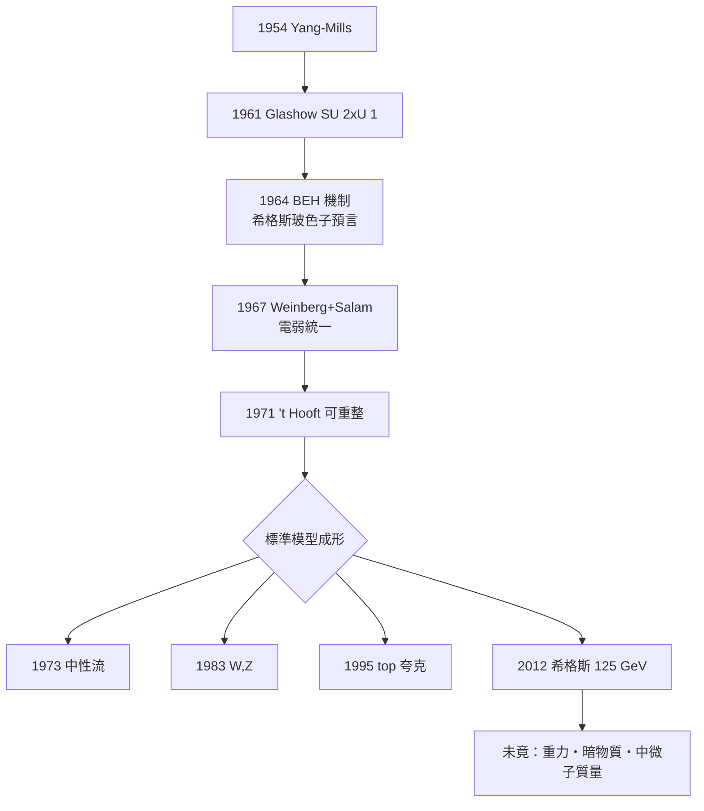

# 節標題：標準模型與希格斯——最後一塊拼圖

1970 年代，粒子物理迎來一種罕見的景觀：幾乎所有已知數據，終於可以由一個單一的數學框架——後世稱為**標準模型**——統一描述。

## 電弱統一：三條路

問題的起點，是楊振寧與米爾斯 1954 年提出的**非阿貝爾規範場論**（Yang–Mills）：規範對稱會自然生出自旋–1 的玻色子，但這些粒子必須無質量，而弱作用的載體交換粒子顯然極重。矛盾長期未解。

1961 年，年輕的格拉肖（Sheldon Glashow）大膽假設：電磁與弱作用可以由 $SU(2)\times U(1)$ 共同規範，產生 $W^\pm, Z^0$ 與光子。但質量問題仍未解。解鎖的鑰匙來自固態物理：南部的超導理論中，玻色子可以經由基態對稱自發性破缺而「吃進質量」。1964 年，三組人同時提出實現此構想的相對論場論版本——布勞特與恩格勒;希格斯（Peter Higgs）;基布爾;哈根;古拉尼克——統稱 **Brout-Englert-Higgs-Hagen-Guralnik-Kibble 機制**。希格斯指出它意味著必然存在一個**標量玻色子**。

1967 年，溫伯格（Steven Weinberg）與薩拉姆（Abdus Salam）分別把希格斯機制嵌入格拉肖的框架，得到自洽的電弱理論；同年 Weinberg 以市場百年的無理數耦合 $\sin\theta_W$ 預言 $m_W \sim 80 \,\mathrm{GeV}$。但這理論在當時只有少數人相信，因為可重整性未證明。打破冰霜的是 1971 年的荷蘭研究生霍夫特（'t Hooft，指導維特曼），他證明 Yang–Mills–Higgs 理論是**可重整化的**——於是全世界的計算開始向它傾斜。1979 年，格拉肖、溫伯格與薩拉姆共享諾貝爾獎（格拉肖同時也被哈佛同輩認為「年少輕狂」的直覺是當年最大膽的作品）。

## 實驗的三場連續劇

1. **1973：中性流**。CERN 的 Gargamelle 氣泡室首次觀測到中性流事件（$\bar{\nu}_\mu + e^- \to \bar{\nu}_\mu + e^-$）——這是 $Z^0$ 交換的直接痕跡。它使電弱理論一夜之間從漂亮的數學變成可測的物理。
2. **1983：W 與 Z**。CERN 的 SPS 被改造成 $p\bar{p}$ 對撞機（Rubbi亞與范德米爾的隨機冷卻技術使反質子束成為可能），UA1（Rubbi亞主持）與 UA2 合作組發現 $W$（80 GeV）與 $Z$（91 GeV）粒子，質量精確符合理論。Rubbi亞得 1984 年諾貝爾獎。
3. **1995：頂夸克**。費米實驗室的 CDF 與 DØ 發現第三代的最後一員 top 夸克（約 175 GeV），明確展現標準模型的第三代完整結構。

## 2012：希格斯現身

剩下的拼圖是希格斯玻色子。它需要更大的能量：LHC（2008 年起，13 TeV）攜帶 ATLAS 與 CMS 兩個一萬人量級的探測器合作組，各自以超過 $5\sigma$ 的標準呈現一個質量約 **125 GeV** 的標量粒子：

$$\sigma/\sigma_{\rm SM}\approx 1,\quad H\to \gamma\gamma,\ ZZ,WW \text{ 衰變均可見。}$$

2012 年 7 月 4 日 CERN 的記者會上，83 歲的希格斯在聽到「我們觀測到新粒子」的結論時，摘下眼鏡拭淚。2013 年恩格勒與希格斯共享諾貝爾獎（布勞特已逝，諾獎不做追授）。這是半世紀前最後一項由理論先行、後由萬人大隊接住的預言。

## 未竟之路

標準模型不是終點：

- **重力**不在其中（廣義相對論只在低階自動引入新月階段）；
- **暗物質**佔宇宙物質約五分之一，標準模型中無對應粒子；
- **中微子有質量**（1998 年起 Super-K 等實驗確立振盪），而標準模型的最簡形式中微子質量為零；
- **宇宙正反物質不對稱**（重子生成）需要超出 CKM 矩陣之外的新 CP 破壞。

一九六零到二零一二這半世紀，是一位英國演講者在一次失败的求職季寫下兩頁論文，一位紐約少年在哈佛走廊空想 $U(1)_Y$，一位巴基斯坦少年卡拉奇的薩拉姆以下流社會身份進入劍橋——三人的人生被一種共同的數學語法黏合。標準模型教給我們的不只是一張拼圖，更是一種制度與文化的證明：理論家與實驗家、萬國但其實是小團隊，可以共同把思想變成宇宙的答案。
