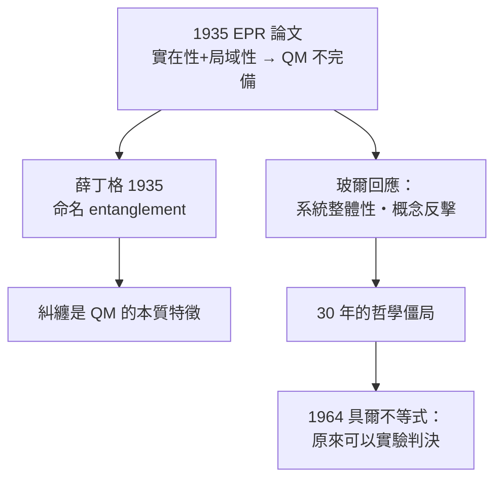

# 節標題：EPR 悖論——鬼魅般的超距作用

1935 年 5 月，《物理評論》（Physical Review）刊登了一篇僅四頁的論文，署名 A. Einstein, B. Podolsky, N. Rosen：《**量子力學對物理實在的描述可以視為完備嗎？**》。它幾乎以一個問號作為武器，挑戰整個哥本哈根詮釋。

## 愛因斯坦的動機

愛因斯坦從不否認量子力學計算的成功，但他多年來認為它**不完備**：波函數只描述系綜，而真實世界中的粒子應有確定的性質（哪怕我們不 measuring 時也「真的」在那裡——即所謂實在論的真值）。1927 年索爾維會議上他已用各種思想實驗挑戰海森堡的不確定性原理，被玻爾一一化解。1933 年他移民普林斯頓後，與年輕助手波多爾斯基（Podolsky）與博士生羅森（Rosen）合作，把它寫成正式論文——但愛因斯坦事後並不滿這一稿：波多爾斯基在提交前未經充分協商就寄出給《紐約時報》發布消息，讓愛因斯坦不快。

## 悖論的構造

EPR 思想實驗的核心是一對「曾經相互作用過的」粒子，它們已分離到極遠。依量子力學，它們共享一個不可分解的糾纏波函數；此時測量粒子 A 的動量，可根據守恆律**即刻推知**粒子 B 的動量，而不用干擾 B。EPR 提出兩條假設：

1. **實在性準則**：若能以完全（百分百）可信度預言某物理量的值，則該量對應物理實在的元素。
2. **局域性準則**：對 A 的操作，不能瞬時影響遠處的 B。

由兩者推論：粒子 B 的動量與位置**在時間點上皆為實在元素**——但量子力學（共軛量的不對易性）主張兩者不能同時有確定值。因此 EPR 結論：量子力學對實在的描述是**不完備的**，必須有更深的、隱變數層次的理論。

## 玻爾的回應：概念的勝利

玻爾在得知論文的幾週之內就投稿同刊回應，題目與原文相同。他的策略不是否認計算，而是攻擊**「實在性準則」所用的語言**：他主張 A 與 B 已構成一個不可分割的整體系統，所謂「不干擾 B」的說法在概念上站不住——你選擇測量 A 的動量還是位置，本身就是在實驗安排層面定義了 B 的哪個性質是「實在」的。換句話說，EPR 的悖論源於我們把經典的『分離系統』語法強加給量子世界。

這場論爭在大多數物理同行眼中，以玻爾「獲勝」告終；但那是**哲學技術上**的勝利，而非科學上的判決。因為 EPR 與本徵隱變數理論並未給出可測的差異。經典的觀點，費曼後來的話有所總結：「沒有人真正懂量子力學」。這場戰爭沉澱了三十年。

## 薛丁格的命名

同年 1935 年，薛丁格——他當時也正深入思考這些難題——在致愛因斯坦的信與另兩篇論文中，為這種現象取了一個後來成為教科書語言的名字：

> **Verschränkung**（糾纏；entanglement）——「兩個系統的一次測量所帶來的全部知識，都無法表示為分開子系統的描述之和。」

薛丁格並指出，糾纏不是量子力學的一個次要特徵，而是**它的本質特徵**。他還写出著名的貓思想實驗，說明這一切如何逾越到宏觀世界。

## 鬼魅之語

愛因斯坦本人的語言更直覺。1947 年他致馬克思·玻恩的信中寫道：

> 「量子力學很難令人接受……這種理論不能在一個存在之於觀察之外的實在基礎上成立。」
> 而糾纏性預測——「我要它像**鬼魅般的超距作用**（spukhafte Fernwirkung）那樣的東西，它在空到渺無一物的空間中能即時地傳遞。」

他至死不接受把這種相關性視為物理世界本身而非「隱藏知識」。他的立場在 1955 年他去世時沒有結論——但問題本身已經成為一個**可被實驗判決的問題**，只是還需要一位特定的數學家和三十年的等待。

