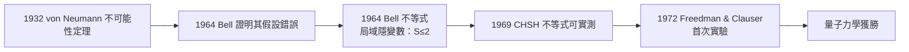

# 節標題：貝爾不等式——在哲學論戰中找到硬證據

三十年來，EPR 之爭一直停留在口舌層面。直到 1964 年，一位在 CERN 工作的北愛爾蘭物理學家約翰·貝爾（John Stewart Bell），把哲學變成了可以測量的數。

## 從日內瓦到斯丹福

貝爾 1928 年生於貝爾法斯特，工人家庭出身，靠獎學金進入女王大學貝爾法斯特，專攻理論物理，1953 年後長期在 CERN 研究理論加速器物理。但「量子力學基礎」是他的私人宗教——CERN 當時的氛圍視這些問題為「哲學空談」，貝爾只能在業餘時間耕耘。1960–64 年他在美國史丹福、威斯康辛、布蘭迪斯休假一年，得以騰出整段時間思考，最終寫成兩篇論文。

第一篇（1964 年）批判馮·諾伊曼 1932 年著名的「不可能性定理」：該定理據稱證明「任何隱變數理論必與量子力學不等價」。貝爾發現其中一個假設不成立——對不可交換觀測量線性相加——因此該證明是**無效的**。這使他膽子更大：也許有些隱變數理論真能重現量子力學。

## 貝爾定理

1964 年 11 月，第二篇論文《論 EPR 悖論》發表。貝爾考慮一個局域隱變數理論：粒子分離後各自攜帶隱參數 $\lambda$，決定各自的測量結果；局域性意味着 A 的結果決不依賴於 B 那邊選擇的測量方向。在這個假設下，他導出了一個純數學不等式，對於某個相關量組合 $S$：

$$|S| = |E(\hat{a},\hat{b}) - E(\hat{a},\hat{c}) + E(\hat{a}',\hat{b}) + E(\hat{a}',\hat{c})| \le 2.$$

但量子力學的預測，對某些特殊選擇的偏振方向，是

$$|S|=2\sqrt{2}\approx 2.828 > 2.$$

**兩個假設不可能同時為真。** 也就是說：局域隱變數理論與量子力學給出**可實驗區分**的預測。哲學議題至此變成實驗物理。

貝爾自己極少做演講，人稱沉默寡言者。他晚年回顧：

> 「我曾把最深刻的哲學問題，帶到一個可以做實驗判決的尺度上。」

## 從的不等式到真正的 CHSH

貝爾不等式的原始形式針對完全相同的自旋–1/2 粒子對，實驗上不夠實用。1969 年，Clauser、Horne、Shimony、Holt 提出 **CHSH 不等式**，即上述 $S$ 的形式——這正是可與光子偏振實驗直接比較的版本。當時在哥倫比亞的 Clauser 博士生說服導師不理會「浪費時間」的警告，開始尋找可做測試的系統；他在哈佛、伯克利求職受阻，卻在 1972 年與 Freedman 在伯克利完成**第一次此類型的實驗**——果然發現量子力學獲勝，違背貝爾不等式（儘管早期的實驗技術還屬粗糙）。

## 一些令人意外的人物

實驗物理的推進中，也有奇特的線索。1970 年代，似是而非的實驗（如 Holt 的負結果）提醒大家，測量是多麼艱難。戴森在一次著名的討論中建議，可通過宏觀現象的無矛盾（如 Aharonov–Bohm 效應）尋找新思路。同一時期，一些建議的更簡單系統——原子級的「雙原子分子」、譜振腔、雙光子原子級聯——成為主流。到 1970 年代末，巴黎、日內瓦、史丹福、馬里蘭的組織紛紛投入，各國年輕實驗家（包括後來獲得 2022 諾獎的 Alain Aspect 與 Anton Zeilinger）把此問題從「邊緣的怪異」提升到「優質的科學」。

貝爾本人起初對這一切有些半疑半信——他重視局域性，曾被問：若實驗違反他的不等式，他要選擇哪邊放棄？他的回答充滿哲學的煩惱：「局域性太基本了，捨棄它就像捨棄整個二十世紀物理的骨幹。」——但實驗終究站在量子力學這邊（見 13.3）。

## 一位「業餘者」的紀念

貝爾的成就尤為罕見：他不是「基礎問題專家」，而是以加速器理論為正業，把業餘的沉思轉化為一個定理。這提醒我們：**基礎科學中，業餘好奇心有時就是革命的火種**。1990 年他因中風突然去世——離 CHSH 實驗完成已近三十年，離他真正被世人充分認識還不夠遠。

