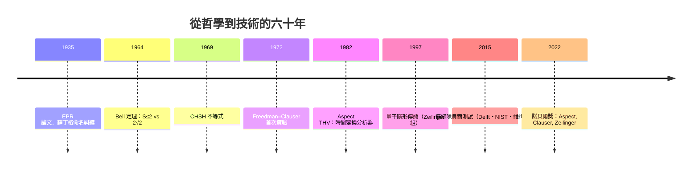

# 節標題：阿斯佩實驗——局域性的死亡

貝爾不等式給了哲學一條可測量的途徑，但要走到「實驗之死」，還需要了不起的勇氣與精巧的技術。

## 巴黎南郊的堅持

1970 年代初，阿蘭·阿斯佩（Alain Aspect）在法國奧賽的巴黎南大（Paris-Sud / Orsay）光學實驗室工作，導師是後來的諾獎得主克勞德·科昂-坦努吉（Claude Cohen-Tannoudji）。他以三級級聯原子（鈣的 $J=0\to1\to0$ 躍遷）為光源，得出一對能量關聯的可見光子對。當時他職業前途堪慮：費曼式嘲笑說這是「哲學家的實驗」，而法國光學界大家（包括 IM klein poppe 曾有「他在浪費時間」的暗語）。但阿斯佩堅持，1974–75 年完成其博士工作，並得到結果明確支持量子力學、顯著違背貝爾不等式——只是仍留下縫隙（loopholes）。

## THV 實驗：把決斷拉到光速尺度

真正的核心發問是：糾纏的相關性，會不會只是因為兩個檢偏器在實驗時間尺度內「偷偷通過某種慢訊號」互通信息？要做到實驗上的命題——必須在光子飛行的瞬間**更換過分析器的定向**。1982 年，阿斯佩與達里巴（Dalibard）、羅吉（Roger）在奧賽完成了第三組 THV 實驗（以他們三位字母命名，亦稱 **THV 組**）：在 12 米基線上，用作回聲的聲光電開關每 10**ns** 自動更換分析器，相當於「改變一個人時光子彼此不能通信」（信號傳遞至光速所需時間遠長於此）。結果深刻：**$S$ 觀測值為 $2.7\pm0.15$，突破經典上限 2，並十分接近量子預測 $2\sqrt{2}$。**

這一結果使愛因斯坦的局域實在論——物理界最敬重的傳統——無法再以「假設」的方式維持。局域確定性並非普遍可行。

## 縫隙的美德與複盤

但 THV 實驗仍有理論縫隙，最著名的是**檢測縫隙**（detection loophole）：光學探測器效率太低，必需假設光子被探測與未被探測樣本無關。法國這一代的技術不斷完成，到 2015 年，三個團隊幾乎同時完成意義重大的任務：

- **Delphi 2015（代爾夫特理工大學 Hensen 協作組）**：以兩顆相距 1.3 公里的 NV 氮空位中心，用糾纏光子聯結電子自旋，做到**無縫隙式貝爾測試**（loophole-free test）——同時封閉檢測與通信縫隙。
- 同年 NIST 與維也納的 Zeilinger 組以高效率光子位置完成無縫隙 CHSH，卡內基美隆（Karns）與另外團隊還做了「自由選擇」縫隙的試驗（結合遠星傳信光源）。

## 從哲學應用到工業技術

這場勝利還催生了一個新兴領域：**量子信息技術**。

- **量子密鑰分配（BB84）**利用糾纏與不確定性製造可證明安全的通信密鑰，並承擔貝爾測試的自我校準功能（device-independent QKD）。
- **量子隱形傳態（teleportation）**將量子狀態以經典信道加上糾纏的方式遠距傳輸——Zeilinger 的維也納組 1997 年首次完成，於 2022 年諾貝爾獲得者內容之列。
- **量子計算機**的糾錯、糾纏存留			    		、質子/離子體的精度，皆直接依賴這一基礎：**世界上不會有「局域隱變數」帮你省事**。

## 2022：諾貝爾協奏曲

2022 年，諾貝爾物理獎授予 **Aspect、Clauser、Zeilinger**，表彰「通過糾纏光子進行的開創性實驗、確認了對貝爾不等式的違反、並開創了量子信息科學」。這是諾貝爾委員會首次以 EPR 之類的基礎問題直接獲獎——近九十年前，愛因斯坦與波耳的口舌戰，在近一個世紀之後以最物理的方式收尾。

哲學餘波仍在：局域實在論死了——但「局域性」與「實在論」二者中必有一個要讓位；哪些是「真實」的問題，已經轉化為量子信息理論、量子重力與哲學中待定的新分支。

