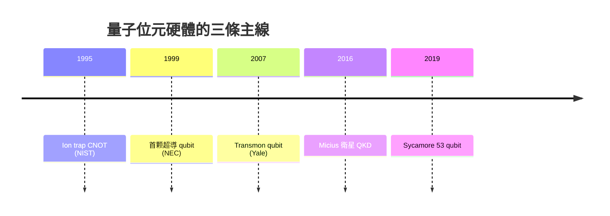

# 14.2 量子位元與糾纏：平行運算的威力

一九九五年，班尼特、克勞德資深理論家與 Smolin、Wootters 等人眼中的「糾纏」，從一個被愛因�斯坦稱為「幽靈般的超距作用」的哲學疑難，正式轉型為一種可計量的資源。這一年是量子資訊科學的成年禮：qubit 有了嚴格定義，entanglement 有了度量衡，整門學問開始像熱力學一樣被「經濟化」思考——糾纏是燃料，退相干是損耗，閘門是引擎。

量子位元的基本形態是一個疊加態
$$|\psi\rangle=\alpha|0\rangle+\beta|1\rangle,\qquad |\alpha|^2+|\beta|^2=1.$$
古典位元只能取 0 或 1，qubit 卻可以在複數二維空間中的任意方向上存在。這看似只是「連續取值」，真正的威力在於張量積：n 個 qubit 的聯合狀態空間維度是 $2^n$。當 n=300，狀態空間的維度已超過可觀測宇宙中的原子總數。費曼當年指出的那個指數爆炸，此刻從障礙翻轉為資源——量子演算法的祕訣，正是在 $2^n$ 維的 Hilbert 空間中讓所有振幅同時演化，最後以干涉把答案「篩」到測量結果上。這不是「一個答案的 n 次平行運算」，而是「一場 $2^n$ 條路徑的波動疊加」；它與古典平行運算的本質差異，就在於振幅可以相消。

糾纏（entanglement）是這場波動的黏著劑。所謂 maximally entangled state，如 Bell 態
$$|\Phi^+\rangle=\frac{|00\rangle+|11\rangle}{\sqrt{2}},$$
兩個 qubit 的聯合狀態不能寫成各自狀態的乘積——測其一，另一個立即知道。一九六四年 John Bell 的不等式、一九八二年 Aspect 的實驗、一九九七年前後的 loophole 檢驗，一路把這個結論逼到無法迴避：要嘛放棄局域實在論，要嘛承認實驗做錯了。二〇一五年，荷蘭 Delft、維也納與 NIST 三個團隊同時完成「無漏洞 Bell 測試」，瑞典的 Zeilinger、Clauser 與 Aspect 因此獲得二〇二二年諾貝爾物理獎。愛因斯坦當年視為瑕疵的東西，如今被清點為「e-bit」，是量子遙傳（teleportation）與量子金鑰交換（QKD）的法定貨幣。一九八九年，Hong–Ou–Mandel 實驗讓兩顆光子在分束器上「互消」，直接展示了光子層次的干涉及不可分辨性，成為光學量子計算的基石效應。

演算法端的好戲也愈演愈烈。除了 Deutsch–Jozsa 的「概念性示範」，一九九六年 Lov Grover 在貝爾實驗室提出搜索演算法：在 N 個未排序的項目中找目標，古典需要 $O(N)$ 次，Grover 只需 $O(\sqrt{N})$ 次，是平方加速。它的直覺是每次反覆運算把答案的振幅「旋轉」一點，疊加態像鐘擺一樣朝著目標擺盪。它不是雙曲級的突破，卻幾乎適用任何搜索問題，也首度讓量子演算法看起來像一種通用工具。

硬體端的故事同樣精彩。一九九五年 Cristopher Monroe 與 Wineland 在 NIST 把單個鍍離子囚禁在射频陷阱中，示範了第一個受控 NOT 閘；一九九九年，日本出生的物理學家中村泰一與 NEC 的 Nakamura、Pashkin 做出第一個超導 qubit，用約瑟夫森接面的兩個能級承載 $|0\rangle$、$|1\rangle$。超導路線的優勢是奈秒級的閘門與半導體工業的現成製程，劣勢是退相干與製程漂移;ion trap 的優勢是極長的相干時間與優質的閘門保真度，劣勢是運算速度與可擴展性。二〇〇〇年代中期，「transmon qubit」被 Yale 的 Devoret、Schoelkopf 團隊發明，柔化對製作精度的要求，Google 與 IBM 都在這條路上擴張。二〇〇〇年代後半，光子路線由多倫多的 Soudagar、象牙塔外的 Jennewein、以及後來中國潘建偉團隊大力推進，把 entanglement 分送到千公里級的衛星鏈路（二〇一六年的 Micius 衛星，實現兩地間的 QKD）。

到二〇一〇年代末，業界開始談論「量子體量」（quantum volume）與「qubit 數量翻倍」——Google、IBM、Rigetti、IonQ 之間的競賽像一場低調的摩爾定律。但要強調的是：qubit 數量不是唯一指標，退相干時間、閘門保真度與錯誤校正開銷才是決定成敗的細節。一個實用的演算法可能需要上百萬個物理 qubit，才能合成出千邏輯 qubit 的可靠執行。

回頭看這一小節的史觀：qubit 不是一個「更好的位元」，而是一種新的資訊物理。量子糾纏從形上學的幽靈，蛻變為能量與資訊般的守恆資源；這個概念上的「貨幣化」（resource theory），把二〇世紀最抽象的爭論，轉化為二十一世紀最實用的工程議程。當愛因斯坦的幽靈被馴服在矽晶片、離子阱與光纖之中，古典資訊理論的地圖被全面重繪——而下一節要講的，是那把刺向密碼學心臟的利刃。
