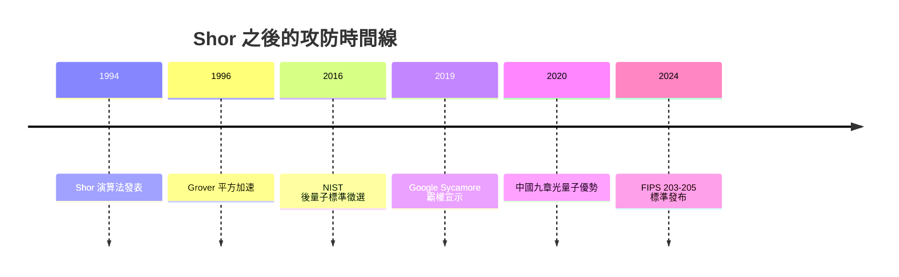

# 14.3 修爾演算法與量子霸權：密碼學的終極威脅

一九九四年春天，貝爾實驗室的數學家 Peter Shor 聽完一場關於量子計算的演講後，把自己關在辦公室裡搞了幾個星期。他原本只是好奇，想看看量子電腦「到底能做什麼」。結果他端出一道菜，讓全世界的情報機構與密碼學家一夕之間坐直了身體：一個在多項式時間內分解大整數質因數的量子演算法。

要理解這一擊的威力，得先回到一九七七年。MIT 的 Rivest、Shamir 與 Adleman 發明了 RSA 公鑰加密系統，其安全性建立在一個樸素的事實上：兩個大質數相乘極容易，但把乘積分解回質數卻極困難。對古典電腦而言，N 位整數的分解是超多項式難題；全世界電子商務、銀行傳輸、國家機密的鑰匙，全都掛在這條數學鴻溝上。一九九四年之前，這條鴻溝被認為是永恆的。

Shor 的洞見在於把分解問題轉化為求週期問題，再用量子傅立葉變換（QFT）「一口氣」讀出週期。古典電腦要對隨機數嘗試天文數字般的次數，量子電腦卻可以在 Hilbert 空間中同時讓所有路徑演化，然後用干涉把錯誤答案的振幅相消、正確答案的振幅相長。整個演算法的核心是五步：選隨機數 $a$、求 $a^x \bmod N$ 的週期 $r$、用連分數從 $r$ 找出 $N$ 的因數。而「求週期」那一步，正是量子傅立葉變換的主場。Shor 本人是個謙和的數論學者，事後回憶：「我只是拿別人已經做好的量子工具，去做數論家早已熟悉的問題。」但這份「謙虛」讓 RSA 大廈的地基被抽走——理論上，一台充分大的容錯量子電腦能用多項式時間完成古典超級電腦需要宇宙壽命的運算。

業界與政府的反應，是這段歷史中最值得玩味的部分。一九九〇年代末期，美國國安局（NSA）與英國 GCHQ 開始設立內部量子資訊計畫，GCHQ 甚至早已在七〇年代秘密研究過量子密鑰分發（後來才在一級解密中曝光）。二〇一六年，美國 NIST 正式啟動「後量子密碼學標準化」公開徵選；二〇二二年七月公布入選名單，CRYSTALS-Kyber（基於格問題的 KEM）、Dilithium、Falcon、SPHINCS+ 脫穎而出，二〇二四年八月正式發布 FIPS 203–205 標準。這場長達八年的公開競賽，本質上是在替整個數位文明換鎖——而且要趕在「先截後解」（harvest now, decrypt later）的陰影下完成：敵人可以今天錄下你的加密流量，等十年後有量子電腦再解密。

另一條攻防線是量子密碼學本身：不靠數學難題，而靠物理不可克隆——QKD 分發的鑰匙一旦被竊聽，量子態會被擾動，合法雙方立即察覺。一九八四年 Bennett 與 Brassard 提出 BB84 協議，二〇〇七年奧地利維也納完成首次實際部署，二〇一六中國的 Micius 衛星把千公里級 QKD 變成現實。於是全球態勢變成「以矛攻矛」：量子電腦威脅古典密碼，量子物理又提供新式城牆。

演算法側還有一九九六年 Grover 的平方加速搜索，迫使 AES 金鑰長度加倍。但 Shor 的威脅才是戰略級的，也因此催生了「量子霸權」（quantum supremacy，或更謹慎地稱 quantum advantage）的競賽——不必破解 RSA，只要證明量子裝置能完成任一古典不可企及的任務，就算戰略宣示。

二〇一九年十月，Google 在《Nature》發表論文：五十三個 qubit 的 Sycamore 處理器對隨機電路取樣，聲稱二十秒完成古典超級電腦需要一萬年的任務。IBM 隨即反駁，認為在有足夠磁碟與更聰明的演算法下，古典模擬只需要兩天半。爭議至今未歇——但因為「隨機電路取樣」本來就是刻意設計出沒有任何實用價值的難題，爭論的焦點是「驗證宣示」而非「實用性」。二〇二〇年十二月，中科大潘建偉團隊的「九章」光量子電腦發表另一種路線，以玻色取樣切入，宣稱十分鐘的運算是超算的六億年。中國和美國與歐盟在隨後十年，都把量子資訊列為戰略科技，設立國家量子計畫與科研聯盟，美國在一八年至一八年宣布「國家量子計畫法」（National Quantum Initiative Act），歐盟則公布「量子旗艦計畫」（Quantum Flagship，十億歐元預算），把量子資訊當成基礎設施來經營——這是三十年前費曼與多伊奇的純理論議題，被推上了地緣政治的牌桌。

從 Shor 到 Sycamore 的這一段歷史，是「理論閃電—工程長征」的典型劇本：一九九四年的紙上演算，花了二十年才等來五十幾個嘈雜 qubit 徒手做出「沒用的」隨機取樣。而真正的實用威脅——破解 RSA-2048——所需的容錯量子電腦至今未問世。但每一個國家的密碼學家都不敢等：換鎖是載入歷史書的事件，而 Shor 已經替它按下了倒數計時器。
