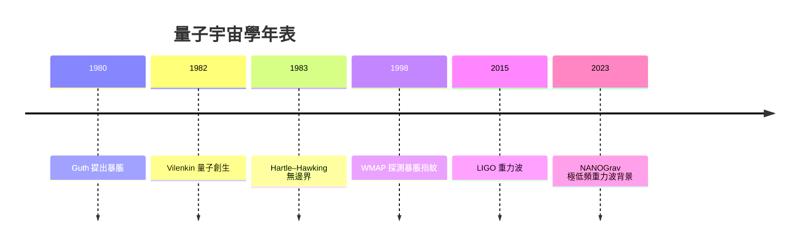

# 15.3 量子宇宙學：量子泡沫與從虛無誕生的時空

一九八〇年冬天，Alan Guth 在史丹佛線性加速器中心的研討會上，第一次展示他的「暴脹」（inflation）理論：宇宙在誕生後 $10^{-32}$ 秒內，經歷了指數級的急速膨脹，體積膨脹了至少 $10^{26}$ 倍。演講結束後，觀眾席上的蘇聯宇宙學家 Starobinsky 等人率先指出：這個想法在蘇聯早有先驅。Guth 當時還是一位九度轉校的苦命博士後，他本人的自述是：「這個想法之所以偉大，是因為它終於把幾個長期的謎題一次性打包解決了。」——平板問題（宇宙為何如此平坦）、視界問題（宇宙為何如此均勻）、磁單極問題。暴脹理論的特色在於：它把宇宙的初始條件從「神蹟」降格為「動力學」，從此宇宙不是被細心調校出來的，而是自動長成這樣的。

但理論走到「最初一瞬」時，還是要問：時間與空間本身是怎麼開始的？一九八三年，UCSB 詹姆斯．哈特爾（James Hartle）與霍金提出「無邊界假設」（no-boundary proposal），又稱 Hartle–Hawking 態。核心思想是：在初期宇宙的 Planck 尺度下，「時間」根本沒有定義——時間要像空間一樣，以虛數座標出現；宇宙因此成為一個四維的緊緻流形，沒有邊界、沒有奇異的起點，「就像問南極以南是什麼一樣沒有意義」。數學上，這就是所謂的無邊界波函數：
$$\Psi[h_{ij},\phi]\sim \sum_{\mathcal{M}}\;e^{-S(\mathcal{M})/(\hbar)}.$$
霍金後來在一九八八年《時間簡史》裡把這個概念通俗化：「宇宙有一個起點，但它不是一個『問什麼在它之前存在』都沒有意義的點——宇宙本身是自足的，不必被創造。」霍金的自傳性敘述顯示，他對宇宙學的熱情来自對「上帝是否在宇宙中擁有一席之地」的思想反叛：他相信物理定律足以自我說明。

與此同時，Tufts 大學的 Alex Vilenkin 在一九八二年提出了另一條路線：「量子創生」（quantum creation）。他主張宇宙可以從嚴格的「虛無」（nothing）中穿隧而來——「虛無」在這裡指的不是哲學上的絕對虛無，而是一個沒有時空、只有量子規律的初始態。Vilenkin 回憶，這個想法是他在望著窗外秋夜的流星時閃現的：「如果宇宙可以穿隧到一個二元化的存在，「宇宙為何能從虛無誕生」的問題，就有一個量子答案。」Hartle–Hawking 態與 Vilenkin 態數學上相近，哲學上差距微妙：前者是時間和空間共存的閉宇宙，後者主張時間從一個奇點的地平線上「滴出」。兩者的差異至今仍有爭論。

Wheeler 的「量子泡沫」（quantum foam）則提供了另一個更直觀的圖像：在 Planck 尺度下，時空像沸水一樣不斷冒出微小黑洞、蟲洞與虛粒子對，幾何本身在量子尺度上沸騰。Wheeler 是一位喜歡用色彩鮮艶的名詞替代數學符號的物理學家，「quantum foam」正是他給那個真實而無法直接觀測的海域起的綽號。這種離散性的期望，與 LQG 預言的面積量子化異曲同工，也和因果集（causal sets）、非交換幾何等路線形成了二十一世紀的量子重力「百派獨尊」。

宇宙學的暴脹理論本身也引出「泡泡宇宙」（bubble universes）與多重宇宙的爭議：若暴脹是量子漲落驅動的，那麼暴脹場可能在量子漲落中孕育出另一個宇宙，像我們這個宇宙一樣膨脹並創生自己。這一圖像把觀測問題變成哲學問題：「另一個宇宙的存在，是否可證偽？」一九〇〇年代，哲學家 Karl Popper 的可證偽性原則曾是科學的法庭律師；多位宇宙學家在二〇〇〇年代後的辯論中，主張多重宇宙論若不能給出任何可觀測預言，就應該歸入哲學而非物理學。

但觀測端也有進展。二〇〇九年發射的 WMAP 與其後繼者普朗克衛星，已在大爆炸輻射（CMB）溫度漲落的功率譜中，看到暴脹理論「刻」出來的指紋：光譜的斜率、振幅與微小負曲率，都與簡單暴脹模型高度吻合。二〇一四年，BICEP2 團隊一度宣布探測到引力波背景的原初訊號，但隨後證明那只是銀河系塵埃的訊號；真正的原初重力波訊號，需要對 CMB 中的 B-mode 極化更精確的測量——目前的上限已把若干簡單暴脹模型排除。另一個觀測窗口是脈衝星計時陣列（Pulsar Timing Array, PTA）：二〇二三年六月，NANOGrav 團隊十五年的觀測數據顯示出一個極低頻重力波背景訊號，可能源自超大質量黑洞雙星，也可能是宇宙相變或暴脹時代的殘響——這是人類第一次能夠「聽見」宇宙尺度的引力背景，也是對「量子泡沫」之外、大尺度証據的間接檢驗。

從費曼「用量子模擬量子」到 Hartle–Hawking 的「時間之外」，這本書的敘事就此環繞了一周：從普通的量子棲所，到宇宙本身的量子起源，量子力學早已不再是微觀世界的特殊規則，而是一切存在的普遍語法。免疫學家巴斯德曾說：「機遇偏愛有準備的頭腦。」Planck 尺度的疑問，也許要等數百年才能被實驗檢驗；但正是這些問題，把人類的思維從原子之城推上了宇宙之牆。
