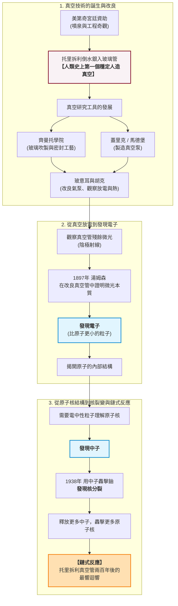

# 前言：歷史的蝴蝶翅膀

1641年的佛羅倫斯，皮蒂宮的工匠們正為一件事苦惱：大公爵府邸的新噴泉，水就是抽不上來。

這件事聽起來微不足道。一位義大利城邦的君主想要更壯觀的水景，工程師們卻發現，無論他們換多大的泵、多粗的管子，水最多只能被抽到約十公尺高，彷彿有一隻看不見的手，在十公尺處把水按住了。這個「工程瑕疵」困擾著宮廷，也困擾著已經雙目失明、生命將盡的伽利略。

誰也沒有想到，這隻看不見的手，最終會按在廣島與長崎的天空上。

本書要講述的，是一條橫跨三百年、貫穿兩大洲的因果鏈。它的第一環，是佛羅倫斯宮廷噴泉裡那截抽不上去的水柱；它的最後一環，是1945年7月16日凌晨，新墨西哥州沙漠上空騰起的那朵蘑菇雲。連接兩端的路徑是這樣的——

美第奇宮廷為了噴泉與工程奇觀，資助了托里拆利的實驗。托里拆利把水銀倒進玻璃管，製造出人類史上第一個穩定的人造真空。真空一旦可以製造，就需要更好的工具去研究它：齊曼托學院積累了玻璃吹製與密封的工藝，馬德堡的市長蓋里克造出了真空泵，玻意耳與胡克在英格蘭把氣泵改良到能反覆抽真空、能觀察真空中的放電與熱。玻璃管裡被抽空後殘餘的微光，後來被稱為陰極射線；1897年，湯姆森在改良過的真空管中證明，那微光是一種比原子更小的粒子——電子。電子揭開了原子的內部結構，而要理解原子核，人們又需要一種電中性的粒子：中子。1938年，中子被用來轟擊鈾，發現了核分裂；每一個分裂的原子核，都會釋放出更多的中子，去轟擊更多的核——這是鏈式反應，是托里拆利那根玻璃管裡「不存在的空間」，在兩百年後發出的最響亮的一聲迴響。

讀者可能會問：這條鏈條是不是事後的虛構？歷史學家確實警惕「輝格史觀」——用今天的結果去倒敘昨天，彷彿一切都朝著原子彈的終點必然前進。事實並非如此。托里拆利不是為了電子做實驗，玻意耳不是為了中子抽真空，他們各自面對的是自己時代的問題。但是，本書想論證的正是：**歷史不需要每個環節都有「最終目的」，它只需要每個環節都留下可被下一代使用的工具、工藝與知識。**真空技術如此，玻璃工藝如此，電學儀器如此。因果鏈不是預言，而是累積。

而累積，是需要燃料的。這是全書的第二條暗線：**資本與權力如何催化科學。**

托里拆利的研究，背後是美第奇家族的宮廷與金庫；齊曼托學院的每一件玻璃儀器，都是佛羅倫斯最頂尖工匠的手藝，由大公爵與親王買單；馬德堡半球的十六匹馬，是帝國自由市的市政財力；英國皇家學會的氣泵，有國王特許狀與貴族贊助人的身影；到了二十世紀，這條贊助之鏈的終點是「曼哈頓計畫」——人類史上第一個以國家之力、以二十億美元和十餘萬人力推動的科學工程。贊助的規模一路升級，贊助者的動機也從「奇觀與榮耀」走向「戰爭與毀滅」。技術是中性的鏈條，但扣動鏈條的手，從來都有名字：有的是美第奇大公，有的是羅斯福總統。

換句話說，這本書有兩條交織的敘事線。一條是**技術演進**：從水銀管到氣泵，從陰極射線管到迴旋加速器，每一次儀器的改良，都打開一扇通往更微小世界的門。另一條是**資本與政治**：從宮廷沙龍到皇家學會，從工業資本到戰時國家機器，每一次知識的躍進，背後都站著付錢的人。兩條線時而平行，時而纏繞，最終在1945年的三位一體試驗場匯合——那裡既有六十年真空技術與核物理的結晶，也有六十年戰爭政治與國家資源的總和。

本書無意歌頌原子彈，也無意把科學史寫成一群天才的偶像劇。我們想讓讀者看見的是：歷史中的每一個「小問題」——噴泉為什麼抽不上水、玻璃管為什麼會發光——都可能是巨大變革的起點；而每一筆「贊助」——大公的金幣、親王的玻璃、議會的預算、戰爭部的授權書——都在決定這些起點能走多遠。

蝴蝶扇動翅膀，風暴需要幾百年才能形成。現在，讓我們回到1641年的佛羅倫斯，回到那個失明的老人與那截抽不上去的水柱面前。

---

*下一章：第 1 章〈大公的噴泉與吸不上的水〉——十公尺的詛咒，與伽利略最後的猜測。*
