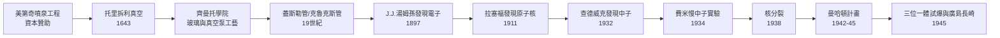

# 真空、粒子與連鎖反應：從美第奇的噴泉到曼哈頓的蘑菇雲

*The Chain Reaction: How Medici's Fountains, Torricelli's Vacuum, and Cathode Rays Built the Atomic Age*

一條始於 17 世紀佛羅倫斯宮廷噴泉、終於 1945 年新墨西哥沙漠的完整因果鏈。

## 全書因果鏈總覽

## 目錄

### 前言

* [00-前言-歷史的蝴蝶翅膀](00-前言-歷史的蝴蝶翅膀.md)

### 第一卷：資本、大氣與被破除的禁忌（17 世紀）

* [01-大公的噴泉與吸不上的水](01-大公的噴泉與吸不上的水.md)
* [02-倒轉的玻璃管與不存在的空間](02-倒轉的玻璃管與不存在的空間.md)
* [03-齊曼托學院與工藝革命](03-齊曼托學院與工藝革命.md)

### 第二卷：管中的幽靈與微觀世界（19 世紀）

* [04-玻璃管中的神祕微光](04-玻璃管中的神祕微光.md)
* [05-陰極射線與電子的獵手](05-陰極射線與電子的獵手.md)
* [06-開啟原子核的大門](06-開啟原子核的大門.md)

### 第三卷：不帶電的子彈與能量解鎖（20 世紀初～1930 年代）

* [07-密室裡的隱形客](07-密室裡的隱形客.md)
* [08-完美的微型子彈](08-完美的微型子彈.md)

### 第四卷：連鎖反應與終極力量（1930 年代～1945 年）

* [09-被切開的鈾原子核](09-被切開的鈾原子核.md)
* [10-從美第奇到愛因斯坦](10-從美第奇到愛因斯坦.md)
* [11-新墨西哥州的太陽](11-新墨西哥州的太陽.md)

### 結語

* [12-結語-科學因果律的啟示](12-結語-科學因果律的啟示.md)

---

### 本書三個核心看點

1. **非線性卻必然的技術演進**：沒有玻璃密封與真空泵的工藝積累，就沒有 CRT 管；沒有 CRT 管就發現不了電子，更談不上中子與核反應。
2. **「資金與權力」的暗線穿梭**：從美第奇家族的宮廷贊助到美國政府的數十億美元，科學突破從不孤立存在。
3. **引人入勝的人物群像**：托里拆利、蓋斯勒、湯姆孫、查德威克、邁特納、奧本海默——跨越 300 年的知識火炬傳遞。
