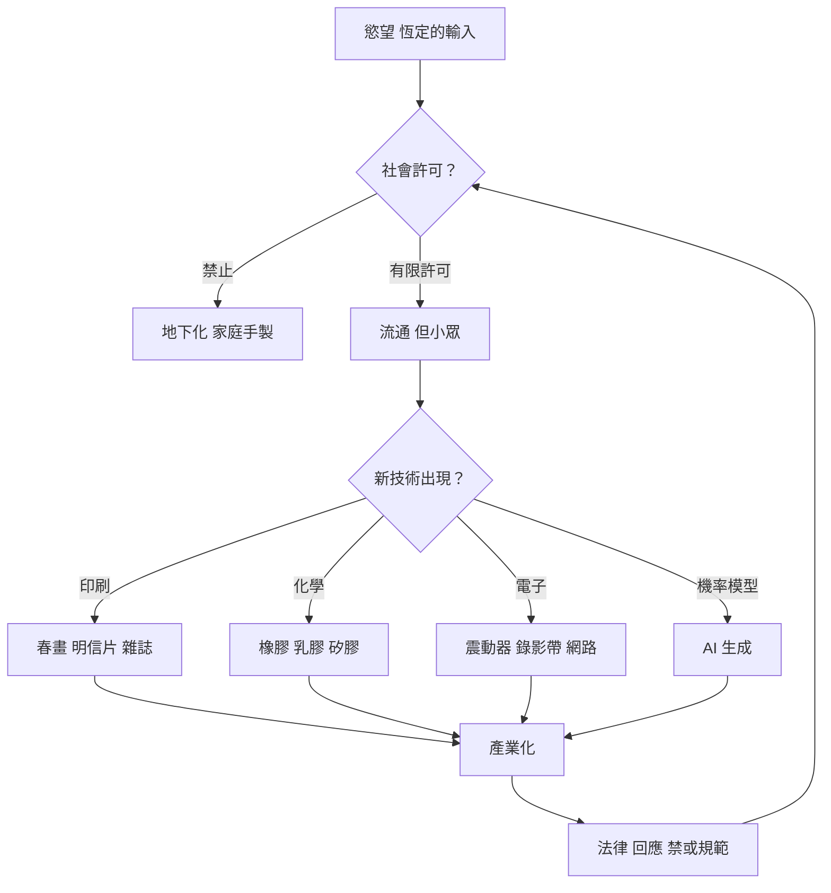

# 第 0 章 · 前言 慾望的工程學：人類如何把性愛變成可製造的東西

有一種歷史學的寫法，把性愛科技的故事講成「技術進步史」：從皮革到橡膠、從橡膠到乳膠、從馬達到 App、從 App 到語言模型。這種寫法很流暢，但幾乎一定是錯的。

因為每一件性愛器材的出現，幾乎從來不是因為「技術準備好了」，而是因為別的事情先發生了：城市出現了孤獨的工人階級、戰爭帶來了梅毒的恐慌、教會與國家的路線之争、電影工業需要一個能持續賺錢的類型、網路把注意力變成了一種可以出租的商品、疫情把人關在家裡、生成式模型把「影像」從一個需要拍攝的世界變成了一個可以用機率分布描述的世界。

性愛科技的真正歷史，是一部「慾望如何被制度化的歷史」。

## 慾望一直存在，技術一直在等

先談一個容易被忽略的事實：人類製造性器具的能力，遠比大多數歷史教科書讓人印象中成熟得多。

上舊石器時代的德國霍勒費爾斯（Hohle Fels）洞穴裡，科學家挖到一根約三萬年前的泥岩柱，長約二十公分，形狀毫不含糊。2016 年《自然》雜誌報導它極可能是古代人的自慰器；同一批考古發現裡還有約一萬三千到一萬九千年前的雙頭製品。中國的考古紀錄裡，「角先生」這類假陽具的形制可追溯到漢代中山靖王墓的青銅件；明清的色情小說裡，它已經是木製或陶製的日常商品，寫在紙上像寫一支毛筆那樣輕鬆。十六世紀的日本有「甲形」——用龜甲或獸角做成、只套住龜頭的器具；同一時期荷蘭商人又把「上等皮革」做成的全套皮套輸入日本，這是第一批「全尺寸」的商品化保險套。

也就是說，人類在工業革命前就已經有：矽膠的前身（獸角、皮革）、矽膠的前身（陶瓷、木）、震動器的前身（手動的、靠肌肉收縮的、靠溫熱的）、以及一套相當成熟的生理學知識。

那麼為什麼這些東西花了兩千年才「升級」？

答案很簡單：因為在工業化之前，製造一件性器具的成本，主要不是材料和技術，而是社會許可。一個人可以在家裡偷偷做一個木頭的東西；但他不能公開生產、運輸、銷售它。他不能為它做廣告。他不能在街上展示。他不能把它編入公司章程、印在包裝上、寄到地球另一邊。

換句話說，性器具一直是「有市場、無產業」的狀態。它有消費者，但沒有生產者、沒有流通、沒有金融、沒有法律。

而所有近代的性愛科技故事，說到底都是「這件事終於變成了產業」的歷史。產業意味著：可以量產、可以融資、可以上市、可以打官司、也可以被禁止。

## 五個驅動力

把全書的因果鏈抽出來看，性愛科技的歷史由五個驅動力反覆推動：

第一是戰爭與疾病。梅毒在 1490 年代進入歐洲，殺死的年輕男性比例高到讓醫學界不得不尋找「物理屏障」；一次大戰期間的性病流行，讓德國率先在軍隊裡推廣保險套，而美國在一戰中堅持只發禁欲海報；1981 年之後的愛滋病，則是二十世紀最大的一次「保險套國家化」。

第二是印刷、攝影與傳播技術。塔爾博的卡羅法照相術（1841）讓裸體影像第一次可以大量複本；1880 年的半調網版印刷讓色情第一次成為真正的大眾消費品；春畫的禁令、Comstock 法、1986 年 Meese 委員會報告、2025 年各國的年齡驗證法，每一次技術進步都撞上一道法律牆。

第三是資本與注意力。VHS 勝出 Betamax 的關鍵原因之一，是成人影片產業的轉移；Pornhub 的商業模型是廣告而非訂閱；OnlyFans 的模型是抽成訂閱；它們賴以生存的不是「人們更想要色情了」，而是「人們更願意為注意力付款了」。

第四是人口與家庭制度。1980 年代中國的計畫生育政策把安全套變成了免費發放品，同時把性用品產業推進了空白地帶；日本戰後的人口結構與獨身經濟，催生了比任何國家都發達的成人影片產業。

第五是藝術與科學。Bellmer 的人偶把「娃娃」從色情商品提升為前衛藝術；愛因斯坦的相對論、AlphaFold、Stable Diffusion——這些技術本身對性沒有興趣，但它們改變了「一個看起來像人的東西」能被製造出來的成本。

這張圖想說的正是全書的結構：不是「技術越來越新」，而是「禁令與解禁的反覆」推著技術一代一代地改變形態。任何一次技術躍遷之後，緊跟著的必然是制度反應；而制度反應又會製造出下一個技術需求——例如年齡驗證技術，就直接催生了 2025 年一批「AI 脫衣」偵測與驗證的商業軟體。

## 這本書不做什麼

首先，它不是一部實用指南。全書不談任何具體產品的購買建議，也不評測性能。

其次，它不打算為任何形態的色情內容辯護，也不試圖證明什麼東西「應該被允許」。書中出現的每一樁審查、封鎖、訴訟與禁令，都會被當作歷史事件記錄，包含它的法律理由與它的實際效果——包括「禁令為何無效」與「禁令如何製造了更大的地下市場」。

第三，它不迴避最難的部分。性愛科技史裡有一條真的、會流血的路：從十九世紀把自慰當作精神疾病的醫學，到二十世紀為「治療」自慰而設計的鐵製防自慰裝置，再到二戰期間的強迫性交的社會化，再到今天用生成式模型製造非自願私密影像的產業鏈。這條線在本書裡不會被處理成「簡單的道德寓言」，因為它本來就不是。

## 怎麼讀

如果只想讀一段，建議從「第三章：保險套的兩千年」開始。因為保險套是這整個領域裡唯一一件「技術簡單、社會複雜」的東西：它的功能從來不是新的，它只是不斷地被允許、被禁止、被納入國家政策、被用來做意識形態鬥爭。它是人類慾望與公共衛生、道德恐慌與個人自由之間，最長的一條實驗記錄。

而如果想看「未來」，直接跳到第八章：AI 伴侶與深偽色情。那一章裡的每一件事都已經發生——不是預測，是已發生的訴訟、已生效的禁令、已破產的公司。

## 最後一點：名字的問題

「保險套」、「按摩棒」、「自慰套」、「AV」、「矽膠娃娃」、「AI 影片」，這六個詞涵蓋了本書幾乎所有的年代。這些詞本身都是技術的產物。

「condom」一詞的詞源至今不明——1981 年語言學者 William E. Kruck 研究的結論是「它的起源仍然完全不明」。它不來自任何一位發明家的名字。也就是說，人類在十七世紀就開始使用這玩意兒，卻用了三百年的時間才決定怎麼稱呼它。

而「AV」這個詞是 1983 年由日本導演小路谷俊樹創造的，用來指那些以攝影機拍攝、以家庭錄影形式流通的影片。當一個產業需要一個專門名詞的時候，通常意味著它已經存在一段時間，而且已經被辨認出是一種「不同於電影的東西」。

名字總是晚於事物。而這個落後，往往就是最有趣的部分。

那麼，讓我們從最老的東西開始——一個在 1490 年代被醫生用來對付梅毒的、用亞麻布做的小袋子。
