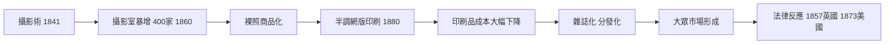

# 第 2 章 · 第 3 節 春畫：一套把姿勢分類學變成商品的印刷技術

## 十三世紀到江戶：浮世繪的性愛宇宙

春畫（しゅんが / shunga）大約在 13 世紀出現，在**江戶時代（1603–1867）**達到鼎盛。

它的形式多種多樣，最著名的是 12 圖合冊「**enpon**」，以及另一種帶圖冊「**kashi-honya**」流通到鄉間的形式。

代表作家包括：菱川師宣《**小むらさき**》、勝川春章《**絵本色好之人式**》、鳥居清長《**色道十二番**》、喜多川歌麿《**歌まくら**》、歌川豐國《**逢世雁之聲**》、葛飾北齋《**萬福和合神**》、溪齋英泉《**夢多滿佳話**》、歌川國芳《**華古與見**》。

這些名字裡面，**喜多川歌麿**是最關鍵的一個。他建立了「**大首繪**」這一體裁：把单个的巨大的女性頭部畫滿畫面，這在技術上是浮世繪的一次革命——因為版畫的難度集中在臉部的細節上，而歌麿與他的出版社（蔦屋重右衛門的「蔦屋版」）在 1780 年代把浮世繪從「便宜的民間版畫」推到了「可以作為藝術品收藏」的地位。

**這裡有一個直接的因果鏈：版畫技藝的進步 → 單一主題的表現力上限被推高 → 出版商願意投入 → 讀者群擴大 → 市場形成 → 政治當局必須管制。**

## 三次禁令，以及禁令為何反而成就了它

- **1661 年**：德川幕府首次頒布禁「好色本」令。
- **1722 年（享保改革）**：更嚴。令出版需町奉行許可，春畫轉入地下。
- **1790 年代（寬政改革）**：再禁。

三次禁令的結果，是春畫從**合法商品**變成了**地下商品**。

而地下商品有地下商品的優勢：**更高的價格、更強的社群連結（町人network）、更保守的內容（因為要面對熟客，品質要求更高）、更強的轉手收藏價值。**

這是一個反覆出現的經濟學現象：**對一個文化品的鎮壓，往往提高了它的單位價值，並強化了它的社區意義。** 禁酒令製造了地下酒吧，《Comstock 法》製造了地下色情郵購，《1934 年日本刑法 175 條》製造了AV產業的跨國遷移。

值得注意的是：**禁令沒有消滅春畫，反而把它從「町人普遍消費品」重新定義為「懂行的人的收藏品」**——而這個轉換，才是讓它能在明治時期慘遭相機擊敗之後，仍然保有價值的關鍵。

## 明治的殘酷打擊：印刷對攝影

1868 到 1912 年明治初期，攝影術傳入日本。

印刷版春畫無法與情色照片競爭。春畫衰退了。

為什麼？因為春畫的核心賣點是**版畫的線條與構圖**——這是一種「繪畫性」的吸引力。而照片的核心賣點是**真實性與細節的豐富度**。當同一個市場（町人男性的私密消費）被一個更好的技術侵入時，前者沒有防禦能力。

**這是所有既有媒體的共同命運：印刷品被照片擊敗，照片被電影擊敗，黑白照片被彩色照片擊敗，實拍影像被生成式影像擊敗。**

而同一時期，在地球的另一邊——法國——同樣的新技術正在做同樣的事。

## 法國明信片：一個失控的攝影產業

1841 年，Louis Daguerre 與 William Henry Fox Talbot 分別取得卡羅法（calotype）與鹽印法專利，影像第一次可以大量複本。

**1848 年，巴黎只有 13 家攝影室；1860 年，超過 400 家。** 其中多數靠販賣裸照維生。

1855 年起，攝影室不再以「académie」（繪畫人體習作）的名義登記裸照攝影，業務轉入地下。

照片多以 **4、8、12 張成組出售**，主要出口英美。

這些東西有個名字，人們現在稱之為「**French postcards**」，但嚴格說那是 1890 年代末才出現的說法——更早的用法是 **cartes de visite**（CDV，即「拜訪卡」）。CDV 是 1850 到 1860 年代的攝影名片格式，一整套放在相簿裡送人，是維多利亞時代的社交媒介。

**CDV 的普及，是「帶有身體的個人」第一次可以隨手分發的社會事實。** 這是一個巨大的技術變化：在此之前，一個人的影像需要一個藝術家、一個小時、和一套暗房；在此之後，一個人可以擁有一百張自己的照片。

而正是這個技術變化，製造了「可以販售的陌生人的身體」。

## 1880 年：半調印刷，色情第一次成為大眾市場

1880 到 1880 年，**半調印刷（halftone）**首次實現了照片的廉價複製。

這是一個印刷技術上的關鍵突破：把連續調的灰階轉換成網點，就可以用普通的凸版印刷機印出照片。於是**雜誌和報紙可以印照片了**。

結果是：**色情第一次成為真正的大眾市場。**

1879 到 1880 年，《The Pearl》出了 18 期。1880 年之後，法國出現《Photo Bits》《Body in Art》等偽裝為藝術或裸體主義的雜誌；英國有《Health and Efficiency》（1900）與《Camera》（Harrison Marks 與 Pamela Green）。

**這裡有一個關於產業形成的通用規律：**

順著這條鏈走，就會看到「色情」在法律上的出現不是道德突然變壞，而是**技術讓它第一次有了可被大規模生產與傳播的物質載體**。

## 1857 年：法律的第一個反應

英文 "pornography" 一詞首次見於 **1857 年**的英國醫學辭典，定義是「對妓女或賣淫的描述，作為公共衛生事項」。**1864 年**，韋氏辭典收錄現代義。

同年，英國《**淫穢出版物法**》（Obscene Publications Act 1857）成為**全球第一部刑事化色情的法律**。

這個順序非常關鍵：先是技術讓色情成為大眾消費品（1840–1880），然後法律才把它刑事化（1857 起）。**法律是產業的回應，不是道德的表達。**

而在美國，同一時期的推手是一個人：**Anthony Comstock**。

1866 年 2 月，紐約 YMCA 執行委員會分發了 Cephas Brainerd 與 Robert McBurney 的備忘錄《關於紐約作為年輕人道德與基督教努力之_fields》，促成 **1868 年**的州反淫穢法。Comstock 藉此進入反淫穢運動，1872 年以騎附於《郵政合併法》的形式促成首版法案，1873 年推動獨立法。

Comstock 任郵政檢查員期間做成**超過 3,600 次逮捕，銷毀超過 160 噸被裁定為淫穢的物品**。

3,600 次逮捕與 160 噸——這兩個數字，比任何道德說教都更清楚地說明了**審查制度的真實規模：它是一支大規模的、持續的、國家資助的銷毀生產線**。

而第一章提過的那個場景——1890 年，Julius Schmid 因藏有近 700 只安全套被 Comstock 逮捕——正是這條生產線上的一個小插曲。

## 「社交衛生」運動：一個被遺忘的重要轉折

在 Comstock 之前，還有另一條線：**YMCA 的「社交衛生」（Social Hygiene）運動**。

它的核心理念與反淫穢運動截然不同：它主張性是可以被管理的，只要透過科學的性教育、醫學檢查、社會改革，就能減少賣淫與性病。

這個運動在 1910 到 1930 年代推動了**性教育進入公立學校**——這是第一次，在美國的公共教育系統裡，出現了關於性傳播疾病與其傳播途徑的正式教學。

但這些課程**教的核心是「禁欲是唯一的避免方法」**。安全套因為被視為「鼓勵性行為」而未被推廣。

**這是一個關鍵的結構性事實：性教育進入公共系統的那個時代，正是安全套在公共政策中最受排斥的時代。** 兩者並存了半個多世紀。

而 1910 年，Comstock 逝世。同一年，美國國會通過了《**白奴法**》（Mann Act），禁止跨州販運女性——這是後來「人口販運恐慌」的源頭，也是反賣淫運動的下一個階段。

## 一個必要的對照：龐貝的街面

回到龐貝的街面上刻著的陽具圖案。

龐貝被火山灰掩埋於公元 79 年，那些刻痕因此完好保存了兩千年。而我們對它們的理解是：**它們是當時日常生活的一部分，是人們走過時低頭就能看見的東西**，而且它們出現在公共空間。

對照 1873 年之後的美國，一個男性如果郵寄了一本描述性行為的小冊子（Knowlton 的《人生的果實》），他會被逮捕。

**同樣的人類，同樣的慾望，在不同技術與制度條件下，產生了「街上的符號」與「獄中的重刑」兩種截然不同的社會結果。**

差別不在於人性。差別在於：

1. 印刷技術的成本與速度，讓小冊子第一次能與教會的印刷能力對等。
2. 郵政這個基礎設施的存在，讓國家第一次能對性內容進行**大規模、遠距離、可記錄的**審查。
3. 工業化社會的資訊流動速度，超過了道德規範的傳播速度。

**審查制度是一項基礎設施，不是一種心態。** 這句話應該被寫在每一本談論性與技術的書的開頭。

下一章，我們進入二十世紀中期那場最激烈的媒體技術戰爭：錄影帶。而它的核心問題是——**一部攝影機，是一個消費者，還是一個工廠？** 這個問題將決定 AV 產業能否存在，也決定了它將如何存在。

而在進入那一章之前，我們先要處理那個至今仍是最羞恥、最有效、也最具有諷刺意味的技術發明：**那本叫 *Onania* 的小冊子**，以及它所開啟的、把人類的身體變成「需要被治理的資源」的醫學傳統。
