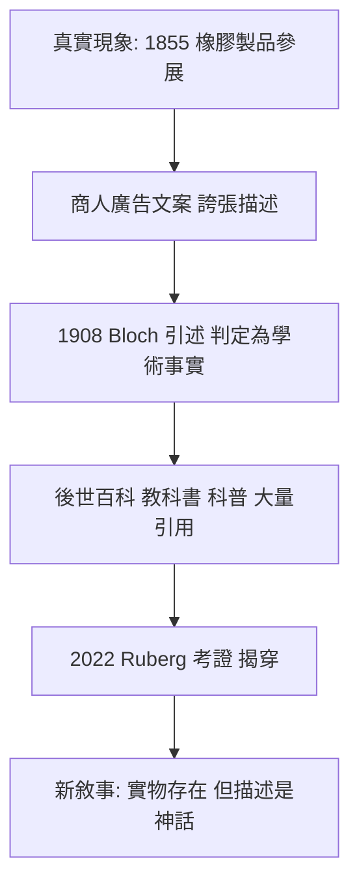

# 第 6 章 · 第 1 節 1855 年的橡膠人偶：一個被神話掩蓋的工業起點

## 1855 年，《費加羅報》

性玩偶作為商品，最早出現於 **19 世紀 50 年代的法國**，透過橡膠製品雜誌以「**橡膠女人**」（*femmes en caoutchouc*）出售。

它們出現的時機，與兩個大事件同步：**19 世紀的巴西橡膠繁榮**，以及**硫化橡膠的發明**。

而最早有文獻記錄的橡膠性玩偶，出現在法國報紙《**費加羅報**》（*Le Figaro*）的一篇報導中，內容是 **1855 年巴黎世界博覽會**上展出的美國橡膠製品。

**1855 年。** 這一年，Goodyear 剛剛為硫化橡膠申請到專利；這一年，攝影術剛剛讓「可複製的圖像」變成可能；這一年，Comstock 還要再等 18 年才會進入郵政部門。

**而同一個世界博覽會上，也擺滿了法國的第二帝國與英國的工業奇蹟。** 1855 年巴黎世博會是第二帝國的宣傳高峰，而性玩偶就擺在工業展品之間。

**這個畫面本身就是全書的主題：性器具的工業化，與工業化本身是同一個過程。**

## 一個被學術界拆穿的神話

1908 年，德國性學家 **Iwan Bloch** 在《*The Sexual Life of Our Time*》中記載了這些玩偶。他描述得極為生動：整具男性或女性身體由橡膠與其他塑膠材料製成，生殖器「以最接近自然的方式表現」，甚至連 Bartholin 腺的分泌都藉由填充了油的「氣動管」模擬，射精也以流體與適當裝置模擬；這些「人工人類」實際上在某些製造商的「巴黎橡膠製品目錄」中販售。

Bloch 這段描述，是「性玩偶起源史」的標準引用來源。**而它基本上是錯的。**

史學家 **Bo Ruberg** 在 2022 年 MIT Press 的專著《*Sex Dolls at Sea: Imagined Histories of Sexual Technologies*》中，用整整一章拆解了這個神話：

- Bloch 的敘述**大量依賴虛構來源**——René Schwaeblé 的短篇集《*Les Détraquées de Paris*》，以及化名 Alphone Momas 的小說《*La Femme endormie*》。
- **「唯一的一手來源是誇張的廣告文案。」**

**這是一個非常值得記住的案例。**

一個在 1908 年看起來是「權威性學著作」的段落，在 2022 年被證明其來源是**小說與廣告文案**。而在這 114 年裡，這段描述被無數書（包括「性愛科技」類的科普書）當成史實引用。

**它的教訓不只關於性玩偶。** 這是一個關於「二手權威」如何生產「不存在的過去」的典型案例：

**而這還不是最驚人的部分。最驚人的是接下來的那個神話。**

## dame de voyage：一個被誤讀了 130 年的詞

**長期以來，人們相信性玩偶起源於 16 世紀的法國與西班牙水手，在漫長孤單的航行中用縫製的布偶或舊衣服自慰。**

Ruberg 的考證結果：

- **dame de voyage** 這個詞**最早出現於 1893 年**的一篇短篇小說裡，而且指的是**性工作者**，不是性玩偶。
- 直到 **1920 年代**，「dame de voyage」（不帶 *en caoutchouc*）才轉指性玩偶。
- 水手使用玩偶的最早記錄出現在 **1880 年代的色情文學**裡。
- 1900 年代初法國確實有面向水手的橡膠人偶廣告，**但沒有檔案證據顯示海上普遍使用**。

**一個詞被用了六十年才轉移意義，而一個用六十年才轉移意義的詞，其起源敘事被反向投射了三百多年。**

這個案例的價值不在於「性玩偶不是水手發明的」這個事實本身，而在於它揭示的**機制**：

**當一個技術的實際使用者是「邊緣群體」（水手、囚犯、旅人、獨居者），而它的使用是私密的，那麼它的歷史必然會被神話化。** 因為留下檔案的是評論者與作家，不是使用者。

**而這個機制在今天仍然在運作，只不過主角換成了 AI 生成內容。**

## Dutch wife：東方主義的替代品

另一個神話是「Dutch wife」（荷蘭妻子）。它的真實來源是東亞（中國、日本、東南亞）普遍存在的消暑器具「**竹夫人**」（bamboo wife）——一個竹製或藤製的抱枕，用來把四肢架空、離開汗濕的床單。

英國維基百科對這個詞的評語極為直白：

> 這個概念實際上是「歐洲男性與亞洲女性性交的東方主義／殖民幻想」的替代物。

而它確實在語言中存活了下來：**日文的「ダッチワイフ」（Dutch wife）至今仍用來指稱較廉價的性娃娃。**

**所以，一個涼爽用的竹枕，因為被歐洲男性想像成一個「不會說話的亞洲妻子」，變成了一個性用品的類別名。**

**這個詞的演化史，濃縮了整整三百年西方男性對「可替代的女性」的想像史。** 而 2020 年代的「AI Girlfriend」產業，是這條想像史的第四個版本。

## 1918 年：Alma 人偶

**1918 年**，奧地利藝術家 **Oskar Kokoschka** 在德累斯頓向德國木偶師 **Hermine Moos** 訂製了一具等身的 **Alma Mahler**（他愛慕的女人）人偶。

這具人偶沒有讓 Kokoschka 滿意，他在一場派對上把它毀掉了。

**這是「性玩偶」與「藝術」之間的分界線上的一個關鍵案例。** 同一個物件，在木偶師的鋪子裡是商品，在藝術家手裡是表現。而 Kokoschka 毀掉它的理由——「不滿意」——說明他要求的不是性功能，而是**另一種東西的準確度**。

## Hans Bellmer：現代性玩偶之父

德國超現實主義藝術家 **Hans Bellmer**（1902–1975）被稱為「現代性玩偶之父」。

他的創作歷程：

- **1933 年**（希特勒上台後）與工程師弟弟 Fritz 開始製作等身女性人偶：第一具由木、亞麻纖維、石膏與膠構成，面具式頭、玻璃眼、假髮、**無手臂**，僅有骨架式框架。
- **1934 年**自費私下印行《*Die Puppe*》（《人偶》），含第一具人偶的 10 張黑白照片。
- **1934–35 冬**《*Minotaure*》超現實主義刊以 18 張照片介紹。
- **1935 年**在**球窩關節（ball joint）**原理下製作第二具人偶（球形腹部），受柏林 Kaiser Friedrich Museum 16 世紀可動木偶啟發；1935–1938 年拍攝逾百張影像。
- **1936 年**法文版《*La Poupée*》出版。
- **1947 年**為 Georges Bataille《*Histoire de l'œil*》巴黎秘密版作 6 幅蝕刻。

**Bellmer 的技術貢獻是具體的：球窩關節。** 這是一個非常簡單的機械設計，但它第一次讓一個人偶可以在多個方向上被擺姿勢，而且**可以重複任意次而不會像關節那樣卡死**。

**而球窩關節正是今天所有現代矽膠娃娃骨架的核心技術。** 從 Bellmer 1935 年到 RealDoll 1996 年，中間隔了六十一年。

Bellmer 的重要性還在於他**把玩偶從色情商品提升為前衛藝術**：這使得它在戰後能被 Braque、Ernst 等超現實主義圈接受，也使得它避開了「淫穢物品」的認定。**藝術標籤是一種法律保護。** 這與 1990 年代日本的「適正 AV」（合法馬賽克）與 2020 年代的「AI 藝術標記」在結構上是同一件事。

## 「Borghild 計畫」：一個必須被拆穿的謠言

有一個流傳極廣的說法：**納粹德國在二戰期間為士兵製造性玩偶（Borghild Project）**。

**此事未獲可靠來源證實，現被視為謊言（hoax）。** Boing Boing 在 2011 年 11 月 3 日也有拆穿報導。

**為什麼這個謠言會流行？** 因為它滿足了三個心理需求：它讓技術史有一個「起源時刻」，它讓戰時的黑暗有一個具体的物件，而且——**它是一個關於「人可以被製造成工具」的隱喻。**

**而我們將在第八章看到完全相同的敘事結構在 AI 時代重演。** 只是這一次，謠言不是「納粹的機器人」，而是「我們的 AI 伴侶」。

## 現代商品性玩偶的源頭：Bild Lilli

**1950 年代的德國 Bild Lilli 玩偶**，被廣泛認為是 **Barbie 娃娃**的靈感來源。

**這個關聯本身就是一則性玩具產業史。**

Bild Lilli 原本是德國漫畫家 **Reinhard Beuthien** 創作的一個成人漫畫角色——一個精明、性感、會賄賂男人的富家女。1953 年，漫畫被停刊後，娃娃公司把角色形象做成 12 吋的布娃娃，大受歡迎。

**1955 年，美國的 Mattel 看到並授權推出了 Barbie。**

所以，**Barbie 這個二十世紀最有影響力的玩具之一，最初是一個德國成人漫畫角色的衍生品。**

**這條線在文獻學上非常有趣，但更重要的是它的結構：** 一個原本只在成人男性消費的媒介形象（漫畫），轉為可攜帶的物件（娃娃），再轉為面向兒童的全球商品。

**而 1968 年，充氣娃娃首次在色情雜誌上投放廣告並可郵購。** 這一年，恰好在 Barbie 問世 13 年之後。

**於是玩具產業與性用品產業，在 1960 年代完成了一次交會。** 這次交會的技術基礎是同一套東西：乙烯基（vinyl）、塑膠模具、可翻模的造型技術。

**下一節我們就會看到，這套技術在 1980 年代如何進入日本，如何催生了Orient 工業，如何在 2010 年代被中國工廠接手，並最終變成了今天全球最大的一個「性愛科技」產業鏈。**
