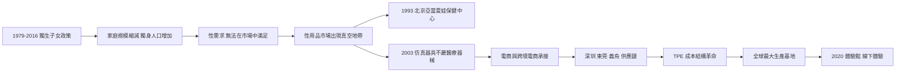

# 第 6 章 · 第 2 節 Orient 與 RealDoll：一個店老闆、一次裁縫機罷工，和一個國家的計生政策

## 1977 年，上野的一間成人用品店

Orient 工業的創辦人 **土屋日出夫**。

他原本是**駐日美軍專用搬家業**業者，後來在上野、淺草經營成人用品店。他的轉折點是一個非常具體的產品觀察：

**店裡的「荷蘭妻」（即充氣娃娃）漏氣嚴重，實用性與同店銷售的女性用振動器相比過低。**

於是他賣掉店鋪，用這筆資金在 **1977 年**創立公司（原名 **有限会社ツチヤ商会**），開發男性向的荷蘭妻。

**注意這個起源敘事的結構：它不是「發明家看到未來」，而是「零售商用產品缺陷發現了一個未被滿足的需求」。** 這是性用品產業最典型的創新來源——不是發明，而是**對既有產品的失望**。

而 Orient 的第一年，據日文維基記載，創業當年頭只面向殘疾人銷售，郵購需出示殘障手冊複印件。

**這個細節極其重要，因為它是「輔助生殖／性輔助器具」與「情色用品」之間那條模糊邊界的實例。** 從 1855 年巴黎的橡膠製品，到 1977 年東京的殘疾人專賣，直到 2003 年中國政府把「仿真式性輔助器具」正式劃出醫療器械體系——**「這是醫療輔助器具還是情趣用品」這個分類問題，貫穿了兩百年。**

## 從 38,000 日元到 560,000 日元

Orient 的產品演化，是一次**長期的、漸進的、針對具體物理缺陷的工程改進**：

| 年份 | 產品 | 技術 | 價格 |
|---|---|---|---|
| 1977 | **微笑（ほほえみ）** | 僅軀幹，無四肢 | 38,000 日元（當時行情 1–2 萬） |
| 1982 | **面影（おもかげ）** | 發泡聚氨酯骨架 + 橡膠／乳膠皮膚；**可承受使用者體重至 120 kg**；**開腿至 90 度**；造型取自菲律賓人模型 | 158,000 日元 |
| 1987 | **影身（かげみ）** | 部分關節可動 | |
| 1992 | **影華（えいか）** | | |
| 1997 | **華三姊妹** | **首次提供頭部三選一** | |
| 1997 | **明日香** | 「面影」系改為軟乙烯基 | |
| 1999 | **阿麗斯（アリス）** | 全身軟乙烯基，身高 **140 cm** 的少女系小尺寸 | 大 hit，**銷量為此前 5–6 倍** |
| 2001 | **プチジュエル アリス** | 開發 2 年後推出**矽膠版**小尺寸 | **560,000 日元**；首批限 **50 台**，**開賣 20 分鐘內接單 120 件**，隨後停止接單 3 個月 |

**請仔細看 1982 年的「面影」那三個數字：120 kg、90 度。**

這是整個產業的技術史濃縮：**「面影」的關鍵改進不是外觀，而是承重與關節角度。** 因為一個不能承受使用者體重、或不能開腿到 90 度的玩偶，在功能上就幾乎不可用。

**而 1999 年的「阿麗斯」是另一個方向的轉折：把身高縮到 140 cm。** 銷量是此前的 5–6 倍。

**這是一個極其露骨、卻完全符合經濟學的產品決策。** 140 cm 的身高在現實中對應的是一個小尺寸女性，而成人玩具市場的實際消費者結構（獨身、與伴侶身高差距大、尋找特定體型），使得「小尺寸」成為一個巨大的市場。**2001 年的矽膠版「プチジュエル アリス」定價 56 萬日元的 20 分鐘售罄，是這個市場旺盛程度的直接證據。**

## 硅膠：一個材料的革命

在 1980 年代，玩偶的皮膚材料是橡膠與乳膠（由 Orient 自己製造）。而 2001 年 Orient 推出自己的矽膠版時，這是一個跨產業的技術轉移——**矽膠技術原來是電影特效與醫療植入物的產業。**

**從乙烯基到矽膠的轉移，帶來了三個質變：**

1. **觸感**：矽膠能模擬人類皮膚的柔軟度與體溫傳導，而乙烯基不能。
2. **耐久**：乙烯基會隨時間氧化、變硬、龜裂；矽膠不會。
3. **可模組化**：矽膠可以分件製造（軀幹、頭、四肢分開），這是它能被「交換頭部」的技術前提。

**而矽膠本身有兩代：錫硫（tin-cure）與鉑金（platinum-cure）。**

**RealDoll 的製造者 Matt McMullen 自 1997 年起製作錫硫矽膠的仿真人體模型，並於 2009 年 6 月改用鉑金矽膠，全行業跟隨。**

鉑金矽膠更耐久、不易撕裂、也更不易留下壓縮痕。這是一次由單一公司推動、整個產業跟進的技術升級。

**而第三個關鍵轉折發生在 2012 年前後：TPE（熱塑性彈性體）的普及，主要由中國廠商推動。**

TPE 的意義是**成本結構的徹底改變**：

- 矽膠：貴、慢（模具與固化時間長）、品質上限高。
- TPE：便宜、快、可量產、**但質感略遜**。

**TPE 把「全尺寸矽膠娃娃」的價格從「數十萬日元的收藏品」拉到了「數千元人民幣的消費品」。**

**這是整個產業從「藝術品/收藏品」走向「大眾商品」的關鍵一步——而且這一步是中國完成的。**

## 價格結構與全球市場

日文維基引《南極1號伝説》的價格結構：

- 等身矽膠娃娃：重 **20–35 kg**，價位 **50–60 萬日元**
- TPE 製品：**10 萬日元起**

而 2023 年 eBay 上的全尺寸 TPE 全身体娃娃約 **200–1,000 美元**，**價格大致按每磅 5 美元遞增**。矽膠或 TPE 娃娃的重量約為等體積真人的一半。

**「每磅 5 美元」是一個非常能說明產業性質的定價公式**：它說明這個產業已經變成了一個**以原料重量為主要成本項目的物流與材料產業**。

寫成定價式：

$$
P = c_{m} \cdot W + c_{f}
$$

其中  $1$  是成品重量、$c_{m} \approx 5$ 美元／磅是材料與物流的邊際成本、$c_{f}$ 是固定的模具與頭部開發成本。$c_{f}$ 之所以能夠被攤薄，正因為它是一次性的：模具是共享的，而材料是逐件的。

**這個式子解釋了整個產業的地理遷移。** 因為  $1$  是線性的，所以產地必須靠近兩樣東西：**廉價的 TPE 原料，以及集裝箱港口。** 中國同時擁有兩者——深圳、東莞、義烏，加上全球最密集的港口群。

**而它也解釋了為什麼 2010 年代之後中國廠商能壓低全球價格：不是技術突破，而是把  $1$  這個係數降下來了。**

**最耐人尋味的是，這個定價公式裡完全沒有「皮膚的觸感」、「骨架的可動性」、「頭部的相似度」這些品質項。** 它說明在 2020 年代的市場上，**一個玩偶的主要經濟內容是它的重量。**

## RealDoll 與 Abyss Creations

**RealDoll** 由 **Abyss Creations, LLC**（美國內華達州拉斯維加斯）製造。

Abyss Creations 為 **Realbotix** 的子公司；Realbotix 前稱 **Simulacra**，被 **Tokens.com** 收購（後 Tokens.com 更名 Realbotix）。

**Matt McMullen** 自 **1997 年**開始製作 RealDoll（維基 infobox 記為 1996 年成立）。

**Face-X 換臉系統（2003）**：臉與身體可互換，一具身體可輪流裝配多個頭。**這是一個極具性愛科技含義的設計：它把「身體」與「身份」解耦了。** 一具 2000 美元的身體，可以承載十個不同的 3000 美元頭部。

- **2009 年 RealDoll 2**：口／陰道可拆內插件，磁吸式換臉（取代魔鬼貼）。
- 男款 **Charlie** 於 **2008 年**退役，改為 2 種體型 + 3 種頭部；另有需訂製的跨性別娃娃。
- 曾提供選配：機器人髖部作動器、手指骨骼、電腦控制語音反饋——**均已停售**。

**「機器人髖部作動器」的停售，是這個產業史上一個關鍵的分水嶺。** 它意味著：**在 2000 年代，性娃娃產業嘗試過進入「機器人」方向，但選擇了退回純被體。** 這個決定，要到 2017 年（Harmony）才被推翻。

## 日本的「裡帰り」制度

Orient 有一個極其特別的制度：**「裡帰り」（回娘家）**。

寄回不用的娃娃，**免費或有償回收、處分並舉行人形供養，供養費捐給受托神社**；出貨時稱「嫁入り」。

**歷史上 showroom 送貨曾數度被警視庁誤認為屍體而遭查抄。**

**這個制度的文化意義遠大於它的商業意義。** 它把一個「拋棄式消費品」轉化為「可以回娘家的女兒」，並且引入了一套**宗教性別的殯葬與紀念儀式**。

**這是性用品產業對「情感需求」的一次真正回應，而且是在完全沒有 AI 的情況下完成的。** 它證明了一件重要的事：**人對性玩偶的主要需求從來不只是生理的，而是「關係性的」——需要一個可以對它負責、可以告別、可以哀悼的對象。**

而這正是 AI 伴侶在 2020 年代試圖用技術直接解決的問題。

## 中國：一個國家的計生政策如何創造一個產業

**中國的性玩偶市場因為人口結構效應而蓬勃興起**（獨生子女政策的後果），近年湧現大量中國製造商。

**2020 年**，中國多城出現「**性娃娃體驗館**」（sex doll experience halls）。

**2013 年**，一批中國廠商開始進入 **RealDoll 的世界**，並逐步**取代日本與美國成為全球最大的性娃娃生產基地**（中英文維基均述）。

**這裡有一個極其漂亮的因果鏈，值得單獨寫出來：**

**一個為了控制人口而設計的國家政策，意外地催生了世界上最大的性用品產業。**

而其中最關鍵的技術節點是 2003 年 8 月 28 日的那份通知——**它沒有禁止、沒有補助、只是改變了分類**。分類改變之後，這個產業就落入了消費品與電商的管轄範圍。

**這是本反覆出現的規律：性和諧的問題，往往是被「分類」解決的，而不是被「禁止」或「允許」解決的。** 日本的「適正 AV」是分類，英國的「top-shelf 雜誌」是分類，美國的「novelty items」是分類。**每一個成功的成人產業，都是在某種分類中找到位置的。**

## COVID-19 與需求曲線

**2020 年**，《Vice Media》報導 COVID-19 封鎖期間性玩偶銷量出現「巨大激增」。

**而這只是更大規模的一個前哨。** 2020 到 2026 年，整個線上成人產業的訂閱人數出現了結構性躍升——OnlyFans 的用戶從 8,500 萬（2020 年 12 月）到 3.7 億（2024 年）。

**疫情是這個產業二十年來最大的單一需求衝擊。** 而它的技術回應是：把一切搬到網上。

**而當一切都在網上之後，AI 就變得不可避免。** 因為網路上的商品不再需要拍攝，只需要生成。

下一節，我們要處理矽膠娃娃產業的第二條主線——**它如何從「一個商品」變成「一個法律與道德的戰場」**：兒童型玩偶的禁令、澳洲的查扣、緬甸的膜拜、以及 2019 年那個「以色列模特被做成娃娃」的事件。
