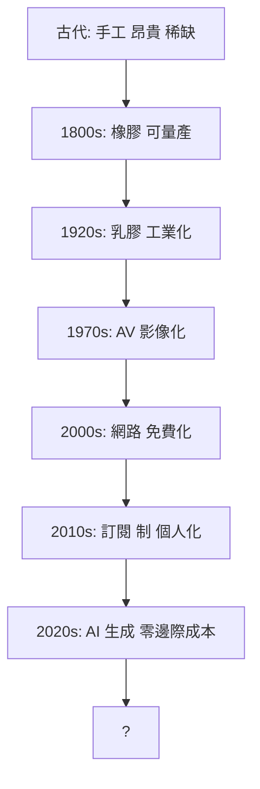

# 第 10 章 · 第 1 節 結語：當慾望不再需要技術

## 一個遞減的故事

如果把全書的曲線畫出來，它不是一條上升線，而是一條**先升後降，最後趨於水平**的曲線：

**A 到 G 的主軸是「把生產成本降到零」。**

而這條曲線的終點是一個反直覺的結論：

> **性愛科技的技術進步，歷史性地不是讓人獲得更多，而是讓「不需要另一個人」這件事變得越來越容易。**

## 三個歷史事實

我們用三個具體的數字來說明這件事。

**第一個：1855 年到 2001 年，Orient 的「微笑」到「プチジュエル アリス」，價格從 38,000 日元到 560,000 日元。**

**而 2001 年之後，TPE 技術把等身玩偶的價格拉到數千元人民幣級。**

**同樣的東西，在一百五十年裡，價格漲了十四倍；然後在二十年裡，價格跌了九成。**

**第二個：1972 年《Deep Throat》的製作成本是 22,500 美元 + 25,000 美元音樂；2024 年一部 Stable Diffusion 生成的內容，成本是零。**

**第三個：2026 年 5 月，一具等身 TPE 性娃娃的價格是 200 到 1,000 美元；一個 AI 生成的、可定製任何外觀與人格的互動角色，成本也是零。**

**而 2026 年 5 月，Character.ai 申請破產，以 2,000 萬美元賣給迪士尼。**

**把這三個數字放在一起，得到的結論是殘酷的：**

> **當生產成本趨向零，這個產業的價值就從「製造」轉移到了「信任」。**
>
> 而信任無法被免費生產。

## 價值的轉移

回顧全書每一次價值轉移：

| 時期 | 價值在哪裡 | 誰賺錢 |
|---|---|---|
| 古代 | 稀有材料與手工 | 工匠 |
| 19 世紀 | 橡膠與硫化技術 | 橡膠產業 |
| 1920s | 乳膠化工與生產線 | 化學工業 |
| 1930s–60s | 品質檢測與品牌 | Schmid、Youngs、Durex |
| 1970s | 內容製作 | 導演、演員、片商 |
| 1980s | 分發 | Vivid、Private、租店 |
| 1990s | 零售與許可 | 連鎖店 |
| 2000s | 流量與廣告 | Aylo / MindGeek |
| 2010s | **人與訂閱關係** | OnlyFans 與平台 |
| 2020s | **？** | **？** |

**注意這張表的右端：價值從「物」一路移到「人」，然後在一個臨界點上，AI 讓「人」變成了可替代品。**

**而這就是 2026 年 10 月 Character.ai 破產的全部意義：**

**一個產業的價值中心移到「人」時，最賺錢。當技術讓「人」變得可替代時，最脆弱。**

**這是一個完全可預測的經濟學後果，而它已經發生了。**

## 那麼誰賺錢？

**如果內容免費、陪伴近乎免費，那麼剩下的價值是什麼？**

有三個可能的答案，而且它們並不互斥。

### 答案一：身分與真實性

**2020 年代唯一沒有被 AI 稀釋的東西，是「這是我」的證明。**

- 一個真人創作者的訂閱（OnlyFans 模式）價值來自「這是她本人」。
- 但 AI 網紅也在做這件事——**而它的價值來自「這是一個 AI」**。這兩種東西形成了一個光譜，而市場在同時為兩端付費。

**驗證性本身成為商品。** 這就是為什麼「身份驗證」在 OnlyFans 是九項文件、在日本是「適正 AV」、在歐盟是提供者溯源、在 C2PA 標準中是機器可讀標記。**所有這些機制的本質都是同一件事：讓消費者能相信「這是真的"。**

**而 2026 年 10 月德國的機器人查扣案，說明這個產業最脆弱的環節仍然是「信任」：當一個 5,000 歐元的機器人被指控對 16 歲女孩騷擾時，整個產業的信任結構就開始傾塌。**

### 答案二：裝置

**AI 伴侶可以在螢幕裡，但它不在你的房間裡。**

**這是一個被嚴重低估的市場空白。** 讓我們看一組數字：

- 全球性玩具市場 2023 年約 **352 億美元**，2030 年預計 **627 億美元**。
- 硅膠娃娃：等身 TPE **200–1,000 美元**。
- 人形機器人：Unitree G1 起售價 **16,000 美元**；1X NEO 面向家庭；高盛預計 2035 年人形機器人市場 **380 億美元**。

**硅膠娃娃產業已經成熟了，它缺的是「大腦」。**

**因此最可能的產業形態是：AI 大腦 + 現有的身體。** 而這個組合的技術難點，恰恰是我們在本書中一路追蹤的那條線的交點：

- 骨節 → Bellmer 1935
- 皮膚 → 鉑金矽膠 2009 / TPE 2012
- 運動 → Unitree 2020 / Optimus 2022
- 對話 → Transformer 2017 / Character.ai 2021
- 觸覺 → Optimus V2 十指傳感器 2023

**這五條技術線在 2020 年代中期第一次真正交匯。**

**而它交匯的那個點，就是「人造性伴侶」這個詞從虛構變成工程問題的地方。**

### 答案三：同意與安全

**這是唯一一個 AI 無法取代的價值。**

我們一路看過的每一場管制，歸根結底都在處理同一件事：

| 事件 | 表面議題 | 實際議題 |
|---|---|---|
| Comstock 逮捕 Schmid 的 700 隻安全套 | 淫穢物品 | 誰能決定生育 |
| 法洛皮奧的亞麻布套 | 防梅毒 | 誰有權保護自己的身體 |
| 英國 140 公分規則 | 兒童保護 | 如何在沒有證人時劃界 |
| 韓國 2024 deepfake 立法 | 生成內容 | 誰被同意 |
| Character.ai 兩起死亡 | AI 安全 | 誰對誰的死亡負責 |
| 德國 2026 機器人案 | 產品缺陷 | 誰是行為主體 |
| 荷蘭 2025 溯源裁決 | 技術規制 | 誰能承擔責任 |

**「同意」是這條線上唯一從未改變過的問題。**

**而技術的進步從未、也不可能解決它。** 它只能用三種方式繞過：

1. **讓人不需要同意**（AI 生成的虛構角色）——迴避了問題，但製造了新的問題（deepfake 冒用真人）。
2. **讓同意可以被檢驗**（年齡驗證、C2PA 溯源、訓練資料治理）——這是唯一有前景的方向。
3. **把同意的成本轉移給生產者**（提供者溯源責任）——這是 2025–2026 年的法律走向。

**而 2026 年 6 月 Mindgard 的報告說明，方案 1 與方案 3 都正在被技術繞過。**

## 那麼，這本書的結論是什麼？

如果要寫成一句話：

> **性愛科技的歷史，是人類把「慾望」從一個社會問題轉化為一個工程問題的歷史。而每一次工程上的成功，都讓社會問題重新出現，並且變得更難解決。**
>
> 亞麻布解決了梅毒，帶來了避孕的道德戰爭。乳膠解決了品質，帶來了 1930 年代的德國禁令與 Constock。錄影帶解決了分發，帶來了 PPV 的失敗與影像店的匿名。網路解決了取得，帶來了 CDA 與 Reno v. ACLU。訂閱制解決了收入，帶來了未成年人與支付通道的風險。AI 解決了生產，帶來了同意的消失。
>
> **每一次，技術解決了一個問題，並且製造了一個更難的問題。**
>
> 而唯一的解法，不是禁止，也不是放縱，而是**讓技術與制度一起演化**——用標準代替禁令，用結構代替道德，用可稽核的痕跡代替信任。

## 三個可以帶走的判斷

**第一，技術不是中性的，但也不是自主的。**

技術提供可能性，制度決定實現方式。同一個 Stable Diffusion，可以長成一個巨大的合法產業（如果配套了標識與溯源），也可以長成一個無法追查的犯罪市場（如果沒有）。**而我們已經看到 2026 年 10 月紐約州一次查扣 12 個網站的規模化執法。**

**第二，禁令的效率遠低於結構的效率。**

Comstock 的 3,600 次逮捕、Meese 委員會的 1,960 頁報告、英國 1994 年對 900 電話色情的收緊——**沒有一個改變了方向。** 而馬賽克技術標準、中國 2003 年的分類通知、訓練資料治理、荷蘭的提供者溯源裁決——**每一個都改變了。**

**第三，「人」是這個產業裡唯一不可替代的資產，而這意味著最成功的公司將是那些懂得把人放回來的。**

2026 年 10 月，Character.ai 破產賣給迪士尼。**而迪士尼是全世界最大的家庭內容資產持有者。**

**這或許是 2020 年代最耐人尋味的一個結局：一個因為「對兒童的不當影響」而被起訴的 AI 公司，最後被賣給了最需要「兒童內容安全」背書的公司。**

**而它的未來形態，很可能不是一個孤立的 AI 伴侶應用，而是既有 IP 世界觀裡的一個永續對話入口——也就是說，回到動漫。**

**2017 年 Pornhub 的搜尋統計早就說明了這件事：「hentai」是美國第一的色情搜尋詞。**

---

**這本書寫到這裡，有一件事還沒說完：**

**我們一路從馬王堆帛書、從 *Onania*、從 1855 年巴黎世界博覽會的橡膠製品、從 1970 年代紐約的 peep booth、從 2026 年德國的一台 5,000 歐元機器人，走到這裡——但我們一次也沒有真正談過「為什麼」。**

**為什麼人類會把如此巨大的工程能力，投注在這一件事上？**

**答案不在技術史裡，也不在制度史裡。它在一個更古老的地方——在希臘人相信 Enki 以自慰創造底格里斯、在埃及人相信 Atum 以自慰創造宇宙、在蘇美爾人相信自慰提升性能力、在中國的《素女經》裡把精液視為腎精、在十九世紀的歐洲把精液視為會枯竭的精華、在 Tissot 面前把自慰視為精神的耗損、在 Betty Dodson 的工作室裡把自慰視為唯一不必道歉的性。**

**同一個生理事實，被人類一次次地解釋成宇宙的起源、生命的資源、疾病的來源，或解放的入口。**

**而工程不過是這些解釋的延伸：**

**如果精液是宇宙的來源，那它值得被研究。**
**如果它是會枯竭的資源，那它值得被管理。**
**如果它是疾病的入口，那它值得被隔絕。**
**如果它是解放的入口，那它值得被最大化。**

**每一種解釋，都生長出了一整套技術。**

**這才是「性愛科技」這個詞真正的意思：不是「跟性有關的科技」，而是「把性當成可以用工程方法處理的對象」的完整歷史。**

**而 2026 年，一個新的解釋正在出現：它是一個可以被生成的對象。**

**這個解釋會長出什麼樣的技術，我們才剛剛看到開頭。**
