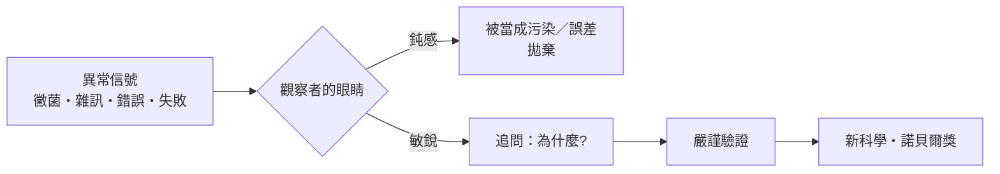

# 前言：計算的靈魂

> 「我向上帝祈禱，希望這些計算是用蒸汽完成的。」——查爾斯·巴貝奇，1821
> 「機器可以編織代數的花紋，就像提花織機編織花朵與草木。」——雅達·洛夫萊斯，1843

## 一顆心和一台機器的兩百年

電腦不是矽的發明，而是一個想了兩百年的念頭：**讓「遵守規則」這件事本身，變成一台機器。**

從算盤上的撥珠，到巴貝奇黃銅齒輪裡的差分表；從圖靈紙帶上的抽象符號，到布萊切利園裡轉動的 Bombe滾筒；從 ENIAC 每天嗡嗡作響的十八萬支真空管，到貝爾實驗室那塊會放大電流的鍺晶片；從仙童半導體的八個叛徒，到今天口袋裡比當年任何超級電腦都強的手機——這段歷史的主角，從來不是晶片，而是**人**：固執的人、被誤解的人、敢賭上一切的人。

本書要講的，就是這些人與他們的偶然與必然：

- 貝克勒爾因為巴黎的陰天，把鈾鹽收進抽屜，卻意外發現放射性。
- 弗萊明度假歸來，看見發黴培養皿上的一圈光環。
- 湯斯在公園長椅的清晨，在報紙信封邊緣算出雷射的原理。
- 彭齊亞斯與威爾遜刷掉了鴿子糞，卻刷不掉宇宙誕生的回聲。
- 白川英樹把催化劑加錯一千倍，塑膠竟然會導電。
- 馬歇爾親口喝下細菌， overturn了一個「胃裡不可能有細菌」的百年偏見。
- 謝赫特曼看見了「不可能存在」的晶體，被鮑林嘲笑為「準科學家」，卻笑到了 2011 年。

## 偶然的科學哲學

Serendipity（偶然的幸運）不是運氣。荷瑞斯·沃波爾在 1754 年創造這個字時，指的是「三個錫蘭王子**總是在追尋一件事時，意外發現另一件事**」。巴斯德說得更直接：「機會偏愛有準備的心靈。」

每一個本書裡的故事都是同一個邏輯的變奏：

意外人人都有，但只有「準備好的大腦」才看得見意外的意義。

## 閱讀路線

本書共五篇十章、三十節，依時間軸推進：

1. **微觀射線與放射性的破曉**（1895–1903）：倫琴、貝克勒爾、居禮夫婦。
2. **醫藥與物理的 serendipity**（1928–1964）：青黴素與雷射。
3. **宇宙脈動與生命密碼**（1964–1979）：宇宙微波背景與導電塑膠。
4. **顛覆常識的發現**（1982–2005）：幽門螺桿菌與準結晶。
5. **基因剪刀與新時代的偶然**（1987–至今）：CRISPR 與 AI 時代的 serendipity。

所有故事皆取材於真實歷史事件——諾貝爾獎官方紀錄、期刊論文、法院判決與當事人回憶錄。有趣，但絕不虛構。

讓我們從一個發光的卡紙盒子，開始這趟科學的奇蹟之旅。
