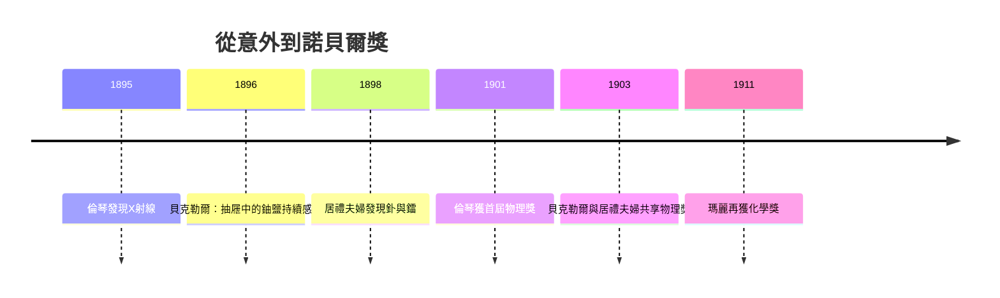

# 居禮夫婦的接棒：從貝克勒爾的意外發現到釙與鐳的提煉

一八九七年的巴黎，瑪麗．居禮（Marie Curie，原名 Skłodowska）需要一個博士論文題目。這位出身華沙、半工半讀考入索邦的女子，在丈夫皮耶．居禮的建議下，選中了貝克勒爾那種使密封底片感光、能電離空氣的「鈾射線」——一個當時幾乎無人競逐的新領域。選題本身就是判斷：貝克勒爾止步之處，正是世界尚未分完的處女地。

## 壓電天平：把放射性變成數字

瑪麗的第一步是定量。她採用貝克勒爾發現的「輻射使空氣導電」效應，以皮耶與其兄雅克早年發現的壓電效應設計了一套測量儀器——壓電靜電計（piezoelectric electrometer）：石英片受砝碼加壓產生已知電荷，用以抵銷待測電離電流，使「放射性」第一次有了可比較、可重複的數值。這個「壓電天平」日復一日地稱量她能找到的一切含鈾物質，她由此確立兩個關鍵結論：放射性強度只與樣品中的鈾含量成正比，是原子本身的性質；而釷也具有同樣的活性（與德國的施密特幾乎同時）。

## 瀝青鈾礦的異常：一定有新元素

接著是那一步神來之筆：她測量天然礦石，發現瀝青鈾礦（pitchblende，主要為 $\mathrm{UO_2}$）的放射性，遠高於等量的純鈾。多出的活性從何而來？唯一合理的解釋是：礦石中含有微量、但放射性強得驚人的未知元素。科學院起初不以為然，皮耶則放下自己的晶體物理研究，加入妻子的追獵。

一八九八年七月，他們宣布發現第一種新元素，命名為釙（polonium），致敬瑪麗被瓜分、不得獨立的祖國波蘭；十二月，與化學家同事居斯塔夫．貝蒙（Gustave Bémont）合作，宣布了放射性遠更強烈的第二種元素——鐳（radium，源自 radius，射線）。

## 閣樓裡的四年：一鍋一鍋地蒸餾礦渣

宣告容易，提煉如山。鐳在礦石中含量不足百萬分之一，證明它必須拿得出看得見、稱得出重量的一份。奧地利方面慷慨地把波希米亞約阿希姆斯塔勒爾礦提煉鈾後的礦渣無償運抵巴黎，於是整整四年，夫婦倆在物理學校一間漏雨的木棚裡，用大鍋以硫酸處理成噸的礦渣，攪拌用的鐵棍幾乎與瑪麗等身；硫化物結晶冷卻後粘壁，逐一沉淀、溶解、再結晶，用「分級結晶」把放射性一步步集中起來。一九○二年，他們終於取得 0.1 克的氯化鐳，並測定其原子量約為 225——新元素自此立於不搖之地。夜裡回到木棚，架上玻璃瓶中的鐳鹽自發地泛出淡藍色微光，成了他們夫妻口中的「微光中的精靈」，瑪麗晚年自述說，那正是她一生最美的時刻。

危險亦隨光而來。皮耶刻意把鐳射線聚焦在自己手臂上，數小時後出現灼傷與潰瘍——他由此率先提出鐳射線或可治療腫瘤；這一實驗直接催生了後來的「居里療法」（Curie Therapy）與放射治療。一九○三年，貝克勒爾與居禮夫婦共享諾貝爾物理學獎；一九○六年皮耶死於馬車車禍，瑪麗接手掌理講座，並於一九一一年再獲諾貝爾化學獎——以釙與鐳的分離與研究獲獎，成為唯一在兩個不同領域各自獲得諾貝爾獎的人。第一次世界大戰中，她親自督造二十輛裝載 X 光機的「小居里」（petites Curies）戰地車隊，並培訓女性技師，讓放射線開到前線。她建立的鐳研究所（居里研究院）成為放射治療與核物理的重鎮。

代價也由肉身清償：她的實驗筆記至今仍具放射性，頁緣存留她的指紋輻射；一九三四年她死於再生不良性貧血，這是長期暴露於輻射的直接結果。從貝克勒爾抽屜裡那張對照底片，到木棚裡發著藍光的氯化鐳，這段接棒史說明：偶然開門，制度與人格接手——幾乎沒有資源的兩個人，靠定量方法與動人的執念，把一次意外鑄成了一個時代。

