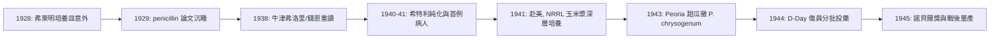

# 錢恩與弗洛里：青黴素的工業化量產

## 牛津：一個被流放的化學家與一個澳洲病理學家

1938 年，牛津大學鄧恩病理學院（Dunn School of Pathology）院長霍華德・弗洛里（Howard Florey）在翻檢文獻時重讀了弗萊明 1929 年那篇沉睡十年的論文。弗洛里是派駐英國的澳洲人，冷靜、講究效率、有一種近乎軍事化的組織感；他的搭檔恩斯特・錢恩（Ernst Chain）則是逃離納粹德國的猶太裔生化學家，在希特勒掌控政權趕出科學家的年代裡被英國「撿走」——英國的制度一時的人道，日後換回了無法估價的回報。錢恩讀到論文的反應是狂熱：他一眼看出 penicillin 是化學問題，而化學是他在柏林弗里德里希・威廉大學受過的訓練。

弗洛里從洛克菲勒基金會與英國醫學研究委員會（MRC）爭取到小額經費，組成一個「有點像小型工廠」的團隊：錢恩負責化學，弗洛里統籌生物學測試，另有一位從未見於教科書的英雄——諾曼・希特利（Norman Heatley），一個動手能力驚人的年輕哲學博士。

## 希特利的技術魔法

純化過程碰到的第一堵牆是萃取：penicillin 是弱酸，只溶於有機溶劑、卻熱穩定極差。錢恩想出了 pH 搖擺萃取法——把發酵液酸化後以乙醚萃取，趁溶劑尚未蒸發前轉回水相，整個過程必須在冷室中以秒計進行。但大量發酵液與少量溶劑如何接觸成為瓶頸，希特利靈機一動，設計了逆流萃取裝置（countercurrent extraction apparatus），以玻璃管與陶瓷件拼出連續萃取的雛形；他又造了一台「藍玻璃烘箱」（以藍色玻璃阻擋紫外線），用低溫真空乾燥把不穩定的產物凍乾成棕色粉末。1940 年 5 月 25 日，團隊以純化後的粉末感染八隻鏈球菌小鼠，次日四隻已注射 penicillin 的小鼠全部存活、對照四隻全數死亡——弗洛里在走廊上對錢恩說了句著名的：「這結果太驚人了（'It looks like a miracle'）。」

## 第一個病人：警察亞歷山大

1941 年 2 月，43 歲的牛津警察阿爾伯特・亞歷山大（Albert Alexander）因修剪玫瑰花叢抓傷嘴角，感染釀成眼部與肺部的敗血症，已瀕臨死亡。2 月 12 日首度注射，奇蹟發生：24 小時內體溫下降、膿瘍消退。但全英國的 penicillin 產量，抵不上他一個療程——牛津的量產是騰空的醫院病床裡架起培養瓶，「浴室尿缸工廠」（bedpans and bathtubs）地說明其荒謬。藥在第五天告罄，亞歷山大病情復發、當月死亡。更殘忍的細節是：penicillin 幾乎全部由腎臟快速排出，團隊只有回收亞歷山大的尿液、再萃取回來投回體內——「從病人尿中回收救命之藥」成為史上最尖銳的量產警鐘。下一個病人的命運一樣懸在「再多一點產能」這一個工程問題上。

## 跨越大西洋：玉米漿與甜瓜上的黴

弗洛里判斷：英國在被轟炸、被圍困的 1941 年不可能量產。他與希特利帶著一撮產孢的表面培養飛往美國——老式護照上一行模糊的技術描述，成為西半球改變歷史的祕密。他們拜訪華盛頓的農業部（USDA），被引介到伊利諾州皮奧里亞的北方地區研究實驗室（Northern Regional Research Laboratory）。那裡的工程師正推動玉米漿（corn steep liquor，玉米澱粉工業的副產物）作為發酵培養基——深層培養（submerged fermentation）取代牛津的表面培養，產量躍升百倍。再下一步是菌種：1943 年，皮奧里亞的實驗室發起全國「找黴」徵集，最後的冠軍竟來自伊利諾州皮奧里亞一家水果市場上的一顆哈密瓜（cantaloupe）——那株 *Penicillium chrysogenum* 經 X 射線誘變的突變株，把每毫升產量從個位數單位拉到上千。

這整套擴散是制度、戰爭與經濟的合謀：美國戰爭生產委員會（WPB）1943 年協調二十餘家藥廠（輝瑞、默克、施貴寶等）共享菌種與製程，把競爭者變成伙伴。到 1944 年 6 月諾曼第登陸（D-Day），盟軍已備妥約二百萬劑盤尼西林，用於傷兵的分批投藥——過去傷口感染死亡率近八成的創傷，降到個位數。戰後產能釋放到民間，一夜之間，淋病、肺炎、產褥熱從死刑變成門診。美國政府本可在戰時把 penicillin 專利化收費，最終選擇讓抗生物質開放競爭；相對地，牛津團隊在戰爭結束前把關鍵知識交給美國人，是出於戰爭倫理，卻也讓英國戰後為授權費付出數千萬美元的懊悔——科技與制度的張力，以貨幣形式遺留下來。

## 1945：三人共享的諾貝爾獎

1945 年諾貝爾生理學或醫學獎授予弗萊明、錢恩與弗洛里三人——希特利不在名單上（諾獎原則上一年一獎最多三人），成為科學史上最著名的遺珠。弗萊明在最後的演說以他一貫的低調收尾：

> 「我沒有發明盤尼西林，是自然發明了它；我只是無意間發現了它。」

希特利一生未獲諾獎，直至 1990 年（九十歲高齡）牛津才授予他英國醫學史上第一個名譽醫學博士學位。青黴素真正的遺產，是三種精神的接力：弗萊明的「看見異常」，弗洛里團隊的「追問能否做成」，美國戰爭機器的「問能否做一百萬份」。Serendipity 只是開端，值得諾獎的意外，得靠整個文明的回應。
