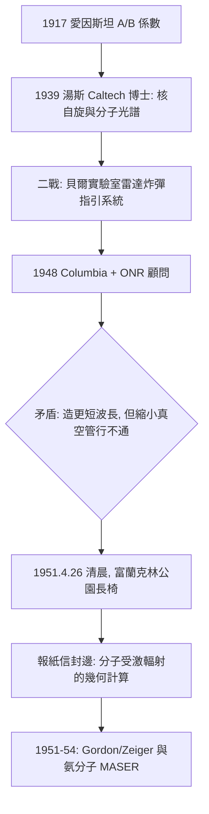

# 公園長椅上的晨間靈光

## 南卡的長老會少年

查爾斯・湯斯（Charles H. Townes, 1915–2015）出生於南卡羅萊納州格林維爾，家學淵源——父親從事法律事務，家中六個孩子裡出了三位博士。他在浸信會背景的福爾曼大學（Furman University）讀物理與數學，再到杜克大學完成碩士，最後進入加州理工學院（Caltech）博士班，一九三九以同位素氘核的自旋與磁矩研究取得博士學位。他的學問底色是分子光譜學——「分子如何吸收與放出特定頻率的電磁波」——這門看似冷僻的技術，日後成為微波與雷射的母語。

同時他是個虔誠的長老會信徒，一生堅信宗教與科學殊途同歸地對付同一份奧秘。他後來在自述中說，那個關鍵清晨的靈光，既像物理推理，又像宗教經驗——「我感受到某種超越我的東西與我對談」。

## 貝爾實驗室的雷達戰爭

二戰爆發，湯斯被徵調至紐澤西的貝爾實驗室（Bell Labs），投入雷達炸彈指引系統（radar bombing system）的研發。這段軍事工程歲月給他兩件事：一是對微波頻段的直覺——他熟透了波導、共振腔與電子束工程；二是對官僚研發體制的手感——國防資源如何在戰時被組織成不可思議的量產機器。二戰結束時，軍方的問題意識接力交棒給和平時期的科學機構：海軍研究辦公室（Office of Naval Research, ONR）成為戰後基礎研究的最大金主，它押注一個問題——

**能不能把雷達推向更短的波長？**

波長越短，解析度與方向性越好，軍事價值驚人。但真空管技術在毫米與次毫米波長撞上死巷：波長縮到毫米級，電子管的電極與腔體尺寸縮到發熱、擊穿、失效的物理極限。一九四八年，湯斯受邀加入哥倫比亞大學物理系，同時擔任 ONR 的顧問，仍被派去啃這塊硬骨頭。

## 工程師們的死巷與物理學家的轉身

「到底該怎麼做更短的波長？」這個問題，被一群世界級的微波工程師用同一種思路包圍了七年：縮小振盪器。把調速管（klystron）、磁控管的腔與隙做得更小、電子束更密、場更強。路線合理，路線死亡。湯斯的特殊在於他是理解分子光譜的人，他知道自然界還有另一種數十年來被擱置的老工具：分子本身。

早在一九一七年，愛因斯坦已在《關於量子輻射的理論》中提出 A、B 係數，預言了受激輻射（stimulated emission）——處於激發態的分子，在恰當頻率的量子擾動下，會「被邀請」放出一個與入射光子完全同相、同頻率、同方向的新光子。理論躺在論文裡三十多年，無人把它變成振盪器；因為直覺告訴所有人：熱平衡下高能態分子總是稀少的，放大似乎不可能。

## 富蘭克林公園的長椅

一九五一年四月二十六日，湯斯到華盛頓特區參加 ONR 的微波顧問會議，與會者討論如何造毫米波振盪器，全場一籌莫展。他住的那家旅館在富蘭克林公園旁。天還沒亮，他醒了，索性走到公園，坐在一張長椅上等早餐時間。

靈光就是在那裡降臨的。他後來反覆講述那個瞬間：與其硬把真空管縮小，**為什麼不讓分子自己或透過場受激放出輻射？** 把處於激發態的分子（他當下想到的是氨分子 NH₃）與輻射場隔絕——裝進共振腔中——場的能量會因受激輻射而指數增長，形成振盪。波長不再受限於電極的機械尺寸，而是受限於分子能階間隙。這是把 B 係數的物理翻轉成工程路線。

他立刻掏出筆，在身邊唯一的書寫界面——一份報紙的信封邊緣（有的回憶版本說是報紙旁頁空白）——寫下估算：需要多少激發態分子、腔要多大、頻率多少、能不能起振。回到旅館，他跟同房的物理學家同事描述這個想法，一切脈絡完好。

那張報紙信封的草稿，幾十年後被史密森尼博物館收藏，有人說它堪與愛因斯坦一八九六年筆記相比——工業與國防體制壓出來的問題，被一個物理基本原理的轉身解決；一個保守長老會信徒的小小靈修。這段模型轉換，湯斯僅僅用了一張紙的邊緣：**與其造更快的火，不如去找會自己發光的分子。**

## 信封之後

回到哥倫比亞，湯斯組建了一支極小而致命的團隊：博士生詹姆斯・戈登（James Gordon）與博士後研究員喬治・蔡格（George Zeiger）。他們挑中氨分子的翻轉（inversion）躍遷——約 24 GHz、微波頻段——設計讓 NH₃ 通過不均勻電場 的分離器，把上能態分子選出、送入共振腔。概念簡單，工程上滿是懷疑者：有人斷言熱力學不允許、有人斷言腔體損耗會吃掉增益。三人在哥大物理系地下室以兩年時間回答了這些質疑。下一章，是他們交卷的日子。

