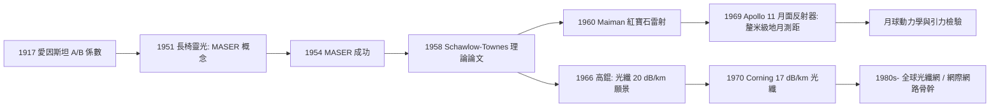

# 從 MASER 到 LASER：光學雷射與現代通訊

## 愛因斯坦的遺產與戰後光譜學的暖身

把 LASER 的譜系說全，必須回到一九一七：愛因斯坦在《關於輻射的量子理論》中寫下的 $A,B$ 係數，第一次指出了「受激輻射」——一個光子可以催生一個完全相同的光子。這在三十多年裡只是統計力學的註腳；二戰後，微波技術與分子光譜學在美國（拉比在哥大主持的分子束實驗室、湯斯的團隊）與蘇聯（列別捷夫研究所的巴索夫與普羅霍羅夫）同時成熟，這個註腳才被工程化。湯斯五十年代在哥倫比亞大學的 MASER 成功後，光學版本的呼聲漸高——但卡在兩個問題：如何選出上能態分子？如何讓光「來回」足以放大？

## 一九五八：肖洛與湯斯的關鍵一紙

一九五七年秋，湯斯拜訪貝爾實驗室的妹夫阿瑟・肖洛（Arthur Schawlow）。兩人爭論的核心是反射鏡的設計：封閉的金屬腔在光波長下尺寸太苛刻，任何工程誤差都會壓片段模。肖洛的貢獻是神來一筆：**拋掉封閉腔，改用法布里—珀羅式的開放平行平板**——光在兩片鏡子之間往返，只有沿軸向、且與鏡面法線夾角極小的模式能存活放大，橫向模式自然洩漏掉，這解決了選模問題。他也在能階方案上建議用基態抽運（如克若斯特的鹼金屬方案）或螢光固體。一九五八年十二月，《Physical Review》刊出《紅外與光學 MASER》（*Infrared and Optical Masers*），成為整個雷射時代的出生證明——同時，貝爾實驗室立刻提交了一紙跨越光頻段放大的專利，日後成為全城最值錢的一紙信封式文件。

## 梅曼的紅寶石：休斯實驗室的「小盒子」

學術界多半押注氣體（氦氖等），覺得固體螢光太難。休斯飛機公司研究實驗室（Hughes Research Laboratories，在加州馬里布）唯一押注固體的，是西奧多・梅曼（Theodore Maiman）。他挑中紅寶石（$\mathrm{Al_2O_3:Cr^{3+}}$）——過去的研究已證明其螢光量子效率接近一，卻被同行普遍認為「三能階系統需要太多抽運功率」。梅曼的獨到在於把抽運幾何做到極致：他沒有採用大功率氙燈與粗重的柱狀晶體的傳統方案，而是用一根直徑 1 公分、長 4.8 公分的紅寶石棒，配以螺旋狀閃光燈包裹，把抽運光全部聚攏到棒上。一九六〇年五月十六日，他看到的螢光在腔內出現了縮窄、變亮、譜線銳化的軌跡——LASER 誕生。休斯的新聞發布會辦得倉促又過度渲染，梅曼論文被《Physical Review Letters》退稿（PRL 編輯以為只是又一篇 MASER 改寫），一開始反而害這第一擊延後問世——學術制度有時是它自己方向的剎車。

## 阿波羅十一號的鏡子

雷射的第一次舉國工程，與無人想到的同行是天文學。一九六九年七月，阿波羅十一號在月球靜海基地安放了由休斯—馬里布合作（後續任務由法國 Côte d'Azur 及前蘇聯探測器納入）製造的**月面雷射反射器**（Lunar Laser Ranging retroreflector）——由一百個角立方（corner cube）棱鏡構成，把入射雷射沿原方向折返。加州大學的利克天文台（Lick Observatory）與麥克唐納天文台隨即向它發射紅寶石雷射脈衝，以 2.5 秒往返計時測距，精度達數公分量級。這組「地月尺」至今仍在每月運行，證實了月球正以每年約 3.8 公分的速度遠離地球，並用於檢驗等效原理——雷射，變成了跨越 38 萬公里的量尺。

## 康寧的玻璃與光纖時代

LASER 的另一半命脈在傳輸介質。一九六六年，在英國標準電訊實驗所工作的高錕（Charles K. Kao）與霍克漢姆（George Hockham）計算出：只要把石英玻璃的衰減壓到 20 dB/km 以下，光波導通訊就勝過銅纜——當時工業玻璃衰減是每公里一千分貝，主流意見認為高錕樂觀得離譜。高錕跑遍全球玻璃廠遊說，最終敲開了康寧（Corning）的大門。一九七〇年，康寧的羅伯特・莫勒（Robert Maurer）、唐納・凱克（Donald Keck）、彼得・舒爾茨（Peter Schultz）團隊以特殊的高純石英與氣相沉積工藝，做出**低於 17 dB/km 的光纖**，三年內壓到 4 dB/km，至七〇年代末逼近理論極限 0.2 dB/km。貝爾實驗室與英國郵政總局同步跟進半導體雷射光源連續室溫操作的突破，光纖通訊系統自一九八〇年代起全面鋪設，跨洋海底光纖取代了衛星與銅纜，最終把網際網路從一批研究主機，織成把五大洲縫在一起的全球神經系統。

## 共振腔裡的文明

回望整條譜系有一個反覆出現的模式：**問題來自軍事與制度的壓力，答案來自基礎物理最抽象的部分。** 愛因斯坦在一戰前的柏林思考輻射平衡；湯斯在戰後 ONR 的預算裡建造第一臺 MASER；肖洛與湯斯把理論交給實驗室；梅曼以一家太空與防務公司的務實，摸出第一道光；高錕以電信公司的長期視野提出玻璃裡的高速路；康寧以材料公司的手藝壓出那根 17 dB 公里的光纖。現代的雷射手術刀、光碟、條碼、光纖到家、以及地月之間那把以釐米為刻度的尺，全都是同一個物理概念的後代——這也是科技史上 serendipity 的真相：意外只提供種子，制度的互動與知識共同體的接力，才把種子長成森林。
