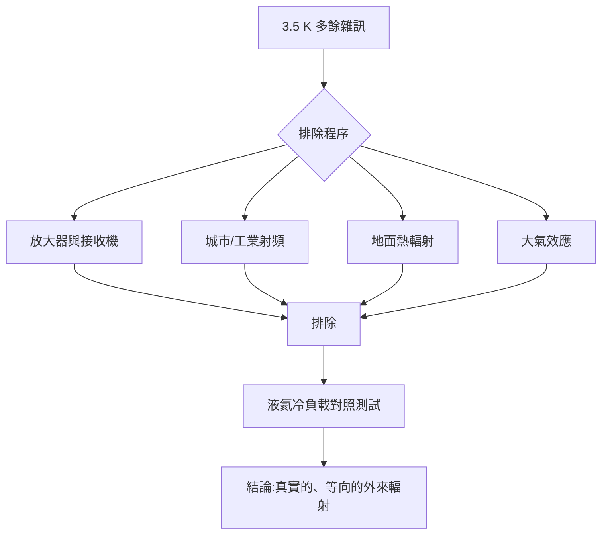

# 貝爾實驗室的喇叭天線與清除不掉的雜訊

1964 年春天，紐澤西州的 Holmdel 郊外，貝爾實驗室的克勞福德山（Crawford Hill）園區裡，豎立著一台造型奇特的巨獸：一座二十英呎（約六公尺）見方的「喇叭天線」（horn antenna）。它像一支朝天空張口的巨大鋼製海螺，開口處嵌著角度精確的反射板。此地早在二十世紀初便是無線電科學的搖籃——卡爾·央斯基（Karl Jansky）正是在不遠處發現了來自銀河中心的無線電波，開創了無線電天文學。

這座天線原本為「回聲」（Echo）計畫而建：1960 至 1962 年間，貝爾實驗室以它成功接收由被動衛星 Echo 1 反射回來的訊號，證明跨洋衛星通訊可行。當 Echo 任務被更先進的主動衛星（Telstar）取代，這座天線彷彿成了過時古董。但它有一項無可取代的美德：極窄的主波束與極低的側瓣，幾乎不會拾取來自地面與城市的雜訊。對接手它的兩位年輕科學家而言，這座「退役」儀器反而成了純度最高的宇宙耳朵。

## 兩位背景迥異的倖存者與書香子弟

阿諾·彭齊亞斯（Arno Penzias）1933 年生於慕尼黑的一個猶太家庭。六歲那年，他親歷了「水晶之夜」（Kristallnacht）暴行後家庭的崩解；1939 年，他與弟弟經由兒童撤運（Kindertransport）被送往英國，父母隨後輾轉抵達美國，一家人在紐約布魯克林重建幾乎一貧如洗的生活。父親做過刷漆工人，母親在高級住宅區幫傭。彭齊亞斯從布魯克林理工高中畢業，進入紐約市立學院讀物理，之後在哥倫比亞大學跟隨雷射先驅查爾斯·湯斯（Charles Townes）做毫米波天文學博士。這段從納粹德國逃亡重生的經歷，養成他一種近乎執拗的較真：任何系統中的異常，都不許糊弄過去。

羅伯特·威爾森（Robert Wilson）1936 年生於休士頓，父親是化學工程師，家中書架上滿是化學教科書；他自幼跟著父親修理收音機，在萊斯大學攻物理，再赴加州理工學院以無線電天文學取得博士。1963 年，彭齊亞斯與威爾森先後進入貝爾實驗室。那是一個壟斷利潤餵養基礎研究的年代：AT&T 的電話營收轉化為科學的自由探索，而每一項基礎研究又隨時可能回饋通訊事業。兩人被安排接手喇叭天線，每人各分擔一半工作量——貝爾實驗室傳統上要求成對合作以便補休與互相評鑑，這個制度細節，意外地把兩人綁在一起。

## 一個不肯降下來的雜訊

他們的科學目標其實相當節制：不是尋找宇宙起源，而是測量銀暈中的中性氫在 21 公分波長輻射以外的殼層氣體雜訊——用現代術語說，是把天線當成極靈敏的溫度計，量測環繞銀河的光暈氣體。

要量得準，必須先量「空」。他們把接收機的等效雜訊溫度都折算進預期，卻發現實測的系統雜訊溫度，始終比所有已知來源的總和高出約 3.5 K。

詭異之處在於這個多餘的 3.5 K 一絲體面都不給：

- 它不隨季節變化，不隨晝夜變化；
- 天線無論指向天空何處，數值都相同——沒有任何方向性；
- 更換零件、重接導波管、檢查接頭，它紋絲不動。

## 逐一排除的偵探之旅

兩人像偵探辦案般逐一排查：

1. **接收機噪聲**：拆解並重測了行波管放大器（TWT）與整條接收鏈路，確認放大器本底噪聲已達當時技術極限；
2. **工業與城市射頻干擾**：紐約市近百公里外的無線電台、雷達站頻率逐一核對；喇叭天線極窄的主波束與超低的側瓣，天然排除了這些地面訊號；
3. **地面輻射**：把天線朝地面校準，比對地面拾取量，證明多餘的溫度不來自地表洩漏；
4. **大氣**：季節與天氣變化對它毫無影響，等向性又排除了大氣的嫌疑——大氣效應與天線仰角息息相關；
5. **儀器內部**：最後一招最狠——他們造了一組以液氦冷卻至接近絕對零度的「冷負載」（cold load），交替量測冷負載與天線。冷負載端與天線端的讀數差，始終穩定在約 3.5 K 上下。儀器再冷，那 3.5 K 依然從天線裡湧進來。

換句話說：他們把整個接收系統冷凍到只剩一種可能——那 3.5 K 不是儀器的錯，而是一種真實的、無所不在的外來輻射。

## 「連清潔天線都試過了」

彭齊亞斯的處女座式嚴謹在這一年發揮到極致：連天線本身的內壁都檢查過、清洗過。這一步引出了本故事最著名的插曲——天線裡曾經住著一對鴿子，以及那層清除不掉、卻又跟這 3.5 K 全然無關的白色物質。那個徒勞的清理行動（即下一節的「抓鴿子與刮鴿糞」），與真正突破的相會，共同構成 1965 年科學史上最戲劇性的偶然。

兩人已隱約意識到：這是一個不來自任何已知天體的訊號。他們沒有急著宣告任何「大發現」——貝爾實驗室的工程習慣使他們寧願繼續做負責任的排除，直到每一條路都走到盡頭。他們只差一個理論的搭橋者，而橋的另一端，普林斯頓有個正在削木頭的天文學家叫羅伯特·迪克（Robert Dicke），恰好也正要量到同一個數字。
