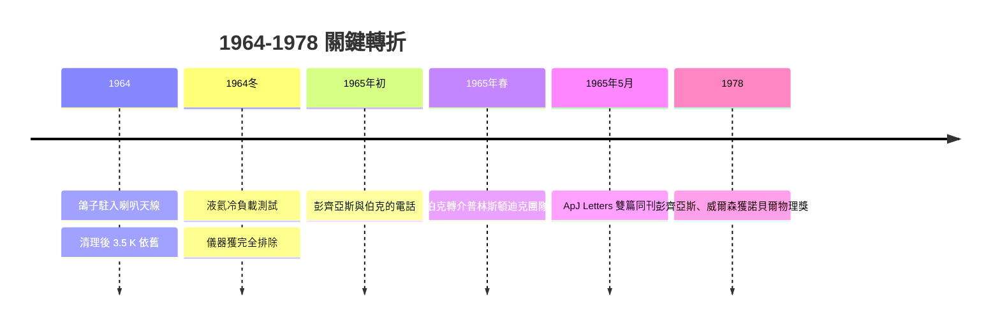

# 抓鴿子與刮鴿糞的徒勞

## 異常、鴿子與白色物質

1964 年，Holmdel 的喇叭天線把那多餘的 3.5 K 帶給了彭齊亞斯與威爾森。兩人在逐一排除儀器與環境嫌疑的過程中，被迫把一切「土辦法」都用上——包括懷疑天線自己「髒了」。

某一天，他們發現喇叭天線喉部隔板上住進了一對鴿子。這對鴿子帶著兩位科學家一生的自嘲正式登場。鴿子在城市邊郊本就常見，而喇叭天線的朝天天口對牠們而言，正好是可以遮風避雨的絕佳巢穴。

問題是：鴿糞——在科學史上首次以「white dielectric material（白色介電質物質）」這種文雅到近乎荒謬的措辭被正式記錄的物質——會不會在天線內部堆積，吸收了某個波段的水汽，因而產生那多餘的 3.5 K 天線溫度？

為此，兩人展開了科學史上最著名的清潔行動之一：

1. **抓鴿子**：說服鴿子搬家，把牠們趕出天線喉道，送走；
2. **清洗內部**：拆卸部件，清洗天線內壁、接合處與隔板上的疑似鴿糞殘渣；
3. **重新量測**：清洗完成後，天線雜訊溫度
   **依然是原本那多餘的 3.5 K**。

「事情又回到原點」，威爾森日後回想。清潔天線沒有效果。

此外還有一個小小的插曲：被抓走的鴿子，幾天後竟又重返喇叭口——「鴿子有極強的返巢本能」，彭齊亞斯與威爾森只能再度移置。這個細節，讓整件事更顯得像一出科學喜劇。

## 白色物質的真正意義

回看這段歷史：鴿糞與那 3.5 K **完全無關**。鴿糞清潔只不過是「排除所有可能異常」的一道必要苦工。但正是這道苦工，逼著兩人把系統的純度測到當時的極限——留下唯一無法排除的「異常」。

這是科學方法最原汁原味的示範：**真正的異常，是在你把所有平常的解釋都清除乾淨之後，仍然站在那裡的東西**。

## 1965 年春天：一通改變歷史的電話

1965 年早春，彭齊亞斯因一件與此完全無關的事，撥電話給麻省理工學院的伯納德·伯克（Bernard Burke）——他們要討論的是一個銀河系電波源的術語命名問題（那是同一時期由兩方合作進行無線電天文觀測而衍生的聯署論文事務）。

閒談中，彭齊亞斯話鋒一轉，抱怨起自己這個「奇怪的儀器異常」：一個 3.5 K 的多餘天線溫度，等向、無季節變化、無法再用任何方法除去。

伯克在電話的另一端沉默短短數秒。他最近恰好聽過一篇演講，講者正是普林斯頓的羅伯特·迪克（Robert Dicke）——而迪克當時想做的事，正是要去找一個等向、恆定的宇宙微波背景輻射。伯克當刻回應：「你應該和迪克談談。」

伯克隨後親自致電迪克；彭齊亞斯與威爾森也接著直接打給普林斯頓。兩個在附近十幾英里內的團隊，在面談之後達成一個戲劇性極高的結論：

- **彭齊亞斯與威爾森在尋找雜訊的來源，卻意外發現了宇宙誕生的迴響**；
- **迪克和普林斯頓團隊則在尋找宇宙誕生的迴響，卻還在準備自製儀器。**

## 迪克團隊與 Peebles 的理論預測

普林斯頓這一端的故事同樣精彩。1948 年，伽莫夫（George Gamow）、阿爾弗（Ralph Alpher）與赫爾曼（Robert Herman）提出熱大爆炸核合成模型，並且由阿爾弗與赫爾曼推論：宇宙若起於極熱狀態、隨後絕熱膨脹，那麼時至今日應該仍殘留著一缸冷卻了的輻射浴——宇宙微波背景輻射，溫度約在數個 K 的量級（他們估計約 5 K）。這一推論當時受到輕忽，幾乎被整個學界遺忘。

迪克本人其實早在 1940 年代也獨立想過類似想法，卻在 1964 年才重新撿起這條線，並在讀了皮布爾斯（Jim Peebles）剛完成的工作後，立即著手組建一台低噪接收機，與羅爾（Peter Roll）、威爾金森（David Wilkinson）準備親手搜索這個訊號。普林斯頓的實驗當時尚未完成。

當伯克的電話把兩條線接起來，彭齊亞斯與威爾森的「異常」，瞬間有了身份：**這就是宇宙微波背景輻射**。

## 兩篇論文的雙聯劇

經雙方商定，兩篇論文在《天文物理期刊快訊》（*The Astrophysical Journal Letters*）同期並排發表：

- **Penzias & Wilson（1965）**：《在 4080 Mc/s 處對超額天線溫度的一次量測》（A Measurement of Excess Antenna Temperature at 4080 Mc/s）——一篇只報告測量結果、幾乎不提宇宙學的實驗論文；
- **Dicke, Peebles, Roll & Wilkinson（1965）**：《宇宙黑體輻射》（Cosmic Black-Body Radiation）——一篇解釋這些測量值正是宇宙早期極熱時代留下的黑體光譜殘骸、並同時報告普林斯顿自身實驗構想的理論論文。

兩篇論文同期刊出於第 142 卷，頁碼相連（414 頁與 419 頁）。彭齊亞斯多年後半開玩笑地說，他們的實驗結果太乾淨，導致那篇著名的實驗論文其實很短；而普林斯頓的那一篇，則提供了整個宇宙學框架。

值得一提的是，迪克與他們的團隊在機緣上的表現極為令人尊敬：他們把「被第三者搶先量到」的懊惱擱在一邊，即刻與彭齊亞斯和威爾森共商——這正是科學與科學家素質之分野。

## 1978 年的諾貝爾獎

1978 年，瑞典皇家科學院將諾貝爾物理學獎的其中一半授予彭齊亞斯與威爾森「發現宇宙微波背景輻射」，另一半授予蘇聯的卡皮察。但遺憾也同時落下：伽莫夫、阿爾弗與赫爾曼在 1948 年就預測了 CMB 的存在與溫度，卻從未被頒發諾貝爾獎。阿爾弗與赫爾曼長年抗議他們的貢獻，被著名的「αβγ論文（Alpher–Bethe–Gamow）」中貝特之名所淡化，這件事成為科學史上被反覆討論的遺憾之一。

多年後，威爾森在回顧那段歲月時說：「那時候我們知道自己處理的是一個異常，但足夠嚴謹的過程只是正確的科學習慣；而宇宙學的大發現，則是隨之而來的幸運機緣。」

## 從鴿糞到宇宙的序章

下次若有人嘲笑「擦鴿糞」這件小事，請記得：擦掉鴿糞的兩個人，恰好擦亮了整個宇宙的黑白底片。

科學史的突破，往往不是天才一擊的靈光，而是集群式、戲劇性地由**嚴謹 + 機緣**交疊而成——其中，嚴謹的部分由彭齊亞斯與威爾森親手完成，而機緣的部分，則交由鴿子與伯克那通電話來完成。
