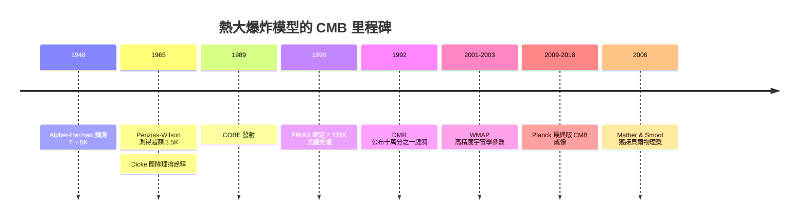

# CMB 的確認：大爆炸理論最關鍵的證據

## 從「αβγ」到 5 K 的預測

宇宙微波背景輻射（CMB）的故事，得從 1948 年說起。喬治·伽莫夫（George Gamow）帶著博士生拉爾夫·阿爾弗（Ralph Alpher）研究一個大問題：宇宙中氫與氦的比例從何而來？

他們推論：若宇宙起於一團極高溫、極高密度的「原始核質」（ylem），早期宇宙的核反應足以合成氫與氦；隨著宇宙膨脹冷卻，早期核火球稀釋下來的熱輻射會殘留至今。1948 年，阿爾弗與赫爾曼（Robert Herman）做了定量預測：這層輻射冷卻到今日，溫度應為**約 5 K**。這個預測在之後的十幾年間幾乎無人理會。

那篇著名的「αβγ論文」（Alpher–Bethe–Gamow），作者行列中「貝特」之名來自伽莫夫的惡作劇——讓三人拼出希臘字母前三字。這則趣聞埋下了阿爾弗與赫爾曼日後畢生的怨氣。

## 標準宇宙模型的理論地基

大爆炸模型並非空想，它建立在 1920 到 1930 年代最穩固的理論與觀測地基上：

- **廣義相對論**：愛因斯坦方程的 Friedmann 解給出宇宙尺度因子 $a(t)$ 的演化動力學，由物質密度與壓力決定膨脹速率；
- **哈伯–勒梅特定律**：哈伯（Edwin Hubble）1929 年的星系紅移量測，搭配勒梅特（Georges Lemaître）的「原始原子」概念，確立退行速度 $v=H_0 d$、宇宙正在膨脹；
- **均勻各向同性假說**：在夠大的尺度上，宇宙是均勻且各向同性的——這一點後來被 CMB 本身以十萬分之幾的精度完美驗證。

在此框架下，宇宙若真的「有熱的開端」（對立陣營是霍伊爾 Fred Hoyle 等人的穩態理論），它早期一定極熱、極密、處於**輻射主導**階段，其黑體輻射隨著膨脹被絕熱拉長紅移，冷卻成今日溫度約 $2.7\,\mathrm{K}$ 的微波光譜。

1965 年彭齊亞斯與威爾森那個 3.5 K 的異常，正是這條預測線的命中。

## 為何 CMB 是「最關鍵的證據」

CMB 之所以成為大爆炸勝出的決定性武器，在於它一次命中穩態理論的幾個弱點：

1. **黑體光譜是原始火球的指紋**：唯有曾處於熱平衡的極早期宇宙，才能生成如此純淨的普朗克譜；
2. **等向性**：3.5 K 異常無方向、晝夜與季節都不變化；任何已知天體理應在天空上有偏倚，等向性只能指向**整個宇宙**；
3. **宇宙氦豐度的互證**：大爆炸核合成同時預測氦豐度 $Y_p \approx 0.24$，與觀測相符——CMB 不是孤證，而是自成體系。

這一瞬，宇宙學從哲學辯論，躍昇為一門精準科學。

## COBE：黑體光譜 2.725 K

1965 年之後，CMB 還剩最後一項驗證：**它是否真的是一條完美的黑體譜？**在 1 mm 到 1 cm 的波段之間，大氣會掩沒精密光譜量測，唯一出路是上太空。

NASA 於 1989 年 11 月發射 COBE（Cosmic Background Explorer）衛星。1990 年初，**FIRAS** 儀器公布光譜結果：**完美黑體光譜，溫度 $T_0 = 2.725\,\mathrm{K}$**——與理論預測的單溫普朗克譜相符到誤差小於十萬分之一，超過 2 個標準差以內看不出任何偏離。現場科學家罕見地起身鼓掌：伽莫夫、阿爾弗與赫爾曼 1948 年的直覺，四十二年後以近乎完美的方式獲得證實。

COBE 的 **DMR** 儀器同時量到 CMB 天空的偶極異向性——主要來自太陽系相對 CMB 以約 $370\,\mathrm{km/s}$ 移動都卜勒效應——扣掉偶極之後，剩下的**微小漣漪**僅約 $\Delta T/T \sim 10^{-5}$，正是日後星系與所有大尺度結構的原始種子。2006 年，Mather 與 Smoot 獲諾貝爾物理獎。

## WMAP 與 Planck：精準宇宙學世代

2001 年 NASA 發射 **WMAP**，2009 年 ESA 發射 **Planck**。兩者以更精細的角解析度與多頻率覆蓋，繪出今日標準的 CMB 溫度天圖。Planck 於 2013 與 2018 年公布的量測給出：

$$
H_0 \approx 67.4\ \mathrm{km\,s^{-1}\,Mpc^{-1}},\quad
\Omega_b \approx 0.049,\quad
\Omega_c \approx 0.26,\quad
\Omega_\Lambda \approx 0.685,\quad
\text{宇宙年齡}\approx 13.8\ \text{Gyr}
$$

被稱為 **$\Lambda$CDM** 的標準模型就此確立：普通物質約 5%，冷暗物質約 27%，暗能量約 68%。

## 制度與文明層面的迴響

CMB 從「擦不掉的雜訊」到宇宙學的基石，本身就是一部制度史：

- **企業實驗室年代**：貝爾實驗室靠 AT&T 的壟斷利潤養基礎研究，閒置的 Echo 衛星天線成為偶然中的必然；1978 年授獎後不久，美國電信拆分、企業實驗室走向黃昏，這段故事成為研究機構史上的古典案例；
- **太空競賽的政治經濟**：冷戰使太空科學拿到舉國資源，COBE、WMAP、Planck 才有機會被造出——衛星科學是 1970 到 1980 年代「小科學轉大科學」轉型的縮影；
- **儀器工業的推力**：低噪放大器、輻射計、超導感測器的每一次躍進，都同步開闊宇宙學的視野——科技永遠是科學的前置肌腱；
- **思想與文化**：宇宙「有起點」從哲學命題變成常識；「大爆炸」一詞本身出自霍伊爾在 BBC 廣播中半嘲弄的說法，最後反由對手陣營接納——成為二十世紀思想史上最漂亮的諷刺。

今日 CMB 是宇宙學中最重要的光：**一張宇宙 38 萬歲時的照片**，攜帶著 138 億年前的物質分佈，翻印出整部星系形成史。

最令人玩味的是：彭齊亞斯與威爾森並未立志改寫宇宙學。他們能改寫它，只因為——**他們不肯放棄一個清除不掉的雜訊**。你的雜訊，可能正是另一個人的訊號。
