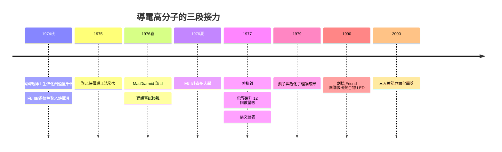

# 塑膠居然能導電：銀色聚乙炔薄膜

## 一杯咖啡掀起的化學革命

1976 年春天，東京工業大學來了一位平凡的訪客：賓州大學化學教授**艾倫·麥克迪爾米德**（Alan MacDiarmid）。此行原本只是例行的海外學術交流——他在東京化學界有一場演講。然而那次演講的中場休息、一頓茶點，卻掀起了此後半個世紀最重磅的化學革命。

故事是這樣接上的：席間從旁人的對話中，MacDiarmid 聽說——東京工業大學的池田研究室有一位研究者，做出了**銀色的聚乙炔薄膜**——一種本應是黑色粉末、卻帶著金屬光澤的東西。

MacDiarmid 是一位極不典型的化學家。他來自紐西蘭，長期鑽研無機聚合物，代表作正是**聚硫氮 $(\mathrm{SN})_x$**——一種帶金屬光澤、電導率可觀的無機導電高分子。憑這份獨家經驗，他直覺地意識到：銀色的有機聚乙炔若真存在，那就不是「塑膠」，而是一部**現成的共軛 $\pi$ 電子系統**——只要有一點摻雜，就可能導電。

會後他到實驗室見到白川。白川舉起那片銀色薄膜給他看。MacDiarmid 說出的第一句話，成了科學史的名場面：

> 「**如果我們摻一點溴（bromine）進去，會怎樣？**」

「摻雜」（doping）在半導體物理裡是盡人皆知的手段——摻點雜質進矽，就能指揮電導。但把摻雜用在有機高分子上，1970 年代的教科書沒有這一頁。白川的回答帶著工程師式的直白：「可以試。」

## 費城：化學家與物理學家的制度接力

1976 年 8 月，白川受邀飛往美國費城，加入 MacDiarmid 與物理學家**艾倫·希格（Alan Heeger）**的團隊。賓州大學此時有一項制度性優勢：化學系與物理系往來緊密，化學家負責合成與摻雜，物理學家量測電導與能帶——**跨領域合作本身就是成功的基因**。三方身份正補位：兩位化學家（白川、MacDiarmid）管材料，一位物理學家（Heeger）管電性。

第一輪用溴蒸氣摻雜，電導率上升但有限。白川隨後想到改用**碘（iodine）**——氧化性更合適、摻雜可控。1976 至 1977 年間，摻碘聚乙炔薄膜的電導率讀數一路上升，最終穩定在：

$$
\sigma:\ 10^{-9} \rightarrow 10^{3}\ \mathrm{S/cm}
$$

從絕緣體到導體，**整整十二個數量級，約一兆倍的躍升**。摻碘後的聚乙炔一片閃亮，摸起來差不多就是一塊金屬紙。1977 年的《化學通訊》（*Chemical Communications*）上，三人合發的論文成了「導電高分子」的開山之作。

## 機理：孤子與極化子

為什麼塑膠能導電？教科書式的答案分四步：

1. **共軛主鏈是一條現成的道路**：聚乙炔主鏈單、雙鍵交替，$\pi$ 電子在整條碳鏈上可准自由運動——先有路，只欠路上有車；
2. **摻雜本質是化學氧化**：碘原子從主鏈奪走電子，留下可在鏈上跳動的帶電缺陷；
3. **載子在鏈內也在鏈間**：碘扮演鏈與鏈之間的搭橋者，導電不靠單鏈孤軍；
4. **1979 年起的理論模型**：Heeger 與 Su、Schrieffer 提出以**孤子（soliton）**與**極化子（polaron）**描述聚乙炔主鏈上的帶電激發——trans-聚乙炔相鄰單、雙鍵的拓撲缺陷，正是它的載子。

這套理論同時回答了反面問題：**為何日常塑膠（如聚乙烯）永遠絕緣？**因為主鏈飽和、沒有 $\pi$ 道路——阻礙不在材料本身，而在道路上根本沒有路。

## 從導電到發光：聚合物 LED 的誕生

摻雜聚乙炔只是序章。真正的落幕畫面，是「**塑膠不僅能導電，還能發光**」。

1989 至 1990 年間，英國劍橋大學卡文迪許實驗室的理查德·弗倫德（Richard Friend）團隊，用共軛高分子 **PPV**（聚對苯亞乙烯）製出史上第一顆**聚合物發光二極體**（Nature, 1990）：一片高分子薄膜夾在上下兩片電極之間，施加低壓即發出光。技术上关键的一条桥，正是弗倫德訪問白川實驗室、以及兩代同行把聚乙炔薄膜的薄膜技術經驗直接移植給 PPV——白川團隊建立的「共軛高分子薄膜工法」，是聚合物 LED 制度性前身的關鍵資產。從此顯示器可以不是玻璃，而是一片軟膜——「柔性電子」一詞就此誕生。

## 2000 年：諾貝爾化學獎

2000 年，瑞典皇家科學院把化學獎授予白川英樹（筑波大學）、麥克迪爾米德（賓州大學）、希格（加州大學聖塔芭芭拉分校），表彰他們**「發現並開發導電高分子」**。

授獎詞背後，是三個完全不同的話語系統接成的一條鏈：

- **白川**：材料化學與工業實踐——他一生自認「材料人」，並在得獎後說自己沒有一天忘記那位韓國留學生的失誤給他的機會；
- **MacDiarmid**：無機導電聚合物的經驗移植——一句「給我溴」的直覺；
- **Heeger**：凝聚態物理的摻雜與載子理論——把化學現象翻譯成電子的語言。

## 改寫世界的十二個數量級

回望這十二個數量級，它不只是化學數據，而是一整條產業鏈的首次開路：

- **成本邏輯翻轉**：矽晶圓需要高溫、真空與單晶；導電高分子在液相、常溫下即可製膜，開啟「可列印電子」的想像；
- **應用的開闊**：抗靜電塗層、電磁屏蔽、電池電極、化學感測器，以及後來取代觸控屏透明的導電層，皆始於摻碘聚乙炔的示範；
- **思想層次的顛覆**：「金屬／絕緣體」的分類第一次被原材料化學取代理性——金屬性不是物種身分，而是一種可以摻出來的狀態。

MacDiarmid 那句「給我一點溴」，是經驗堆積出來的自信直覺；白川舉起薄膜的那隻手，是工程師對「異常形態」的敬意。科學史在這一章講的正是：**從失誤到革命的距離，通常不超過一杯咖啡。**
