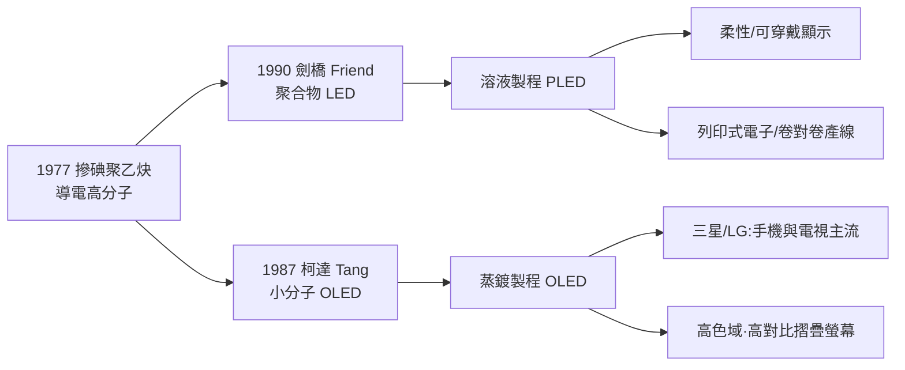
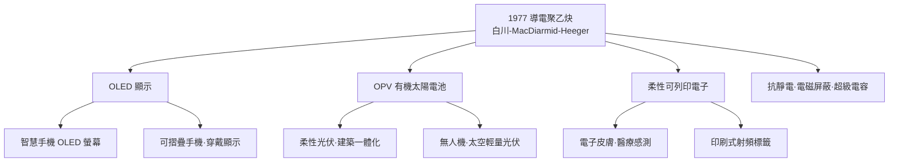

# 跨國聯手：導電高分子引爆 OLED 與太陽能革命

## 從實驗室的銀色薄膜到產業的柔性之光

導電高分子在 1977 年誕生後，產業化的路徑大致沿三條支線展開：**顯示器（OLED）**、**能源（有機太陽電池 OPV）**、**柔性電子（可列印電子）**。三者的共同地基，是摻碘聚乙炔那記「十二個數量級」的示範——它證明共軛高分子的電性可以在液相、低溫下被人設計與控制。這一點對產業的意義超過任何一項單性能指標：**電子器件第一次可以離開真空與單晶**。

## OLED：顯示器產業的權力轉移

1987 年，柯達（Eastman Kodak）的**鄧青雲（C. W. Tang）與 Steven VanSlyke** 發表了第一顆具實用效能的**有機發光二極體（OLED）**：以有機小分子 Alq3 為發光層，蒸鍍器件在低壓下發出明亮、均勻的光。這篇論文是現代顯示器史的分水嶺——**每一個像素本身就是光源**，不再需要背光板。

鄧青雲是香港出生的華裔科學家，在柯達原本研究的是影印機用的有機光電導材料（organic photoconductor）。柯達數十年累積的有機薄膜與蒸鍍技術，使他能把「複印機的化學」溢出到「顯示器的化學」——這是企業實驗室內部技術路徑常常不按計畫走、卻意外開出新枝的典型。

OLED 產業鏈之後分三階段推進：

1. **1990 年代**：小分子蒸鍍 OLED 成熟，Pioneer 於 1997 年量產車用音響面板，是首次商品化；
2. **2000 年代**：**聚合物 OLED（PLED）**打開溶液製程路線——劍橋大學 Richard Friend 團隊 1990 年的聚合物 LED 是其源頭，「可列印顯示器」成為新詞；
3. **2010 年代**：**三星**以 OLED 拿下智慧手機螢幕的主流地位，**LG** 把它推向大尺寸電視，台灣與中國的面板業（友達、京東方等）跟進整合——OLED 由實驗室一躍成為每年千億美元量級產業。

## OPV：可以摺疊的太陽能

第二條支線是**有機太陽能電池（organic photovoltaic, OPV）**。第一槍同樣來自柯達：1986 年，鄧青雲發表第一顆具有清潔雙層結構的有機太陽能電池，效率約 1%——數值雖低，卻證明有機材料可以將光轉為電。

今日 OPV 的核心結構是**本體異質結（bulk heterojunction, BHJ）**：把給體聚合物與受體分子混成奈米尺度的互穿網路，讓光生激子在擴散距離內分解成自由電荷。材料史上的選手一路更迭：從 **P3HT**（聚噻吩衍生物）配富勒烯 $\mathrm{PC_{60}BM}$，到 2010 年代後期的**非富勒烯受體（NFA，如 ITIC、Y6 系列）**，認證效率已推到**約 19%**，逼近非晶矽。

相較於矽晶太陽能，OPV 的不可取代之處有三：

- **柔性、可摺疊、超輕**：貼於建築幕牆、無人機翼面、太空載具；
- **可溶液製程**：借印刷產業的**卷對捲（roll-to-roll）**產線，長期成本曲線完全不同於矽的高溫晶圓路線；
- **可調色與半透明**：可做成往建築玻璃「順光取電」的窗。

## 制度、經濟與政治：一場多國的接力

這段產業史是科技、經濟、制度、文化互相驅動的教科書案例：

- **企業實驗室的黃金年代**：柯達的 OLED 出自影印機化學的技術溢出；它證明壟斷利潤餵養的內部研究能長出無法規劃的果實——而柯達自己，卻在數位轉型的風暴中破產，其發明由他人收成，是「創新者困境」最諷刺的註腳；
- **學術—風險資本機制**：劍橋 Friend 團隊的聚合物 LED 催生了 CDT 等衍生公司，英國開啟了「大學科技成果新創化」的先例；
- **日韓台的工業接力**：日本出材料與精度設備，韓國三星、LG 完成大規模量產與市場引爆，台灣提供面板與供應鏈整合。OLED 是冷戰後東亞電子分工的縮影；
- **碳中和的政治經濟**：2010 年代起，歐盟、韓國、中國先後把柔性光伏與有機電子列入國家科研重點——氣候政策為 OPV 輸入了一整套 1970 年代無法想像的資源；
- **教育與文化**：白川英樹獲獎後，「塑膠能導電」寫進日本、韓國中學科學教材，築波大學設立紀念講座；一個實驗室失誤，變成一整代年輕人的啟蒙故事。

## 白川英樹的「工程師哲學」

白川英樹一生自認是**材料工程師**，而非純理論化學家。得獎後他反覆強調三條工程師式的科學美德：

1. **不丟棄異常**：那片銀色薄膜若第一眼被當失敗品倒掉，整個產業不會出現；
2. **工業型直覺**：從石橋輪胎回到學院的經歷，使他永遠把「能不能做成薄膜、能量到什麼精度」放在理論之前；
3. **跨國、跨領域合作**：日本化學與美國物理的聯手、韓國留學生的催化劑、英國的發光突破——沒有一環可以缺席。

他在諾貝爾演說中說：「我的發現是由失誤與偶然組合而成；但把偶然轉化成重大發現的，是長期的耐心，以及對材料命運的謙遜。」

## 導電高分子：現代科技樹的遺產

## 一場跨國的化學遠行

這一章同時登場的名字來自五個國家：日本（東京工業大學）、美國（賓州大學與柯達）、英國（劍橋）、韓國（三星、LG）、以及台灣與中國的面板及光伏供應鏈。從一片「催化劑加錯千倍」的銀色薄膜，到今日握在我們掌中的可摺疊螢幕與貼在窗上的光伏膜——導電高分子的五十年，是戰後國際科學分工、企業內部自由研究與氣候時代政策資本共同搭建的一次遠征。

而整段遠征的起點，只是白川英樹那個樸素的判斷：「**不丟棄異常。**」
