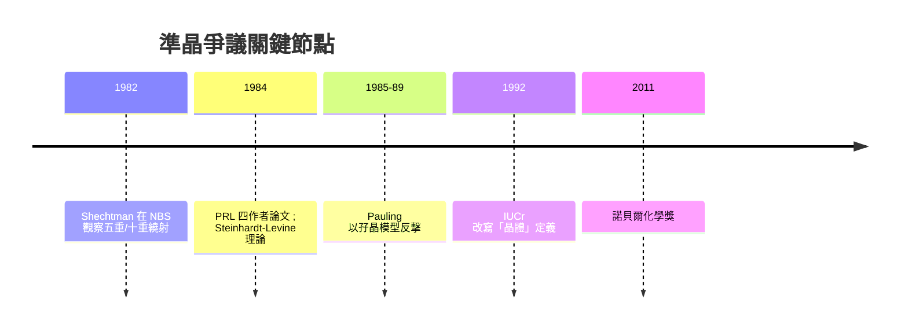

# 權威的嘲弄：鮑林與「準科學家」

## 「沒有準晶體，只有準科學家」

1987 年左右，一個小型國際會議上，年近九旬的 Linus Pauling——兩度諾貝爾獎得主（1954 年化學獎、1962 年和平獎）、晶體化學的奠基者——當眾對 Shechtman 說出了那句將被寫進科學史的話：

> 「Dan, **there is no such thing as quasicrystals, only quasiscientists**.」——「世上沒有什麼準晶體，只有準科學家。」

Pauling 不是打混仗的外行。他隨後幾年持續以正式論文反擊：1985 年在《Nature》、1987 年在《PRL》，他主張 Al–Mn 相其實是普通的「多重孖晶」（multiple twinning）——把正常二十面體小晶疊錯疊起來，可以假裝出五重繞射。他自視為晶體學的守門人：他的觀察是，自己「研究了七十年的晶體」。1989 年在《Physica B》等處，他繼續提出退火可把準晶「變回」普通晶體的證據。歷史判決在此後不久出爐：高品質準晶的繞射點遠比任何孖晶模型能解釋的更銳利、更有 $n$ 無理數的準週期規律；退火反而讓準晶**更完美**，而不是瓦解。但這對當時的 Shechtman 沒有安慰作用——被 Pauling 點名，等於被化學界的重心宣布出局。

## 更近處的屈辱：Technion 的觀察組

比 Pauling 更傷人的是身邊人的態度。Shechtman 回到 Technion 後，把自己 1982 年的數據與論文初稿交給所屬研究組，遭到研究組領導的冷待，並被要求「退出我這個組」——他被逐出研究組，且高層對他的主張深表不耐。多年後他在領獎演說中描述那幾年：他成了院裡的謎、被同情的對象、一個「聲稱違反教科書」的笑柄。他自嘲：「我沒有被開除，我只是被丟出大門，所有人都高興少了一個麻煩。」

真正接住他的是美國。1984 年，NIST/NBS 的理論金屬物理學家 **John W. Cahn** 邀請他在附近工作並共同整理數據，隨後與 Blech、Gratias 合成 PRL 論文。1984 至 1987 年，大部分時間 Shechtman 在美度過——**7 年**間他在美國的訪問與工作（NBS/NIST、約翰斯·霍普金斯一帶），Technion 與以色列學界對他的接納要等到國際共識形成之後才姍姍來遲。

## 幾何學的轉譯：Penrose 鋪磚走進物理

理論上的轉捩點來自數學家與物理學家的隔空合作。1970 年代，Roger Penrose 構造出一種只由兩種磚塊（「胖」「瘦」菱形）組成的鋪滿平面卻**永不重複**的模式——白話地說，平面被鋪得像晶體一樣密合，卻沒有任何平移週期。這由黃金比 $ \phi = \tfrac{1+\sqrt{5}}2 $ 支配的非週期鋪磚，1984 年被賓大的 Paul Steinhardt 與博士生 Dov Levine 推廣到三維：二十面體的準週期結構可以像 Penrose 鋪磚一樣「密合而不重複」，不僅合法而且繞射銳利。他們在 1984 年 12 月《PRL》提出 **quasicrystal** 一詞，正是與 Shechtman 的 PRL 前後相隔三週。這一次，數學先行、物理跟上的路徑完成了一個教科書式的典範轉移。

## 制度的重寫：1992 IUCr 改定義

當理論與實驗都推向滿格之後，剩下唯一的戰場是**制度的語言**。「晶體」的定義本身——教材、索引（如國際晶體學表）、期刊分類——期性文字是根深蒂固的保守規則。1992 年，國際晶體學聯合會（IUCr）正式改寫定義：晶體是「**任何具有明確離散繞射圖樣的固體**」——把繞射從結果倒推回定義，讓「無週期但長程有序」的物相也能合法擁有晶體的身分。這是二十世紀物理學中少見的一次「名詞級的典範轉移」：一次會議文件改動數行，就使 150 年的教科書與之一夕改軌。新興期刊如《Journal of Non-Crystalline Solids》及專門的準晶研討會迅速成形，歐洲與日本的多個金屬研究所（法國 CNRS、日本東北大學等）把準晶變成一個穩定的研究領域。

## Pauling 的最後頑抗與 Shechtman 的沉默十年

Pauling 至 1994 年去世前都沒有承認準晶需修正傳統晶體學——他臨終前最後的科學對手之一就是準晶理論。Shechtman 的態度出奇節制：他從不與 Pauling 進行媒體對罵，多年後只說了一句很準的話：「Pauling 是偉大科學家；但他在這件事上錯了，而他的錯誤證明了一件事：**再偉大的科學家，也有可能用聲望代替數據。**」這句話後來在 2011 年斯德哥爾摩被記者反覆引用。

2011 年諾貝爾化學獎宣布時，Pauling 已去世十七年；但他的那句「準科學家」被當成反面教材寫進了諾貝爾基金會的新聞稿敘事中。科學史的吊詭在於：這場論戰的最終受益人不只是 Shechtman，而是所有在「權威否定」時刻不知道該不該相信顯微鏡的年輕研究者——他們多了一個可以拿來引用的、持續七年的真實案例。

