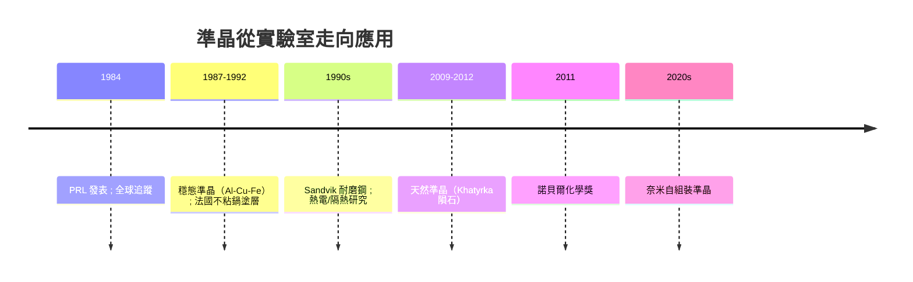
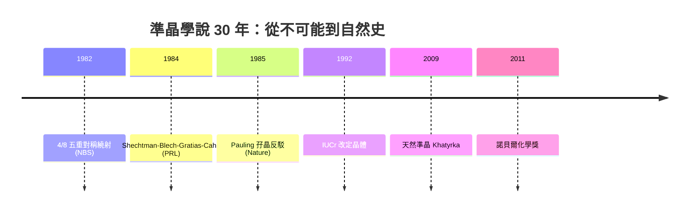

# 堅持真理：準結晶對材料科學的重構

## 從「不可能」到「填空格」：一門新物質科學的誕生

一旦準晶被接受，它就不再是「奇怪的例外」，而是把晶體學的空間由五種對稱擴充到幾乎無限多種對稱的新框架：二維可以有 5、8、10、12 重準晶，三維則出現二十面體準晶的「完美相」。整個熱力學圖景隨之重畫——過去的相圖（phase diagram）只在二元與三元合金中找「週期相」，如今科學家知道在變大的成分空間的特定成分附近，等電子濃度的自由能極小值會落在準晶相上。這正是 **Hume-Rothery 規則**（電子濃度決定金屬間化合物結構）這條一百年的老規則在準晶身上獲得的延伸。日本東北大學的蔡安邦（An-Pang Tsai）與井上明久（Akihisa Inoue）等團隊以精確的化學計量設計，證明多種準晶（Al–Pd–Mn、Al–Cu–Fe、Zn–Mg–RE 等）是「穩態」而非「亞穩態」：它們可以在平衡條件下生長出毫米級的完美晶體，熱力學上如同一顆真正的礦物。

## 物理：有點叛逆的性質組合

準晶的性質組合非常有工程吸引力：

- **硬度高、摩擦低**：晶體的「滑移面」在準晶身上原則上不存在，因此耐磨、抗刮；
- **導熱低、導電也偏低**：繞射「開了洞」，週期崩壞阻斷了電子與聲子的長距離傳輸——準晶是金屬合金中的「半絕緣體」；
- **不粘、抗氧化**：Al–Cu–Fe 等準晶表面能低，煎烤時不易沾附。
- 一個多世紀以來，材料學家習慣在週期晶體（強）與非晶玻璃（韌）之間取捨；準晶提供了第三種選項。

最富戲劇性的應用出現在法國。CNRS 的一支團隊（C. Janot 等人）與工業夥伴合作，開發含準晶顆粒的合金塗層，做成不粘平底鍋與隔熱塗層。瑞典工程公司 **Sandvik**（山特维克）則推出含準晶分散相的鋼材，用於耐磨零件。準晶也被做成熱電材料的候選與氫儲存介質的研究——低導熱恰好是熱電材料夢寐以求的特質。

## 天然的準晶：地質學的最後背書

2009 年前後，普林斯頓的 Luca Bindi 與 Paul Steinhardt 在 Chukotka 半島的 **Khatyrka** 隕石中發現了天然形成的二十面體準晶（icosahedrite，Al₆₃Cu₂₄Fe₁₃）。這一發現意味著準晶不僅能在實驗室的急冷金屬中靠「機會」存在，也能在行星演化、高壓衝擊等天然條件下生成並保存至今。原本的「物理上不可能」到「冶金限度的意外」再到「宇宙中自然存在」，準晶的認識論地位完成了三連跳：**一種物質，若是真實的、可穩定的、可在沒有人類干預下出現的，那教科書的舊定義就必須讓位**。

## 二十一世紀的新挑戰：奈米世界的準晶

2010 年代之後，準晶思想從冶金擴散到軟物質與奈米科技：膠體微球、高分子微球、金奈米粒子自組裝，在程式化條件下自發構成五重、十重、十二重準週期排布。準晶不再是「合金的奇癖」，而成為一種**普適的在非週期中達成長程秩序的方式**——這正是它的哲學深度。它告訴工程師：「有序」與「重複」是兩回事，長程紀律不以週期為前提。這樣的準則在光子晶體（準晶光子晶體以其「既局域又傳導」的光學模式聞名）、表面科學與准晶體超材料中不斷被複用。

## 為什麼值得寫進傳記：性格與歷史的鏈條

2011 年 10 月 5 日，瑞典皇家科學院宣布 Dan Shechtman 獨得諾貝爾化學獎。他在記者會上再次講那個反覆出現的故事：1982 年的顯微鏡、Eyn chaya kazo、被逐出研究組、7 年美国、Pauling 的嘲弄。他強調的教訓並非「堅持就會成功」，而更冷靜：**科學的第一條紀律是懷疑自己**。「我做了五次實驗，才敢相信；我做了三年，才敢發表。」這句自述與這本書的主題遙相呼應：他不等待制度，但也不衝動發表；他被社群放逐，卻從未以對罵回應；他把休息留給顯微鏡，把嘲笑還給時間。

從文化層面看，準晶與幽門螺桿菌的故事底下有一條共同的線：兩者的反例都先於理論存在，且都靠「憨人看眼睛」的方式而非偉大理論的推演獲得承認。教科書、編輯、審稿人與諾貝爾委員會之間的落差，最終是由「把東西丟進顯微鏡、培養箱與自己嘴裡」的人填平的。科技驅動經濟（不粘鍋、耐磨鋼、根除療法市場重構），經濔回頭資助制度（期刊、研討會、教學改革），制度重新敘述文化（教科書重寫、紀錄片、諾貝爾演講），文化再餵養下一代對「不可能」的警覺——這正是本書每一章想要完成的那張圖。

