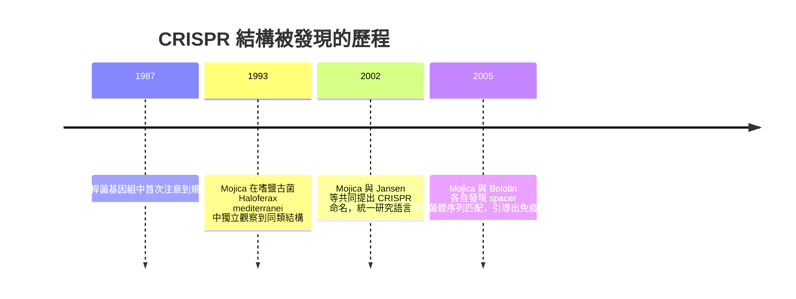

# 被誤當垃圾基因的重複 DNA 序列

## 一段被註記「意義未知」的怪異序列

1987 年，任職於日本的研究者石野良泉（Yoshizumi Ishino）在分析大腸桿菌基因組時，與同事在解讀 iap 基因（鹼性磷酸酶同工酶轉化酶）側翼的序列時，注意到一個奇怪的結構：一串以約 29 個鹼基為單位、重複出現的序列，彼此之間被 32 個鹼基的「間隔序列」分隔開。石野在論文的討論段落裡輕描淡寫地寫下一句：這些重複序列「在其他地方沒有見過，其生物學意義未知」。

誰也沒有想到，這一句「意義未知」，二十五年後會成為國際科學敘事的核心、並改寫醫藥與農業的歷史。石野本人後來回憶說，當時他並沒有特別興奮——那只是一段序列上的「怪東西」，他甚至沒有繼續追下去。一個被日常瑣事淹沒的觀察，就這樣靜靜地躺在文獻的長河中。

## 「垃圾 DNA」的黃金年代

要理解為什麼這個發現被時代忽略了，必須還原 1990 年代的科學氛圍。人類基因體計畫啟動前後，分子生物學的主流共識是：會編碼蛋白質的基因是「有用的」，剩下的非編碼序列則是演化留下的廢棄物。壓縮在教科書裡的一個詞——"junk DNA"（垃圾 DNA）——不只是一種解釋，更形成一種研究綱領：敬而遠之。資金、人才、頂級期刊的版面，全部流向「找基因、讀基因、改基因」的方向。

在這樣的氛圍裡，一段不編碼蛋白、功能不明、還只存在於低等原核生物中的重複序列，幾乎注定不會有任何人撥經費去研究。加上當時的生物資訊學剛剛起步，電腦算力貧瘠，序列資料庫稀疏，要做大規模的「模式比對」根本無從下手。科學史上無數次證明：一項發現能不能被看見，不只靠發現者的眼力，還要看整個知識體系準備好了沒有。

## Mojica：十年堅持一件「無名之物」

轉機來自西班牙亞利坎特大學（Universidad de Alicante）的微生物學家弗朗西斯科·莫吉卡（Francisco Mojica）。1993 年，他在研究嗜鹽古菌 Haloferax mediterranei 時，首次在這種於極端環境中生存的微生物基因體裡，觀察到類似的「規律間隔重複短回文序列」。隨後他花了將近十年時間，忍受經費審查者的訕笑與同行的勸退，系統性比對了大量微生物基因組序。

期間他經歷了幾個關鍵的「不放棄」：一是他發現這類結構廣泛存在於原核生物（細菌與古菌）中，顯示它們是有功能的，而非偶然的垃圾；二是他注意到，回文結構 repeats 總是固定側接著 spacer；三是當荷蘭的魯德·揚森（Ruud Jansen）等人在 2002 年與他共同提出統一命名，以之取代十多年來散亂的稱呼，最終定下那個長達 16 個字的縮寫：CRISPR，規律成簇、間隔的短回文重複（Clustered Regularly Interspaced Short Palindromic Repeats）。命名看似小事，其實是一門科學「制度化」的標誌——有了統一詞彙，全世界的論文才能互相銜接、索引與檢索。

## 2005：Mojica 的直覺大躍進

真正的突破出現在 2005 年。當新的微生物基因組序列資料庫擴大後，莫吉卡把 spacer 序列拿去與病毒基因庫比對，得到一個震撼的結果：spacer 不是隨機垃圾，而是噬菌體（吞噬細菌的病毒）或質粒的基因片段。他大膽推論：CRISPR 可能是一種對抗噬菌體感染的免疫或記憶系統。同一時期，俄羅斯的亞歷山大·博洛金（Alexander Bolotin）在分析不同環境下的微生物時，也獨立發現 spacer 與噬菌體序列一一對應的規律。

這個假說在當時過於大膽，投稿屢屢遭拒。審稿者的邏輯很典型：既然主流教科書認為原核生物沒有後天免疫能力，spacer 不過是演化碎片，那麼把「垃圾」解釋為「免疫系統」看起來就是荒謬的。這是教科書阻礙科學的一次典型案例。

## 本章小結：從「垃圾」到「金礦」的社會學

回望 CRISPR 結構被發現的近二十年歷史，可以看到一條典型的「意外—忽略—堅持—轉化」曲線：

石野的敏銳、Mojica 的十年堅持、Jansen 的制度性整合、Bolotin 的獨立複證——每個人的角色都不可缺。而整個過程中，「垃圾 DNA」這個發生在 1990 年代特定知識氛圍中的偏見，幾乎扼殺了這項發現。教訓是深刻的：所謂「垃圾」，往往只是我們暫時的無知；所謂「沒有意義」，往往是我們還沒換一副眼鏡。

這條路遠未走完。CRISPR 到底能不能真正對抗噬菌體？誰在什麼樣的實驗裡證明了這件事？答案在下一章。
