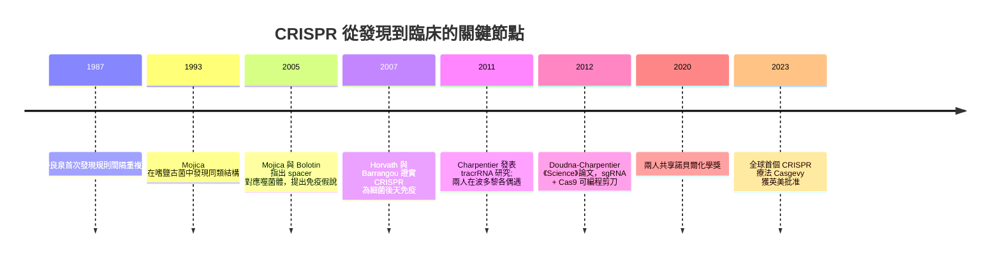

# 杜德納與卡彭蒂耶：把細菌防衛轉化為基因剪刀

## 宛如電影的相遇

2011 年，波多黎各聖胡安舉行的一場美國微生物學會會議上，兩位各自埋首的科學家在地下室咖啡廳偶遇。一位是法國微生物學家埃瑪努埃爾·夏彭蒂耶（Emmanuelle Charpentier），當時在瑞典于默奧大學（Umeå University）主持一個資源有限的小型研究團隊；另一位是加州大學柏克萊分校的 RNA 結構生物學家珍妮佛·杜德納（Jennifer Doudna），在該領域早已聲望赫赫。

夏彭蒂耶當時正在追蹤化膿鏈球菌（Streptococcus pyogenes）中一個不尋常的 RNA 分子——tracrRNA（trans-activating crRNA，與 crRNA 反向互補的轉錄 RNA）。她與團隊在 2011 年發表的研究中提出：tracrRNA 是 Type II CRISPR 系統運作所必需的，它與 crRNA 配對，共同引導 Cas9 定位目標 DNA。但要在分子層面確認「誰與誰相遇、Cas9 究竟怎麼切」，需要結構生物學的功力。而杜德納的專長，正是 RNA 結構。

這一場「在會場走廊上撞見對方」的相遇，成為後來一切的起點。

## 2012 年：雙 RNA → 單一嚮導 RNA → 可編程剪刀

聖胡安的咖啡簾幕之後，是一連串飛越太平洋與大西洋的合作通訊。兩人團隊合力產出了 2012 年 6 月發表於《Science》的論文：《A Programmable Dual-RNA-Guided DNA Endonuclease in Adaptive Bacterial Immunity》。核心發現層層遞進：

- **識別機制**：Cas9 之能切對位置，是因為 crRNA 帶有與目標互補的序列；
- **兩分子缺一不可**：crRNA 需要 tracrRNA 的骨架配合，缺一 Cas9 便無法工作；
- **融合簡化**：把兩者合成一條嵌合 sgRNA 之後，系統照常運作；
- **可重編程**：只要改寫 sgRNA 的十幾個鹼基，就能把 Cas9「指揮」去切任何指定的序列——前提是附近有 PAM（前間隔序列鄰近基序，如 5'-NGG-3'）這個識別標記，否則不切；
- **在體外**驗證了上述一切，證明它原則上可以在任何物種的細胞裡「編輯」。

這是一篇沒有花俏儀器、只用了幾百美元試劑就完成的論文，卻隨後觸發了二十一世紀迄今最大的生物醫學革命之一。

## 從論文到世界的競賽

2012 年之後，CRISPR-Cas9 迅速進入「競速模式」。張鋒、George Church 等團隊於 2013 年率先把 Cas9 成功用在人類與小鼠細胞的編輯上，把工具真正推進活細胞。隨之而來的是急速的產業化：Editas Medicine、Intellia Therapeutics、CRISPR Therapeutics 等公司陸續成立，累計募資數十億美元；專利戰（加州大學系統對 Broad Institute）也從一開始就點燃，纏鬥多年，成為史上最受注目的生物專利訴訟之一。

與此同時，社會與政治的反應同樣劇烈。2018 年，中國學者賀建奎宣布誕生了經 CRISPR-Cas9 編輯的「基因編輯嬰兒」，引發全球科學界幾乎同聲嚴厲譴責——原因是程序不透明、人體試驗倫理防護完全失位、風險與獲益不成比例。這起事件使得各國加快為 CRISPR 治療與生殖系編輯劃定法律紅線，也使諾貝爾委員會在 2020 年頒獎時，明確把技術的光明與風險並列討論。

## 2020 年：諾貝爾化學獎與臨床之花

2020 年，諾貝爾化學獎授予埃瑪努埃爾·夏彭蒂耶與珍妮佛·杜德納，表彰她們「開發了基因組編輯的方法」。值得注意的是，獎項只授予兩人並落在化學獎，背後是對技術工具屬性與化學（分子識別與切割）本質的綜合考量。這次授獎距離 2012 年的論文不過八年——在以「慢」著稱的諾貝爾史上相當罕見。

此後這門技術穿過漫長的臨床驗證，終於在 2023 年開出第一朵臨床之花：全球首個獲批的 CRISPR 療法 Casgevy（exagamglogene autotemcel）相繼獲英國藥品監管機構與美國 FDA 批准，用於治療鐮刀型紅血球疾病（鐮刀型貧血）——基因編輯史上第一次，「不治之症」在教科書上被改寫為「可被編輯」的疾病。

## 本章小結：每一次咖啡相遇都可能改寫世界

回顧這一段，值得放進記憶的不只是那篇《Science》論文，還有三個人性的瞬間：夏彭蒂耶在資源捉襟見肘的小實驗室裡，堅持追問 tracrRNA 的意義；杜德納在學術會議的咖啡廳裡停下腳步，與素不相識的同行詳談；兩人跨越大洋與時區，把一個來自食品工業的微生物學細節，重塑為把整條 DNA 剪開的能力。

科學的地基從來不是「計畫」出來的，而是由敏銳、合作與意外的相遇一塊塊鋪成。
