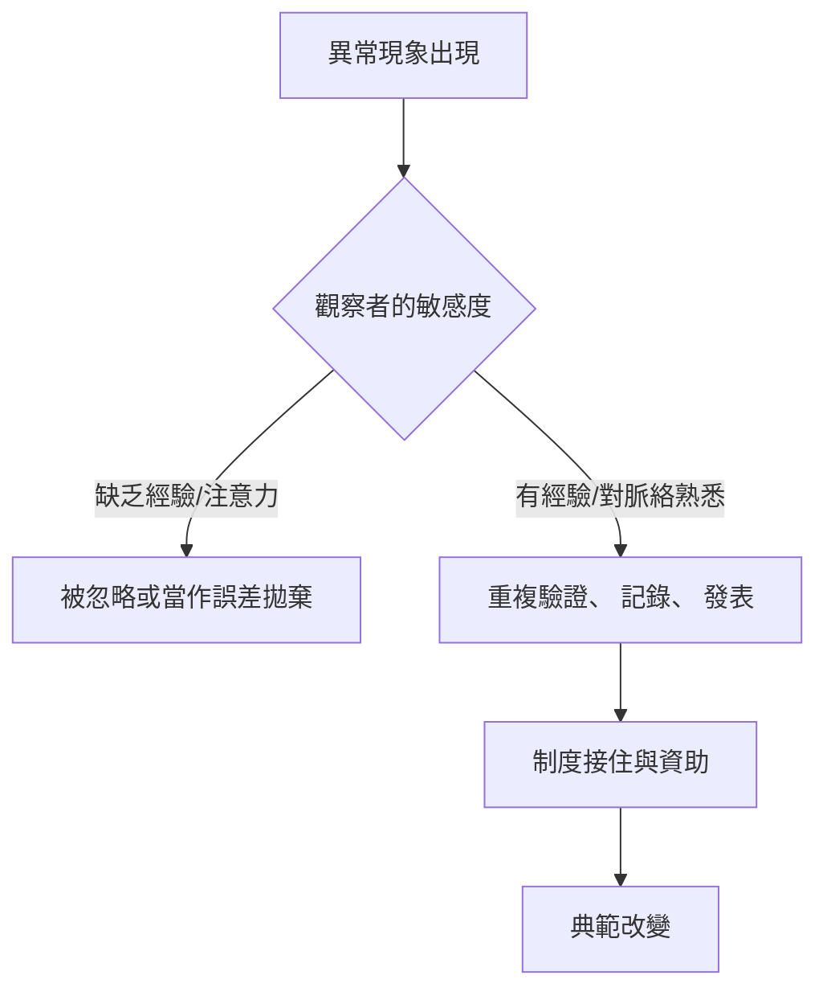

# 為什麼重大突破無法被預先計畫

## 字源：三王子的故事

英語裡的「Serendipity」是一個奇特而難以翻譯的詞，它的誕生本身就是一次意外。1754 年 1 月 28 日，英國作家霍勒斯·渥波爾（Horace Walpole）在寫給友人賀拉斯·曼（Horace Mann）的一封信裡，需要形容一個他自認「聰明」的洞察，便從他讀過的波斯童話《The Three Princes of Serendip》造了一個新詞：三位塞倫迪普王子總是「靠意外與智慧，發現他們並不曾尋找的東西」。Serendip 是錫蘭（今斯里蘭卡）在中古波斯語裡的舊名。

這個新詞後來被反覆重提。社會學家羅伯特·默頓（Robert K. Merton）將它帶入科學社會學，提出「意外發現模式（serendipity pattern）」：研究者原本以為在解決 A 問題，卻意外撞出了 B。1976 年，默頓在一篇回顧性文章中系統地整理了這個詞的源流，並指出：科學的進展從來不只靠「按計畫完成」一條軌道，還有大量被意外改寫的關鍵節點。巴斯德的著名格言——「機會偏愛有準備的心靈（chance favors the prepared mind）」——正是同一個意思的另一種表述：意外只會選擇那些有能力理解它的人。

## 案例檢視：意外為什麼會變成發現

X 射線的發現常被講成「意外」，但歷史真相更複雜。1895 年 11 月，倫琴（Wilhelm Röntgen）在維爾茲堡的實驗室裡已是深耕陰極射線多年的資深物理學家。當他看到鋁箔遮蔽之後的螢光屏依舊發光，這個「反常」立刻吸引了他的注意；換作一個初學者，可能只會覺得「儀器好像壞了」。同樣，放射性是被亨利·貝克勒（Henri Becquerel）觀察到的，但他家兩代人都是研究螢光與磷光的物理學家，工作環境裡正好存放著鈾鹽與未曝光的底片。換言之，發現者的身份從來都不是隨機的——這不是運氣，而是「準備好的心靈」。一個「意外」能否轉化為發現，至少取決於三件事：

## 制度的土壤

科學革命從來不只在於「天才」，更在於一種制度性的土壤：

**穩定的經費與自由度。** 大多數的意外發現（例如青黴素、X 射線）都誕生於「編制充分但目標不太拘泥」的環境。那些資助程序高度精細、動輒要求在三到五年內出具明確 KPI 的模式，往往不利於孕育真正新的東西；相反，個別大學、企業或研究機構保留「非定向研究」的小額預算，卻能在長期出現不可計畫的豐收。

**開放的共享與流動。** 意外發現需要交叉混搭，這要求研究者之間有順暢的溝通。青黴素之所以能在十年之內從弗萊明的培養皿變成挽救生命的藥品，靠的是牛津的研究、英國的戰時政府支持、以及美國 Pfizer、Merck 等產業網絡的配合。沒有這套結構，那個培養皿就只是一樁實驗室軼事。

**對異常的寬容。** 審稿人、經費審查委員會與實驗室主任對「奇怪的結果」的態度，直接決定異常是被記錄、被討論，還是被刪除、被退回。

## 與「指標驅動研究」的張力

反過來看，今天的研究環境正朝著令人擔憂的方向移動。「Publish or perish」（不發表就出局）、以影響因子評職稱、資助高度依賴事先寫死「預期成果」的提案、以及頂級期刊加劇精品化的發表壓力——這些都在把研究推向「只照計畫產出」的軌道。在這種誘因結構下，一旦數據出現奇怪，最「理性」的策略往往是剔除、修補，或者把它裝進一個已經準備好的故事裡。原本是獎勵「照計畫完成科學」的評估系統，不知不覺把「意外」從制度裡擠了出去。

默頓早在二十世紀中葉就敏銳指出：科學社會學必須同時關注「制度如何獎勵正常的科學」與「制度是否還讓反常的發現能夠存活」。這是關於「unexpected observation」的治理問題——不是抽象的哲學，而是組織設計的真實課題。

## 青黴素：制度如何接住幸運

弗萊明 1928 年的「黴菌盤」是意外，但它能變成 1945 年的諾貝爾獎，靠的是十多年後的另一群人：牛津的弗洛里、錢恩與希特利在英國戰時動員與美國政府的資助下，把提純、量產、臨床試驗一一做完。這提示我們，重大突破常常有「兩段式」的結構——第一段是敏銳的觀察者抓住異常；第二段是制度與產業把發現規模化成技術。缺了任何一段，青黴素都只是歷史角落裡的一句閒話。

## 本章小結

重大突破不能被預先計畫，並不是否定計畫的價值——計畫保證了系統起碼的正常運轉。真正的智慧在於：設計一個「計畫之外的結果仍然能被聽見」的系統。這需要為年輕科學家保留沒有考核壓力的思考時間，需要保持不同學科之間的制度性走廊，需要在評估體系裡為「暫時沒有產出但探索了新方向」留一席之地。一個社會最好的投資，不只是資助那些一定會成功的項目，更是為「那一刻」的來臨預留生命空間。
