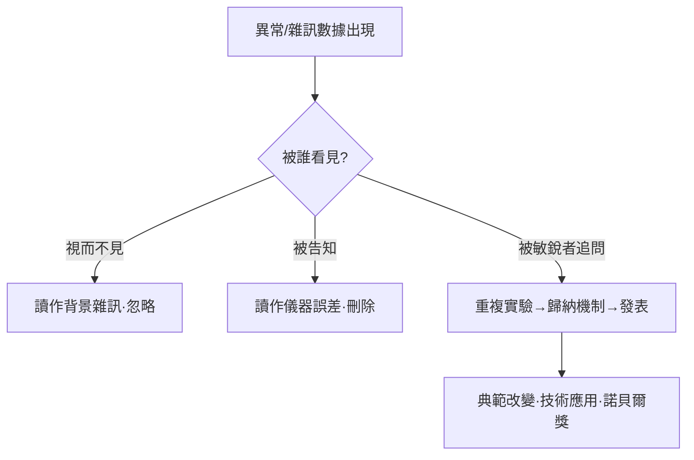
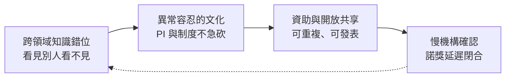

# 跨領域交叉與對異常數據的敏銳度

## 「錯位」的眼睛

科學史上一個反覆出現的模式是：真正開創性的發現，常出自一個「不完全屬於那個領域的人」。青黴素的發現者弗萊明是細菌學家，但他在第一次世界大戰做過戰地醫療，親眼目睹細菌感染造成的死亡，因而一生對「殺菌與免疫」保持高度敏感；巴里·馬歇爾與羅賓·沃倫發現胃潰瘍其實由幽門桿菌（Helicobacter pylori）造成，靠的不是服從教科書「胃裡不可能有細菌」的教條——沃倫是病理學家，在顯微鏡下看見了別人忽略的螺旋菌；年輕的消化科醫師馬歇爾甚至敢親口喝下細菌培養液自我感染，以證明因果。

宇宙微波背景輻射（CMB）的發現更是「錯位」的絕佳戲劇。1964 年，貝爾實驗室的阿諾·彭齊亞斯（Arno Penzias）與羅伯特·威爾遜（Robert Wilson）是微波通訊工程師，他們調試一台原本為衛星通訊設計的號角天線時，怎麼都刪不掉大約 3.5 K 的背景雜訊——他們一度懷疑是天線裡白鴿落下的鳥糞引起的。而就在幾十公里外的普林斯頓，Robert Dicke 團隊正在尋找恰好是這種訊號的宇宙學殘餘輻射。一個不懂宇宙學的工程問題，與一個不懂工程設備細節的理論預期，在一通電話裡交叉，撞出了 1978 年的諾貝爾物理學獎。如果他們不是工程師，可能一開始就把那雜訊當設備故障刪掉；如果他們不在貝爾實驗室，可能根本接觸不到那台天線。歷史就這樣被「錯位」改寫。

## 異常數據的三種結局

凡實驗都會產生異常數據。異常數據的命運，可以歸為三種：

第一道關是「看」：很多異常根本沒有進入意識，因為初學者不知道「什麼是奇怪的」。第二道關是「判斷」：在實驗室文化裡，資深研究者常會一句話打發——「梯度不對，重跑」。如果 PI 的知識不夠跨域、或過於看重結果的美觀，異常就被判死刑。第三道關是「轉化」：只有少數人——通常是有外來背景、或曾被訓練過「不舒服就要追問」的人——會重複實驗、追根究底，把異常變成真正的發現。

## 教育制度怎樣製造（或消滅）敏銳度

從這個角度審視現代科學教育，可以看到一種張力。博士培養與 PI 導師制本應是傳遞「判斷力」的通道——好的導師會帶著學生一起看異常，講述「當年我也被這個數據騙過」。但當實驗室以發論文為 KPI、以產出為存亡時，導師最經濟的做法是讓學生去「優化已知流程」，而不是「解釋未知現象」。於是制度性地，異常數據被系統性過濾，敏銳度不再被訓練與獎勵，而成為隨機的個人特質。

相反，有些環境刻意保留了這種敏銳度。例如某些不以論文指標衡量研究者的國家，反而留下了「用一整年去搞懂一個奇怪現象」的空間；美國、印度、中國的若干頂尖實驗室，則在制度上給年輕 PI 保留了「藍天研究（blue-sky research）預算」。歷史上，1970 年代丹·舍特曼（Dan Shechtman）在美國國家標準局發現準晶體（quasicrystal）的十重對稱衍射時，曾被團隊負責人以「回去讀讀教科書」羞辱、隨後離團；但以色列理工學院（Technion）相對的寬容與長期支持，讓他在三十年後拿到 2011 年諾貝爾化學獎。白川英樹的助手在摻雜碘時「不小心多加了一千倍」的意外，讓導電聚合物成形，同樣是在日本傳統大學體系下被幾位資深同事鼓勵繼續追下去的結果。

捨特曼、白川、彭齊亞斯與威爾遜、馬歇爾與沃倫共同見證了一件事：敏銳度不是天賦，而是一種被環境、階段與制度條件所培育的能力。

## 諾貝爾委員會的「時間功能」

諾貝爾獎的延遲授獎相當有名：許多獎在發現之後十年甚至三十年才頒（舍特曼 29 年，白川英樹 21 年，彭齊亞斯與威爾遜 14 年）。這種延遲表面上是「慎重」，實際上是制度功能：它為科學共同體留出反覆驗證、反覆爭論、典範收斂的時間。從這層意義上看，諾貝爾獎不只是榮譽，它還是一種罕見的「慢機構」——相對於科技產業的快速節奏，它恰恰讓人們停下來，衡量什麼才真正改變了對世界的詮釋。

## 「意外」轉化的四個驅動輪

綜合本章與前面的歷史案例，可以把 serendipity 轉化為發現的必要環節圖示如下：

少了任何一輪，「意外」都進不了歷史。這也意味著：要培養下一個 CRISPR 或下一顆青黴素，與其設計一個更精確的五年計畫，不如營造一個擁有更多「交叉、等待、寬容」的社會實驗環境。
