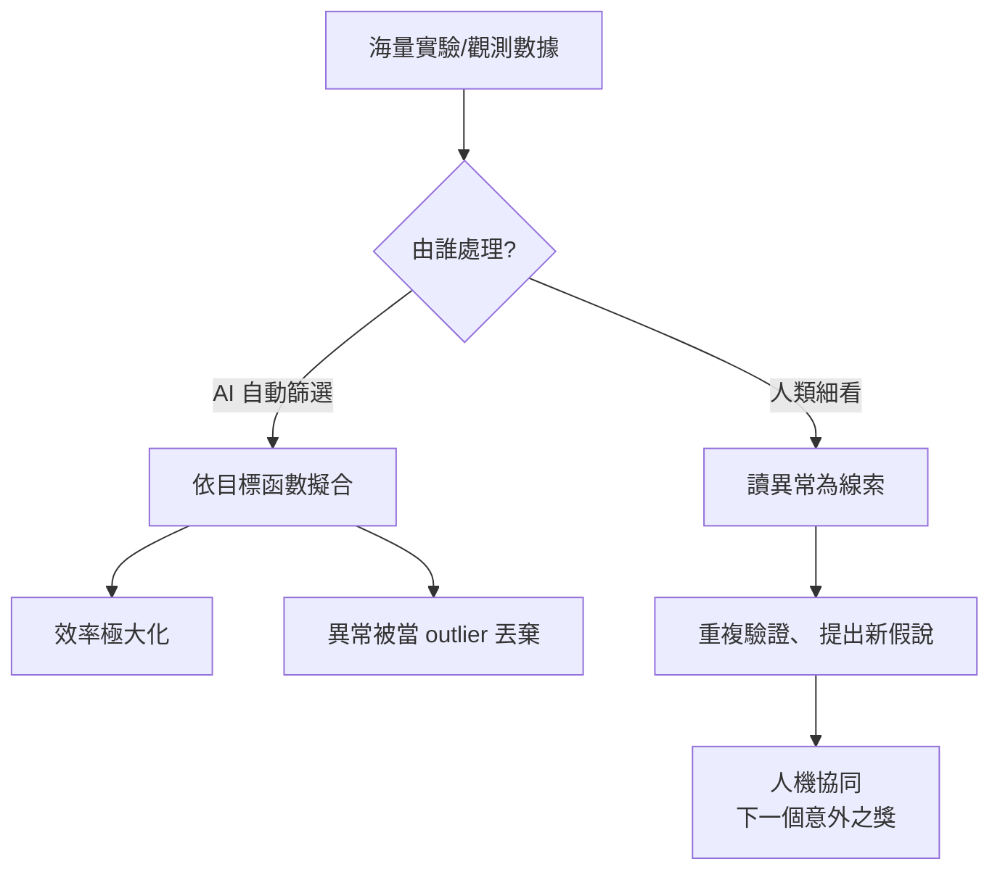

# AI 時代如何在意外中尋找下一個諾貝爾獎

## 2024：AI 走進斯德哥爾摩

2024 年 10 月，諾貝爾化學獎揭曉的那一刻，象徵著一個時代的轉折：一半頒給華盛頓大學的大衛·貝克（David Baker），表彰他在「計算蛋白質設計」上的奠基性工作——他與團隊開發的 Rosetta 系列方法，不再只是預測自然界已有的蛋白質結構，而是能夠從零開始設計出自然界從未有過的全新蛋白；另一半由 DeepMind 的德米斯·哈薩比斯（Demis Hassabis）與約翰·江珀（John Jumper）共享，他們開發的 AlphaFold2 解決了困擾結構生物學五十年的蛋白質摺疊預測難題，並將預測出的兩億多個蛋白結構開放為免費的公共資料庫。同一年的諾貝爾物理學獎則授予約翰·霍普菲爾德（John Hopfield）與傑佛里·辛頓（Geoffrey Hinton），表彰他們「利用神經網路進行機器學習」的基礎性發現與發明。

一年之內，AI 從科學的輔助工具躍升為能獨立獲獎的「主角」。這既是對 AI 的肯定，也提出一個本章要追問的難題：當機器能「設計」與「預測」，人的角色是什麼？更尖銳地說：AI 時代，還會不會出現「意外的諾貝爾獎」？

## 雙面刃：效率與盲點

AI 與大數據為科學帶來空前的效率——它能在數小時內篩過上萬條候選路徑，能識別人類視覺無法分辨的微弱訊號。但與此同時，它也帶來一個結構性的隱憂：**模型的天性是擬合目標函數，而不是欣賞異常**。當我們訓練一個模型去預測蛋白結構、診斷疾病、優化材料性能時，所有偏離訓練分布的資料點，都會被當成雜訊或離群值（outlier）排除——而過去一百年的諾獎史告訴我們，真正的突破最初往往「長得像離群值」。

青黴素的「黴菌盤」、CMB 的「刪不掉的雜訊」、準晶體的「奇怪衍射點」、CRISPR 的 spacer——這些在當年哪一個不像今天的離群值？如果當初的實驗室已被換成「全自動、以最佳化指標為唯一目標」的系統，這些發現大概率會被當成「資料清洗的失敗」直接丟棄。AI 並非中立的觀察者：它繼承了訓練者與訓練資料的偏見，甚至放大了這種偏見——因為它不會為眼前的一個小異常而停下整條流水線。

## 自駕實驗室：「計畫」得出意外嗎？

近年，self-driving labs（自動駕駛實驗室）成為熱門範式：機器人做實驗、AI 分析結果、再由 AI 決定下一個實驗，一週之內跑完人類團隊數年的循環。在材料篩選、催化優化、蛋白工程等任務上，這些系統的產出令人驚嘆；貝克實驗室後續推出的 RFdiffusion，正代表這種「AI 設計—實驗驗證」閉環的成熟，甚至連具有「意外」色彩的實驗設計都有演算法可循。

但這類系統的本質，仍是高度局部的最佳化：它極擅長在給定的目標空間裡找極值，卻不擅長在目標空間本身被錯誤定義時去質疑目標。真正的大突破，幾乎總伴隨「目標函數被重新定義」——例如夏彭蒂耶與杜德納把一套細菌的免疫系統重新解讀為「可編程的工具」。這種重新解讀的能力，建立在人類對世界的整體理解、對目的的反思、以及對「為什麼會這樣」的好奇心上，而不單純是處理資訊的容量。

## 人機協同：留給人類的三個崗位

當 AI 接手大部分常規實驗設計、資料分析與文獻綜述之後，人類科學家的價值將集中到三個難以自動化的崗位上：

1. **提出好問題。** 判斷「什麼值得研究」需要歷史感、倫理感與社會想像，這正是人文素養的用武之地。AI 只能在給定的問題空間內回答，人類才有權限改寫問題空間本身。
2. **解讀並轉化異常。** 當 AI 回報一個它無法解釋的離群點，決定「要不要為它停下整條流水線」是一種價值判斷與勇氣，屬於人的選擇。異常檢測演算法可以輔助警示，但「重視它」永遠是人的美德。
3. **跨領域對話與制度設計。** 需要有人把生物學家、化學家、程式設計師、倫理學家與社會公眾拉進同一個房間，設計讓異常能夠被聽見的制度。

在這個意義上，「下一個諾貝爾獎」很可能不再來自單一天才的直覺，而是來自一套精心設計的人機協同系統——**AI 負責把注意力引向最可能的假說，人類負責在不放棄效率的同時，開放地接住那些效率之外的小小聲音**。AlphaFold 問世後，許多結構生物學家把時間從「解析結構」轉移到「解釋結構與功能的關係、設計實驗驗證」上，整個領域的產出不降反升，便是一個正向的例子。

## 收束：給未來的一堂實驗課

回望本書一路的故事，幾乎每一次革命性突破都不是源自一個被精心計畫的項目，而是源自一雙被訓練過的眼睛、一種被保護過的好奇、一份並未被迅速打壓的敏感。當 AI 能替我們做更多工作時，尋找「下一個意外」的困難不再是技術問題，而是制度與教育的問題：我們把「奇怪」當成麻煩，還是當成最珍貴的提示？

或許可以這樣總結：**過去，諾獎多來自「有準備的人遇上意外」；未來，諾獎將更青睞「準備好的人類，與準備好『鼓勵人類』的制度，一起遇見 AI 看不見的意外」。** 科學的最深處從來不在數據裡，而在於我們對世界仍然願意提出的問題。
