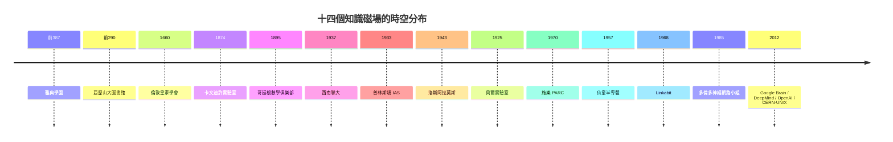

# 前言：天才為何成群而來？——人類文明背後的「群聚智慧」密碼

> 「世界的進步，取決於那些『不聽信任何人的話』並且『彼此密切合作』的人。」——改寫自皇家學會格言

## 單一天才的神話是被建構出來的

牛頓說自己「站在巨人的肩膀上」；達爾文的成功，背後是小獵犬號的國家資助、
萊爾的地質學著作、以及華萊士的平行發現。歷史反覆證明：**天才很少孤獨誕生，
天才總是成群出現**。雅典同時湧現蘇格拉底、柏拉圖、色諾芬；17 世紀的倫敦
皇家學會裡，胡克、波以耳、哈雷聚在同一間地下室；20 世紀的哥廷根、卡文迪許、
洛斯阿拉莫斯、貝爾實驗室，則是「一個屋簷下多个諾貝爾獎」的現代版。

## 群聚智慧的五個密碼

從本書的 14 個知識磁場中，我們可以提煉出反覆出現的五種要素：

1. **密度**：智者的絕對數量與近距離共處。走廊裡的閒聊比論文交換更快傳遞未成形的思想。
2. **自由度**：得以擺脫 immediate 的經濟壓力與權威審查——從亞歷山大圖書館的
   供養，到 IAS「不必教書也不必申請經費」，再到 OpenAI 的無限算力。
3. **工具與問題的齊備**：知識磁場往往同時擁有「困難的問題」與「剛好誕生的新工具」——
   卡文迪許拿到陰極射線管時，正是問題等待工具的經典時刻。
4. **制度設計**：一座知識城邦的「憲法」決定它能走多遠。皇家學會用實驗證言挑戰權威；
   施樂 PARC 用跨學科任用打破部門牆；多倫多大學神經網路小組靠的就是三位「另類」。
5. **歷史的鄰接效應**：每一天才群體幾乎都是上一群的「子代」。波蘭尼、盧瑟福、
   錢學森、維特比、辛頓——師徒譜系與人才流動串起整條文明史。

## 一條看不見的「智慧遷徙地圖"

教科書寫的是理論與方程式的傳播；本書追問的反而是——**知識為何總是「人」帶著走**？
希臘文獻隨目錄學家而流亡、納粹手下的哥廷根數學家搭船駛向普林斯頓、
戰後的貝爾工程師辭職創業、PARC 的設計師跳槽蘋果、DeepMind 的研究員
輾轉成為 OpenAI 的創辦者。知識經濟時代的最重要的「資本流動」，
其實是每一代智者的腳步聲。

## 本書結構

**第一篇**（ Ch1–2 ）古人類知識的第一次「航母化」——雅典與亞歷山大，
及以實驗取代權威的倫敦皇家學會。

**第二篇**（ Ch3–5 ）20 世紀前三個對照組：物質豐裕的卡文迪許、制度完美的哥廷根
（最終毀於極權），與物質極度匱乏卻創造奇蹟的西南聯大。

**第三篇**（ Ch6–9 ）戰火鑄造的極限組織（IAS、洛斯阿拉莫斯），與企業烏托邦
（貝爾實驗室、施樂 PARC）——兩種「有錢有自由」的模式，結局卻截然不同。

**第四篇**（ Ch10–11 ）矽谷的母體——仙童半導體，及其在無線通訊的同族兄弟
Linkabit 與高通。

**第五篇**（ Ch12–14 ）從多倫多的 AI 寒冬守候，到 Google Brain / DeepMind / OpenAI
三巨頭的算力軍備競賽，最後望向無邊界的 CERN 與全球開源社群——
那可能是「智者匯集之處」的終極形態。

---

*本書每一章為一個獨立「磁場」，各章以三節展開：其興、其學、其變與其對後世的影響。
請準備好走完 2500 年，看天才如何一次次成群而來。*
