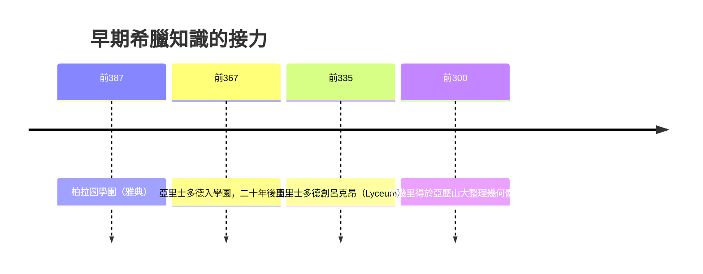

# 第 1 節 柏拉圖學園（Platonic Academy）：橄欖樹下的哲學對話與幾何禁區

## 一所沒有圍牆的學校，存在了近九百年

西元前 387 年，柏拉圖在雅典西北郊、英雄阿卡得摩斯（Academus）的橄欖林中建立學園。這裡不是官辦學府，而是一個由蘇格拉底式對話組織起來的私人社團——柏拉圖自己出資、朋友捐贈、賓客贊助維持。它一直運作到西元 529 年被查士丁尼封閉，存續近 900 年，是人類最早、也最長壽的知識磁場。

**三個制度設計：**

- **沒有固定課程，只有「共同探究」**：以自由對話與研討為核心，老師與學生是平等的思想伙伴——這是兩千年後牛津劍橋導師制的原型。
- **門口刻上「不懂幾何者勿入」**：把數學訓練當成抽象思考的體操，等於最早的「入學資格測驗」。
- **長程的知識接棒**：柏拉圖→克內西布斯（數學家）→亞里士多德→色諾克拉底……每一代的繼承不只是行政，更是一次學術計畫的延續。

## 幾何禁區：數學為何成為哲學的必經之路？

柏拉圖從畢達哥拉斯學派吸收了一個驚人的觀點：**數學不是描述世界的都科普學問，而是通向本體的工具**。在《理想國》第七卷以「洞穴譬喻」展開論證，並將「logos」提煉為宇宙的底層構造。學園要求所有學員先受幾何訓練，並非為了應試，而是為了**塑造一種「不依賴感覺」的抽象思維方式**——這正是後來歐幾里得能在亞歷山大寫下《幾何原本》的智識土壤。

## 橄欖樹下的「磁場」效果：為何一場對話能生產哲學？

學園的妙處在於：**問題是隨時可見的鄰居**。亞里士多德在這裡被兩股力量同時拉扯——柏拉圖的形上學和身邊數學家的實證傾向，這兩股張力最終催生了他對邏輯、生物、政治的全面研究；斯多亞學派的芝諾、伊比鳩魯學派的伊比鳩魯，都在同一時代的雅典街頭「客場挑戰」學園。**磁場的本質，不是天花板高，而是近鄰夠多、觀點夠衝突。**

雅典式磁場後來被亞歷山大的「國家級硬體」接力——見下一節：一座藏了近五十萬卷書的知識熔爐。