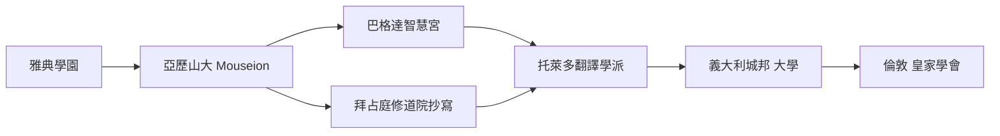

# 第 3 節 希臘、埃及與東方智慧的碰撞：古地中海世界的多元學術網絡

## 知識磁場的第一定律：多元才會撞出火花

圖書館與學園的偉大，不在「希臘人」，而在它是一個**多文明的匯兌站**：希臘移民帶來思辨傳統、埃及祭司交出天文與土地測量、巴比倫占星師提供三角與行星資料、腓尼基水手貢獻航海與字母、印度數學的數字系統沿貿易路線慢慢滲入。所謂「希臘奇蹟」，其實是地中海南岸的**知識自由貿易區**。

| 文明 | 注入的知識 | 在亞歷山大演化成的學科 |
|------|-----------|-------------------|
| 埃及 | 土地丈量、曆法、醫藥 | 幾何學、天文學、解剖學 |
| 巴比倫 | 60 進位、行星週期表 | 三角函數、系統化的天文記錄 |
| 腓尼基 | 字母、航海 | 文獻整理、地理測繪 |
| 印度 | 數字系統、醫術 | 數學記號演化的前身 |
| 希臘 | 幾何公理、邏輯論證 | 證明體系、系統哲學 |

## 「地緣磁場」的邏輯

- **貿易走廊定理**：知識磁場幾乎都出現在**貿易走廊的中點**——亞歷山大在尼羅河與愛琴海航線之間；倫敦在北海與大西洋之間；哥廷根扼中歐陸上走廊；矽谷、聖地牙哥在太平洋岸。地理從不缺席。
- **翻譯浪潮是第二波知識輸入**：希臘語的科學被譯為敘利亞語、阿拉伯語（巴格達智慧宮，8–10 世紀），再由 12 世紀西班牙托萊多譯回拉丁語。**火種的延燃，幾乎全靠翻譯者與流亡學者**。

## 從磁場走向孤島，再從孤島重生

羅馬帝國的官僚化與基督教帝國的動盪，使希臘式自由探究在西方逐步失能。直到 16 世紀，義大利城邦的數學決鬥賽（塔爾塔利亞與卡爾達諾的三次方程之爭）、私人書信網、與印刷術把「面對面的思想拳賽」重新拾回。

**人類的知識磁場休眠了約 1500 年，重生時的形態已變：不再是王室的供養，而是城市、商人與「用眼睛做實驗」的新方法。**

下一站：1660 年的倫敦，一群不想再被古人文本綁住的紳士，把「實驗」正式制度化為皇家學會。