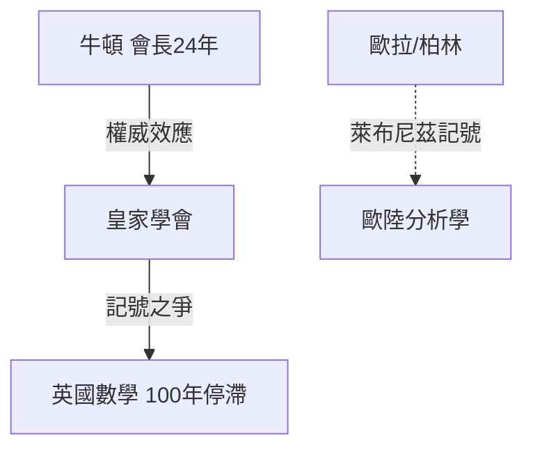

# 第 3 節 牛頓的倫敦朋友圈：鑄幣廠、咖啡館與近代科學權力的中心

## 從孤僻教授到倫敦權力動物

1687 年《自然哲學的數學原理》出版後，牛頓的人生劇烈轉折：1696 年出任倫敦鑄幣廠督察、1703 年起連任皇家學會會長 24 年到去世、1705 年封爵。**牛頓把「科學家」改造為一種可累積地位與行政資本的職業**——這是近代科學家階層的第一例「從研究所到官商網」的成功路徑。

鑄幣廠不是閒職：1696 年英鎊重鑄中，他動用鳌廠管理與刑訊手腕（追捕偽幣犯、包括偽幣大犯 William Chaloner），證明**數學嚴謹也可以用在制度暴力**。這種複合角色，是之後拉瓦錫（稅務公司）、萊布尼茲（漢諾威外交官）、朗福德火炮工廠、再到貝爾與矽谷 CEO 的原形路徑。

## 咖啡館：倫敦的平民智庫

- **格雷沙姆學院走廊**：皇家學會常年集會點，鄰近金融與商業圈；
- **Grecian、Rainbow 等咖啡館**：一便士可入座，商船水手、數學家教、報紙與謠言混在同一張桌上——「一便士大學」把知識壟斷的門檻拉低一個數量級；
- **劍橋現身說法**：牛頓的徒弟天文學家哈雷自掏腰包為《原理》付印——**科學家資助出版**的先驅案例。

## 牛頓的王座：用地位鎖定傳統

牛頓死後英國以他為偶像，固守牛頓記號、拒用萊布尼茲的 dx/dy，百年內分析數學焦頭爛額；等到拉格朗日與拉普拉斯在法國完成「牛頓的數學再改造」時，倫敦已被拋在後面。**磁場的領袖若被立成人格神，磁場反而產生遲滞。**

## 離「做實驗的紳士」已三百年遠

到 19 世紀中葉，做實驗已不再是倫敦紳士的野餐，而是需要專用建築、專用儀器與專用薪水的「重工業」。1874 年，劍橋讓一位失聰的陶瓷業遺族捐了錢，把「實驗」做成一間屋子——卡文迪許實驗室。它將用三十多位諾獎得主，回答下一個問題：**一座實驗室如何被制度性地設計，讓天才一個接一個產出？**