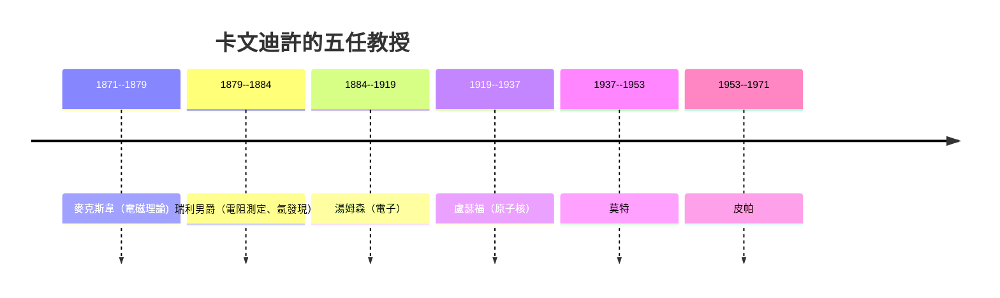

# 第 1 節 1874 年的創立：麥克斯韋、湯姆森與早期實驗物理的黃金奠基

## 一個不愛學問的富二代，蓋了一間「測量屋」

1871 年劍橋立下卡文迪許物理學講座，1874 年以亨利·卡文迪許的捐助建成
「卡文迪許實驗室」。這筆錢來自一個以孤僻聞名的貴族遺族亨利·卡文迪許
（六代傳承），由他退休的侄祖父促成交付——財富轉化的知識硬體，
是維多利亞時代英國「貴族贊助科學」的總收束。

## 麥克斯韋：以一個人的思想蓋出一棟樓的秩序

首任教授是**詹姆斯·克拉克·麥克斯韋**。他對這間小屋的貢獻不是發現，
而是**建立一種工作文化的憲法**。他自己動手做實驗、號召學生用自己
設計的「白搭式」儀器小組合作；他留下了著名的《電磁理論》講課稿——
把「實驗」從雇工工作升格為**可以被大學生開展的正規學業**。他只掌舵
8 年（1871–79 逝世），但卡文迪許的靈魂，是他寫進去的那套「
**由理論與測量組成的耐心、精確與誠實**」。

## 湯姆森的「同步聽診器」：把陰極射線測成電子

湯姆森以「從買家拃度儀器不算，先為測量重複性建標規則」的方式，
帶領學生配合陰極射線管與電磁偏轉，於 1897 得到 **e/m**（電荷質量比），
宣布「比氫原子還小千分之一的帶電粒子」存在——**電子**。這是
第一種「亞原子」粒子，並使卡文迪許一躍成為世界級「微世界 實驗室」。

當時的物理界的主流投資都聚集金融與電報業，實驗物理的「生態」
仍非常貧困。湯姆森能赢，是因為：
1. **儀器便宜**（陰極射線管約百鎊）；2. **問題剛好解開**（真空與高壓
電源）；3. **人才早年命名清晰**（學生時代就動手）。

這寫在後世你能看到的每一間「世界級實驗室誕生」故事裡：**問題＋工具＋
氛圍，其實比經費更大。**