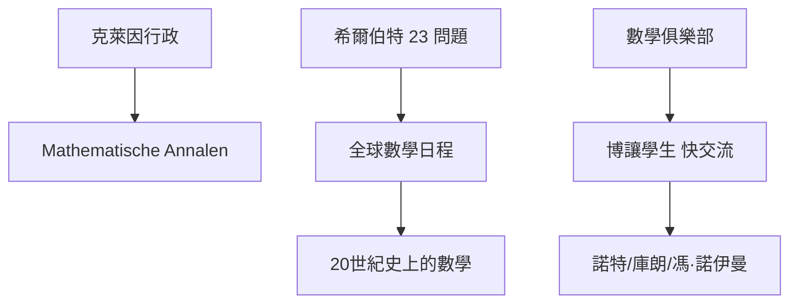

# 第 1 節 克萊因與希爾伯特：如何將一座德國小鎮打造成全球數學家的麥加？

## 一座小城，五種地理資源，數學首都誕生

哥廷根只是德國中部小城，但在 1895–1933 這約 40 年間，它被視為「世界的數
學首都」。這個奇迹非天成，而是一場雄心壯志的**學術烏托邦工程**：

- **克萊因從意大利、柏林引入了「數學研究=聯合制度」的藍圖**：
  他把數學與物理、工程捆綁在同一座樓（後來的數學研究所）、
  建立「**數學俱樂部**」（以茶會、演講、快問快答社交為主），
  以及讓算、天、機械、物理四科同時在座。
- **希爾伯特在 1895 年接任以免「本科生似乎一點也不緊張」的小城陷入孤獨」
**：他創造的 23 個問題（1900 巴黎演講）把整個 20 世紀的數學日程
握在同一張題目表中，使磁場天然成為「世界問題的中心」。

## 制度與「金雞蛋」感磁場的兩場對手表演

哥廷根與巴黎/柏林（過去曾經較最有名氣的數學學派）的最大差異：
- **純學術烏托邦**：一個教授（克萊因）自充當研究院的院長，
  大小行政與出版（Math. Annalen）在他眼中只是磁場的服務。
- **「年輕人需要快速的早期方向」**：希爾伯特的博士生（與講師）
  兩百多人，包括海森堡、諾特、庫朗、馮·諾伊曼是他的間接傳承。
- **:「簡單辦公室，不好老vention」**克萊因曾說「我要有人人更聰明天
  就比昨天世界更小，誰都可以 knock my door」。**自由＋關注**
  的磁場配方，被一表重eds到清強嫌。

## 磁學的「匯兌」：「漂亮理論」與「大工業」同時上桌

克萊因本位是**不等 science 在隔離上空飛**，他把數學拉到：
- 合適公務（航空力學、變換理論、功能分析）；
- **普魯士王國與德國鴉工商業的好派遣**——愛因斯坦的「廣義相對論」
  最終的數學工具（（倫奇幾何）主要由哥廷根的希爾伯特、勞（Grossmann 林德與德（廖）由北）
  **宇宙數學**「大隊」共同合成；
- 實驗科學的驗證（波恩、索末菲與「**數學描述一切**」的物理學 20 年。）